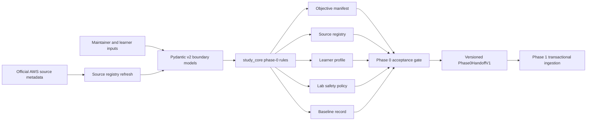
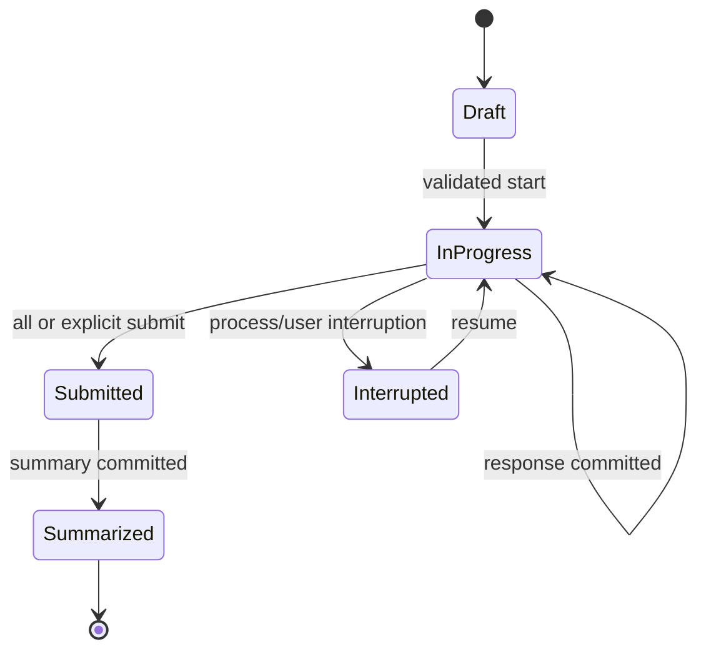

# Phase 00 Blueprint, Safety, and Baseline Design

## Overview

Phase 0 produces validated, versioned inputs for the study platform rather than a runtime application. Deterministic scripts validate human-authored Markdown/YAML and machine-readable manifests through Pydantic v2 boundary models, preserve provenance, and emit a handoff consumed transactionally by Phase 1. Baseline capture is local-first and never stores AWS credentials.

## Goals

- Lock all 20 AIP-C01 task IDs and official domain weights in a versioned manifest.
- Establish source attribution/freshness, learner-profile, safety-policy, diagnostic, and seed-admission contracts.
- Block unsafe labs and incomplete or misleading baselines.
- Make handoff artifacts deterministic, versioned, and independently validatable.

## Non-Goals

- Adaptive study, grading services, Streamlit pages, FastMCP tools, AWS calls, or lab execution.
- Reproduction of official/proprietary question content.
- Certification readiness prediction or AWS resource provisioning.

## Upstream and Downstream Contracts

### Upstream inputs

| Input | Owner | Required behavior |
|---|---|---|
| Roadmap objective/task scope | Project | Defines stable IDs, weights, and phase gates |
| Official AWS exam/domain pages | AWS | Canonical source metadata; copied text is not an input contract |
| Learner constraints | Learner | Validated profile values; unknown remains explicit |
| Authored diagnostic/questions/labs | Content maintainer | Original/licensed, attributed, safety-complete |

### Phase 1 handoff

A versioned handoff manifest references immutable artifact versions and hashes. Phase 1 validates every referenced artifact before a transaction. Logical exports are:

- `ObjectiveManifestV1`
- `SourceRegistryV1`
- `LearnerProfileV1`
- `LabSafetyPolicyV1`
- `BaselineRunV1` / `BaselineSummaryV1`
- `QuestionAdmissionV1`
- `Phase0HandoffV1`

All IDs are stable strings; all timestamps are UTC ISO 8601. Unknown profile values use `null` plus explicit optionality, not guessed defaults.

## Architecture



Implementation code belongs in `study_core` for rules/models and `scripts` for deterministic commands. Human-authored materials live under `content/` and `labs/`; local baseline/runtime state lives under gitignored `data/`. No `study_core` import may depend on Streamlit, FastMCP, or boto3.

## Components and Interfaces

### Blueprint manifest validator

- Enforces the explicit 20-ID allowlist and ID pattern `AIP-[1-5].[1-6]` with domain-specific ranges.
- Enforces unique IDs, domain ownership, version, status, and domain weights `31/26/20/12/11` totaling 100.
- Produces one complete result or validation errors; never publishes a partial manifest.

### Source registry manager

- Normalizes canonical HTTPS URLs, source IDs, titles, publisher, retrieval dates, types, objective references, and freshness.
- Requires the exam overview, five domain pages, and certification/preparation page.
- Records only source metadata and compliant summaries; it does not mirror restricted pages.
- On failed refresh, retains the last verified record and changes no retrieval timestamp.

### Learner profile validator

- Captures exam-date intent, positive weekly capacity, experience enum, Region, account type, and non-negative budget.
- Excludes credentials, payment instruments, and account secrets.
- Versions updates to make later recommendations reproducible.

### Lab policy gate

- Validates the complete lab-definition envelope and blocks missing prerequisites, cost class, Region assumptions, or cleanup.
- Defines read-only validator action policy and evidence levels.
- Treats resource mutation as learner-operated and out of validator scope.

### Diagnostic coordinator

- Records official-external versus local-original provenance.
- For a local baseline, validates coverage of all 20 tasks and keeps answer material separate until submission.
- Computes descriptive per-task/domain accuracy, confidence calibration, speed, and unanswered counts; it never maps these to AWS scoring.
- Preserves interrupted runs as incomplete.

### Seed admission validator

- Enforces at least two original scenarios per task and at least 40 total.
- Validates source linkage, review state, meaningful constraints, formats, and separate answer/rubric records.
- Emits content-health errors rather than silently admitting incomplete material.

### Handoff builder

- Canonically orders records, preserves schema versions/provenance, and computes content hashes for change detection.
- Writes atomically by creating a temporary artifact and replacing only after complete validation.
- Produces the acceptance report consumed by Phase 1.

## Interfaces

```python
from collections.abc import Sequence
from dataclasses import dataclass
from datetime import datetime
from decimal import Decimal
from typing import Protocol


@dataclass(frozen=True)
class ValidationIssue:
    code: str
    path: str
    message: str


@dataclass(frozen=True)
class AcceptanceReport:
    accepted: bool
    blockers: tuple[ValidationIssue, ...]
    handoff_version: str | None


class SourceMetadataGateway(Protocol):
    def refresh(self, canonical_url: str, timeout_seconds: float) -> "SourceMetadata": ...


class ArtifactStore(Protocol):
    def write_version(self, artifact_type: str, version: str, payload: bytes) -> str: ...
    def read_version(self, artifact_type: str, version: str) -> bytes: ...


def validate_objective_manifest(records: Sequence["ObjectiveRecord"]) -> tuple[ValidationIssue, ...]: ...
def evaluate_phase0_exit(handoff: "Phase0Handoff") -> AcceptanceReport: ...
```

Network refresh is behind `SourceMetadataGateway`; deterministic validators do not perform network I/O. The initial implementation may use the standard library for HTTP metadata only if needed, but source refresh can remain a manual validated operation. No boto3 is needed.

## Data Models

### Core records

| Model | Key fields | Invariants |
|---|---|---|
| `ObjectiveRecord` | `objective_id`, `domain_id`, `title`, `blueprint_version`, `status`, `source_ids` | ID allowlisted; sources exist |
| `DomainRecord` | `domain_id`, `weight_percent` | Exact official weights; sum 100 |
| `SourceRecord` | `source_id`, URL, title, publisher, retrieved date, freshness, objectives | HTTPS; known objectives |
| `LearnerProfile` | learner ID, exam date/unknown, capacity, experience, Region, account, budget | no credentials; valid ranges |
| `LabDefinitionHeader` | lab ID, objective IDs, prerequisites, cost, Regions, cleanup | all safety fields present |
| `ValidatorPolicy` | service, action, Region rules, timeout | explicit read-only allowlist |
| `BaselineRun` | run ID, kind, blueprint, started/completed, responses | incomplete is explicit |
| `BaselineResponse` | question ID, objectives, answer, confidence, elapsed | no answer material before submit |
| `QuestionAdmission` | prompt metadata, answer reference, review state | original/licensed and attributable |
| `ArtifactEnvelope` | schema name/version, artifact version, hash, provenance, created UTC | immutable version identity |

### Baseline state transition



Submitted and summarized records are append-only. Corrections create a new superseding version and retain provenance.

### Source freshness

Freshness is an enum such as `current`, `review_due`, `stale`, or `unverified`. A failed network attempt does not alter `retrieved_at`; it may record a separate non-authoritative refresh-attempt event under local runtime data.

### Cleanup evidence semantics

Phase 0 defines, but does not execute, evidence categories: `none`, `self_reported`, `validator_observed_present`, `validator_observed_absent`, `terminal_deletion_state`, and `validator_failed`. Only observed absence or a documented terminal deletion state can support `Cleaned up` downstream.

## Error Handling

Domain errors are typed and safe to render:

- `ContractValidationError`: malformed or incomplete input.
- `CompatibilityError`: unsupported schema version.
- `ConflictError`: immutable ID/version collision.
- `SourceUnavailableError`: source refresh failed; prior metadata remains.
- `PersistenceError`: atomic artifact write failed.
- `SecurityPolicyError`: secret-like data or prohibited validator action.

Commands return non-zero status and structured issue lists. They never continue to publish after blockers. Unexpected errors are logged with artifact IDs only, not diagnostic answers or private learner data.

## Security, Privacy, and Cost

- Authored files contain no credentials, `.env` values, payment data, or sensitive AWS content.
- Runtime learner/baseline data is under `data/` and gitignored.
- Pydantic models reject unknown fields on security-critical records.
- Validator policies permit only explicit read-only actions. Phase 0 performs no AWS calls.
- Cost is a learner-declared budget plus lab cost classification; no resource cost is incurred by this phase.
- Source summaries are paraphrased and attributed; no exam dumps or copied proprietary content are admitted.

## Testing Strategy

The validation strategy combines model, artifact, failure-injection, security, and release-gate checks.

1. Model tests: valid/invalid IDs, weights, URLs, dates, profile ranges, schema compatibility, and unknown fields.
2. Manifest tests: exact 20-task set, duplicates, missing/wrong-domain IDs, and version preservation.
3. Source tests: mandatory registry entries, unknown objective references, failed refresh truthfulness.
4. Safety tests: each missing gate blocks; mutating actions reject; cleanup evidence categories remain distinct.
5. Diagnostic tests: complete and interrupted runs, answer separation, calibration arithmetic, and no AWS-score claim.
6. Seed tests: 39 prompts fail, per-task count below two fails, unreviewed material cannot score.
7. Artifact tests: deterministic canonical output, hash stability, idempotent rebuild, atomic-write failure.
8. Exit-gate test: each blocker independently prevents acceptance; the complete fixture produces `Phase0HandoffV1`.
9. Quality checks: `uv run ruff check .`, `uv run ruff format --check .`, and targeted `uv run mypy study_core scripts` once implemented.

## Requirement Traceability

| Requirement | Design elements | Validation evidence |
|---|---|---|
| P0-R1 | Blueprint validator, objective/domain models | Exact-ID and weight tests |
| P0-R2 | Source registry manager, freshness enum | Required-source and refresh tests |
| P0-R3 | Profile validator/model | Range, unknown, secret-exclusion tests |
| P0-R4 | Lab policy gate, validator policy, evidence semantics | Safety and cleanup-state tests |
| P0-R5 | Diagnostic coordinator/state machine | Coverage, interruption, answer-separation tests |
| P0-R6 | Seed admission validator | ≥40 and ≥2-per-task tests |
| P0-R7 | Artifact envelope and handoff builder | Compatibility, determinism, history tests |
| P0-R8 | Atomic store, runtime boundary, UTC invariants | write-failure, offline, secret tests |
| P0-R9 | Acceptance evaluator | complete fixture and blocker matrix |

## Risks and Decisions

| Topic | Decision | Risk / mitigation |
|---|---|---|
| Blueprint drift | Version manifests; never rewrite historical bindings | Refresh before major releases and exam date |
| Source availability | Keep last verified metadata and mark freshness truthfully | Do not equate failed refresh with stale fact automatically |
| Diagnostic size | Require all-task coverage, not a readiness-quality claim | Clearly label baseline limits |
| Secrets in authored files | Reject security-critical unknowns and scan for credential-shaped values | Keep runtime data separate and gitignored |
| Artifact format | Versioned deterministic JSON/YAML envelopes derived from Pydantic models | Canonical serialization and compatibility errors |
| Question legality | Admit original/licensed content only | Review provenance and reject dumps/copies |
