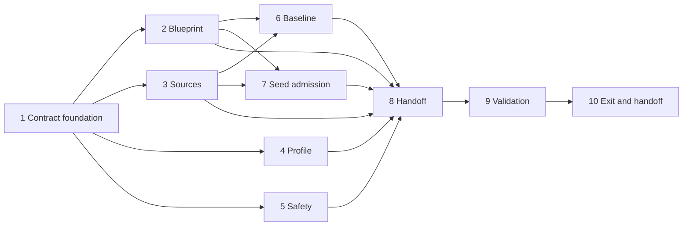

# Implementation Plan

## Overview

Build and validate the machine-readable blueprint, source, profile, safety, baseline, and seed-admission contracts, then publish one accepted Phase 0 handoff. Tasks are ordered around shared contract foundations while source, profile, safety, diagnostic, and content work can proceed independently after those foundations.

## Phase Prerequisites

- The roadmap and workspace steering documents are approved inputs and remain unchanged by this phase.
- The current official AIP-C01 overview, five domain pages, and certification/preparation page are available for metadata verification, or their last verified metadata is supplied and marked accurately.
- The learner can provide profile and baseline inputs. No AWS credentials are required.
- Implementation uses Python 3.12, `uv`, Pydantic v2 boundaries, stable IDs, UTC timestamps, and local gitignored runtime storage.

## Task Dependency Graph



```json
{
  "waves": [
    {"wave": 1, "tasks": ["1"]},
    {"wave": 2, "tasks": ["2", "3", "4", "5"]},
    {"wave": 3, "tasks": ["6", "7"]},
    {"wave": 4, "tasks": ["8"]},
    {"wave": 5, "tasks": ["9"]},
    {"wave": 6, "tasks": ["10"]}
  ]
}
```

## Notes

- Parent checkboxes group work; each numbered child is an executable leaf with explicit requirements and dependencies.
- Do not mark the phase accepted when any exit blocker remains.
- Source refresh failure must preserve last-verified truth rather than invent a new retrieval date.

## Tasks

- [ ] 1. Establish the Phase 0 contract foundation
  - [ ] 1.1 Create the minimal Python 3.12 project metadata and exact dependency declarations needed for Phase 0 validation
    - **Outcome:** `uv` can reproduce the environment from a committed lockfile; each non-development dependency has a documented purpose and exact version.
    - **Requirements:** P0-R7, P0-R8
    - **Depends on:** Phase prerequisites
  - [ ] 1.2 Define strict Pydantic v2 artifact envelopes, schema-version handling, stable ID types, UTC timestamp types, and typed validation issues
    - **Outcome:** Every Phase 0 artifact crosses one versioned, `extra="forbid"` boundary and yields structured compatibility/validation errors.
    - **Requirements:** P0-R1, P0-R2, P0-R3, P0-R4, P0-R5, P0-R6, P0-R7, P0-R8
    - **Depends on:** 1.1
  - [ ] 1.3 Implement atomic local artifact storage and canonical serialization under the authored/runtime data boundaries
    - **Outcome:** Valid artifact versions are deterministic and prior versions survive failed writes; learner runtime data is confined to gitignored `data/`.
    - **Requirements:** P0-R7, P0-R8
    - **Depends on:** 1.2

- [ ] 2. Lock the AIP-C01 blueprint manifest
  - [ ] 2.1 Author the versioned objective/domain manifest containing all 20 stable task IDs and exact domain weights
    - **Outcome:** The manifest contains `AIP-1.1`–`AIP-1.6`, `AIP-2.1`–`AIP-2.5`, `AIP-3.1`–`AIP-3.4`, `AIP-4.1`–`AIP-4.3`, and `AIP-5.1`–`AIP-5.2`, with weights 31/26/20/12/11.
    - **Requirements:** P0-R1
    - **Depends on:** 1.2
  - [ ] 2.2 Implement complete-manifest validation for IDs, uniqueness, domain ownership, source links, status, version, and weight total
    - **Outcome:** Missing, duplicate, malformed, misassigned, or partially valid manifests fail as a whole with actionable paths.
    - **Requirements:** P0-R1
    - **Depends on:** 2.1
  - [ ] 2.3 Add manifest versioning and historical-preservation behavior for future blueprint updates
    - **Outcome:** A new blueprint creates a new version without rewriting IDs/versions referenced by earlier records.
    - **Requirements:** P0-R1, P0-R7
    - **Depends on:** 1.3, 2.2

- [ ] 3. Build the official source registry
  - [ ] 3.1 Register the official overview, five domain pages, and certification/preparation page with canonical metadata and objective mappings
    - **Outcome:** Every mandatory primary source has a stable ID, HTTPS URL, title, publisher, retrieval date, type, freshness, and applicable objectives.
    - **Requirements:** P0-R2
    - **Depends on:** 1.2, 2.1
  - [ ] 3.2 Implement registry validation, compliant summary classification, and objective/source referential checks
    - **Outcome:** Invalid URLs/dates/references and unattributed or unclassified summaries are rejected without publishing partial registry state.
    - **Requirements:** P0-R2, P0-R8
    - **Depends on:** 3.1
  - [ ] 3.3 Implement bounded source-metadata refresh with truthful failure and last-verified preservation
    - **Outcome:** A failed or offline refresh retains prior metadata, does not advance retrieval time, and visibly preserves freshness status.
    - **Requirements:** P0-R2, P0-R8
    - **Depends on:** 1.3, 3.2

- [ ] 4. Capture learner constraints safely
  - [ ] 4.1 Implement the versioned learner profile model and field-level validation
    - **Outcome:** Exam-date intent, positive weekly capacity, experience, Region, account type, budget, and explicit unknowns are represented without credentials/payment data.
    - **Requirements:** P0-R3, P0-R8
    - **Depends on:** 1.2
  - [ ] 4.2 Implement profile create/update persistence with stable learner identity and UTC provenance
    - **Outcome:** Updates create reproducible versions and failed writes preserve the prior profile.
    - **Requirements:** P0-R3, P0-R7, P0-R8
    - **Depends on:** 1.3, 4.1

- [ ] 5. Define and enforce AWS lab safety gates
  - [ ] 5.1 Author the safety policy covering credential-chain/profile guidance, least privilege, budgets, Regions, tags, validator allowlists, cleanup, and evidence categories
    - **Outcome:** One versioned policy defines prerequisites and truthful downstream evidence semantics without granting mutation.
    - **Requirements:** P0-R4
    - **Depends on:** 1.2
  - [ ] 5.2 Implement lab-definition admission validation for every required instructional and safety field
    - **Outcome:** A lab missing prerequisites, objectives, architecture, cost, Region, steps, predictions, validation, failure injection, reflection, cleanup, or delayed recall is blocked with reasons.
    - **Requirements:** P0-R4
    - **Depends on:** 5.1
  - [ ] 5.3 Implement validator action-policy and cleanup-evidence validation
    - **Outcome:** Only explicit read-only actions are admitted; clicks/self-report cannot satisfy Verified or Cleaned up, and secret-bearing evidence is rejected/redacted.
    - **Requirements:** P0-R4, P0-R8
    - **Depends on:** 5.1

- [ ] 6. Implement baseline diagnostic capture
  - [ ] 6.1 Define separate baseline run, unanswered item, response, private answer material, and summary models
    - **Outcome:** Official-external and local-original baselines are distinguishable; unanswered payloads cannot expose answer keys.
    - **Requirements:** P0-R5, P0-R8
    - **Depends on:** 1.2, 2.1, 3.2
  - [ ] 6.2 Implement local diagnostic assembly and all-task coverage validation
    - **Outcome:** A local baseline samples all 20 tasks using only attributable original/licensed items and rejects incomplete coverage.
    - **Requirements:** P0-R5
    - **Depends on:** 6.1
  - [ ] 6.3 Implement durable response, interruption/resume, submission, and baseline summary behavior
    - **Outcome:** Confidence, elapsed time, unanswered state, strengths/weaknesses, and calibration persist truthfully; incomplete runs remain incomplete and no AWS-score claim is emitted.
    - **Requirements:** P0-R5, P0-R8
    - **Depends on:** 1.3, 6.2

- [ ] 7. Define Phase 1 seed-content admission
  - [ ] 7.1 Define question, option, private answer/rubric, distractor rationale, review, attribution, and Markdown/YAML front-matter contracts
    - **Outcome:** Public unanswered content is structurally separate from private grading material and every scored field is explicit.
    - **Requirements:** P0-R6
    - **Depends on:** 1.2, 2.1, 3.2
  - [ ] 7.2 Implement prompt admission validation and legality/quality blockers
    - **Outcome:** Unknown objectives, missing sources/constraints, unsupported absolutes, unreviewed scored content, and non-original/unlicensed material are rejected.
    - **Requirements:** P0-R6, P0-R8
    - **Depends on:** 7.1
  - [ ] 7.3 Implement complete seed-bank coverage validation
    - **Outcome:** Acceptance requires at least two original scenario prompts for each of all 20 tasks and at least 40 total.
    - **Requirements:** P0-R6, P0-R9
    - **Depends on:** 7.2

- [ ] 8. Build the deterministic Phase 0 handoff
  - [ ] 8.1 Implement `Phase0HandoffV1` references, hashes, canonical ordering, compatibility checks, and provenance
    - **Outcome:** Phase 1 can validate all artifact versions without interpreting prose; repeated builds are semantically identical.
    - **Requirements:** P0-R7
    - **Depends on:** 2.3, 3.3, 4.2, 5.3, 6.3, 7.3
  - [ ] 8.2 Implement the acceptance evaluator and blocker report
    - **Outcome:** The evaluator reports every manifest, lab-safety, baseline, source, and seed-admission blocker and emits no accepted handoff on failure.
    - **Requirements:** P0-R9
    - **Depends on:** 8.1

- [ ] 9. Validate Phase 0 behavior and quality
  - [ ] 9.1 Add targeted tests for models, manifest, registry, profile, safety, diagnostic, seed coverage, determinism, offline behavior, and atomic failures
    - **Outcome:** Tests demonstrate happy/unhappy paths, exact 20-task coverage, ≥40/≥2 seed rules, no answer leakage, evidence truthfulness, and preservation after failure.
    - **Requirements:** P0-R1, P0-R2, P0-R3, P0-R4, P0-R5, P0-R6, P0-R7, P0-R8
    - **Depends on:** 8.2
  - [ ] 9.2 Run Ruff, formatting, mypy, and targeted pytest checks and resolve every failure
    - **Outcome:** `uv run ruff check .`, `uv run ruff format --check .`, relevant mypy targets, and Phase 0 tests all pass with recorded output.
    - **Requirements:** P0-R7, P0-R8
    - **Depends on:** 9.1
  - [ ] 9.3 Perform security/content review for secrets, exam dumps, copied proprietary text, and mutating validator actions
    - **Outcome:** Review evidence confirms authored artifacts contain none of the prohibited material and logs/errors are sanitized.
    - **Requirements:** P0-R2, P0-R4, P0-R6, P0-R8
    - **Depends on:** 9.2

- [ ] 10. Complete Phase 0 handoff and exit gate
  - [ ] 10.1 Execute the Phase 0 gate against production-intended artifacts
    - **Outcome:** Evidence proves every current official task is represented, every admitted lab has prerequisites/cost/cleanup, and baseline strengths, weaknesses, and confidence calibration are recorded; any missing item blocks acceptance.
    - **Requirements:** P0-R9
    - **Depends on:** 9.3
  - [ ] 10.2 Publish the accepted versioned Phase 0 handoff for Phase 1 ingestion
    - **Outcome:** Phase 1 receives validated objective/source/profile/safety/baseline/seed-admission artifacts and an acceptance summary that makes no certification-readiness claim.
    - **Requirements:** P0-R7, P0-R9
    - **Depends on:** 10.1
