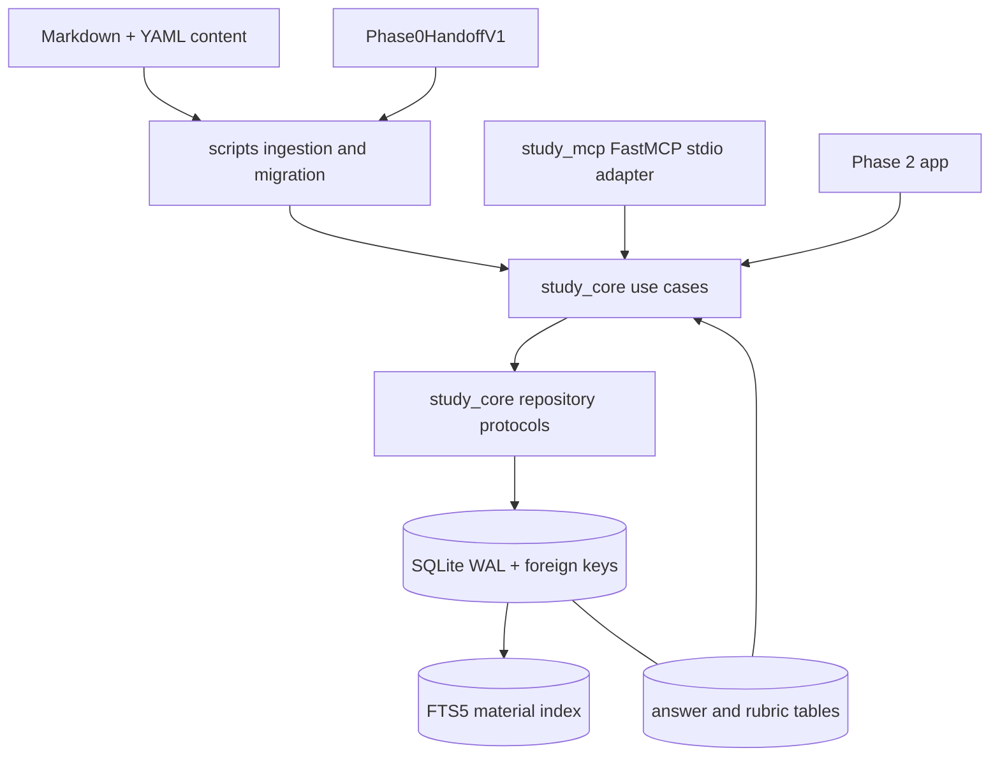
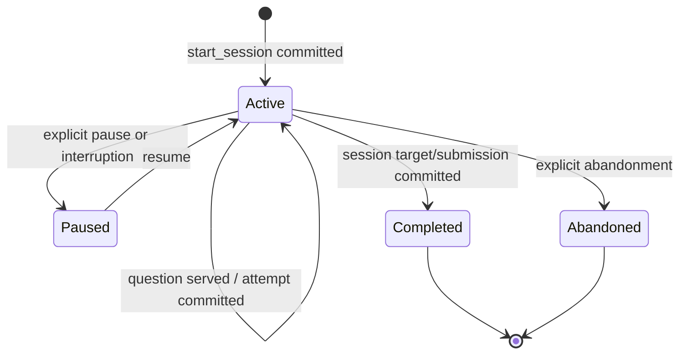
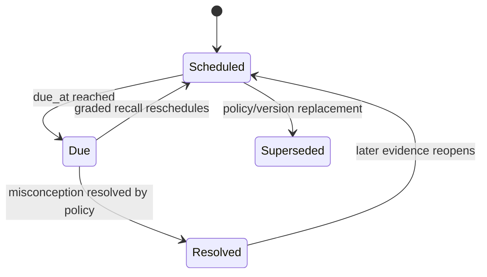
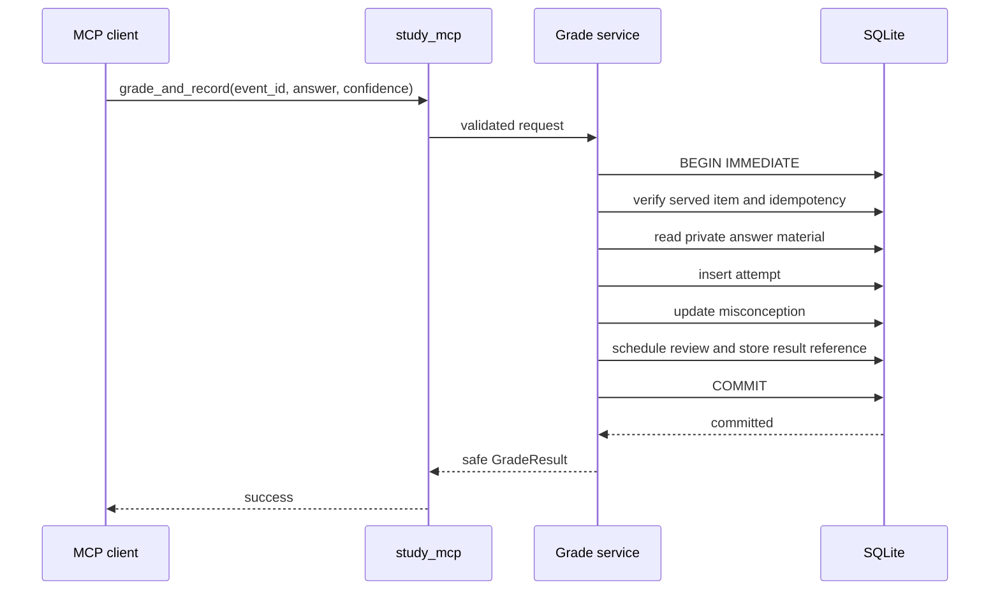

# Phase 01 Local Study Core Design

## Overview

Phase 1 creates the transport-independent study engine and authoritative SQLite persistence. `study_core` owns selection, grading, misconception, review, progress, and retrieval rules. `study_mcp` exposes six narrow FastMCP stdio tools through Pydantic v2 contracts. Deterministic scripts ingest Phase 0 artifacts and Markdown/YAML content. The system remains fully useful offline.

## Goals

- Consume Phase 0 artifacts transactionally without losing provenance or history.
- Provide durable, restart-safe sessions and atomic grading/review updates.
- Enforce complete original seed coverage and structural answer-key separation.
- Provide attributable SQLite FTS5 retrieval.
- Expose six stable, typed, narrow MCP tools with idempotent mutations.

## Non-Goals

- Streamlit UI, AWS calls, resource mutation, hosted services, vector retrieval, model generation, and full lab transport implementation.
- Readiness guarantees or replacement of official AWS practice resources.
- Business rules inside MCP handlers or SQL exposed as an API.

## Upstream and Downstream Contracts

### Phase 0 consumption

`Phase0HandoffV1` references objective, source, learner profile, safety, baseline, and admission artifacts. Ingestion verifies schema version/hash, validates foreign references, and writes one transaction per coherent artifact set. Historical objective/source/profile versions remain immutable once referenced.

### Phase 2 handoff

Phase 2 receives:

- `StudyService` methods corresponding to the six MCP tools.
- Stable unanswered-question, grading, review, progress, and search DTOs.
- Database/repository interfaces that Phase 2 extends with lab run/checkpoint records.
- Reserved `LabService` and `ReadOnlyValidator` protocols whose concrete tools are implemented in Phase 2.
- Truthfulness rules: success follows commit; verification follows evidence; answer material never enters unanswered DTOs.

## Architecture



Package direction is enforced: `app`, `study_mcp`, and `scripts` may call `study_core`; `study_core` never imports Streamlit, FastMCP, or boto3. `study_aws` is unused in Phase 1 except for future protocol compatibility.

## Components and Interfaces

### Configuration and connection factory

- Typed settings resolve database path under `data/`, busy timeout, search limits, and non-secret defaults.
- Every connection enables `PRAGMA foreign_keys = ON`, verifies it, requests WAL mode, and applies busy timeout.
- Connections are bounded to use cases; no mutable import-time global connection.

### Migration runner

- Discovers numbered immutable SQL files under `migrations/`.
- Applies pending migrations in lexical/numeric order within transactions and records checksums/versions.
- Refuses checksum drift for an applied migration.
- Creates ordinary relational tables first and FTS5 virtual/index maintenance structures explicitly.

### Phase 0/content ingestion

- Validates Pydantic boundary models before database work.
- Upserts by artifact identity/version without duplicating immutable records.
- Parses Markdown plus YAML front matter and normalizes metadata.
- Checks ≥2 original scenario prompts for every one of the 20 tasks before seed acceptance.
- Inserts public question data and private answer/rubric data into separate tables and repository types.

### Session service

- Starts/idempotently returns sessions bound to learner, mode, blueprint, and filters.
- Resumes active state from SQLite.
- Selects questions using due review, weak objective, and coverage priorities; tie breaking uses an injected random source.
- Records served items before returning them to prevent accidental untracked grading.

### Grading and review service

- Retrieves private answer material only inside the grading use case.
- Validates that the question was served in the session.
- In one `BEGIN IMMEDIATE` transaction writes attempt, updates misconception, reschedules review, and records idempotency result.
- Uses injected clock and deterministic scheduling policy.
- Supports explicit `grading_uncertain` rather than fabricated correctness.

### Progress service

- Aggregates committed evidence by task/domain.
- Computes measured accuracy, delayed recall, confidence calibration, misconception recurrence, coverage, and baseline comparison.
- Represents no evidence as `not_measured`, not zero mastery.
- Labels aggregates as internal estimates and includes component inputs.

### Search service

- Converts validated search terms to safe FTS5 expressions.
- Applies objective/source/service filters with parameterized SQL.
- Returns bounded snippets, attribution, freshness, and deterministic cursor/page ordering.
- Never falls back to network or silently drops filters.

### MCP adapter

- Registers only the six Phase 1 tools.
- Validates Pydantic v2 requests/responses and maps one use case per handler.
- Converts known domain errors to stable error envelopes.
- Contains no SQL, selection, grading, or scheduling logic.

## Interfaces

```python
from dataclasses import dataclass
from datetime import datetime
from typing import Protocol


@dataclass(frozen=True)
class UnansweredQuestion:
    question_id: str
    prompt: str
    options: tuple["QuestionOption", ...]
    format: str
    source_ids: tuple[str, ...]
    # No answer, rubric, or correctness fields exist.


class Clock(Protocol):
    def now_utc(self) -> datetime: ...


class RandomSource(Protocol):
    def choose_index(self, upper_bound: int) -> int: ...


class UnitOfWork(Protocol):
    sessions: "SessionRepository"
    questions: "QuestionRepository"
    attempts: "AttemptRepository"
    misconceptions: "MisconceptionRepository"
    reviews: "ReviewRepository"
    idempotency: "IdempotencyRepository"
    def commit(self) -> None: ...
    def rollback(self) -> None: ...


class StudyService(Protocol):
    def start_session(self, request: "StartSessionRequest") -> "SessionResult": ...
    def next_question(self, request: "NextQuestionRequest") -> UnansweredQuestion: ...
    def grade_and_record(self, request: "GradeRequest") -> "GradeResult": ...
    def get_due_reviews(self, request: "DueReviewRequest") -> "DueReviewPage": ...
    def get_progress(self, request: "ProgressRequest") -> "ProgressReport": ...
    def search_local_material(self, request: "SearchRequest") -> "SearchPage": ...


class ReadOnlyValidator(Protocol):
    def validate(self, request: "ValidationRequest") -> "ValidationEvidence": ...
```

`ReadOnlyValidator` is a downstream port only; Phase 1 neither instantiates it nor reports validation.

### MCP tool contracts

| Tool | Mutation | Idempotency | Result |
|---|---:|---|---|
| `start_session` | Yes | `request_id` + payload hash | durable session |
| `next_question` | Yes (served item) | `request_id` + payload hash | `UnansweredQuestion` |
| `grade_and_record` | Yes | `event_id` + payload hash | committed grade/review summary |
| `get_due_reviews` | No | N/A | deterministic page |
| `get_progress` | No | N/A | evidence-rich report |
| `search_local_material` | No | N/A | attributed FTS page |

`next_question` is treated as mutating because serving is persisted. Reusing an ID with another payload is a conflict.

## Data Models

### Key tables

| Table | Purpose / important constraints |
|---|---|
| `schema_migrations` | version, checksum, applied UTC |
| `blueprints`, `domains`, `objectives` | versioned blueprint; stable IDs; weight checks |
| `sources`, `source_objectives` | canonical metadata/freshness; foreign keys |
| `learner_profiles` | versioned non-secret constraints |
| `safety_policies` | accepted Phase 0 policy versions |
| `baseline_runs`, `baseline_responses` | complete/incomplete baseline evidence |
| `content_units`, `content_objectives` | normalized Markdown metadata |
| `questions`, `question_options`, `question_objectives` | public unanswered material |
| `answer_material`, `distractor_rationales` | private grading material, separate access path |
| `sessions`, `session_items` | durable mode/filter/state and served order |
| `attempts` | answer, correctness/uncertain, confidence, elapsed, committed UTC |
| `misconceptions` | stable misconception identity and lifecycle |
| `reviews` | due UTC, interval/state, attempt linkage |
| `idempotency_events` | operation, caller ID, payload hash, committed result reference |
| `material_fts` | FTS5 index over permitted content fields |

Foreign keys are explicit. Stable string IDs are application-generated; timestamps are UTC text. Answer material cannot be joined by repositories that return `UnansweredQuestion`.

### Session state



### Review state



State transitions are validated by closed enums and domain methods.

### Atomic grading sequence



Any failure before commit rolls back all effects. No model/AWS/network call occurs inside this transaction.

## Selection and Scheduling Rules

Selection creates eligible buckets in priority order: overdue/due reviews, active high-priority misconceptions, weak measured objectives, uncovered objectives, then reinforcement. Filters and reviewed-content eligibility apply before priority. Blueprint weights may influence long-run distribution but cannot eliminate a task. Deterministic sorting precedes injected tie breaking.

The initial review scheduler is deterministic and versioned. Inputs include prior state, correctness, confidence, hints if known, and `Clock.now_utc()`. The policy stores its version with each schedule event so future policy changes do not rewrite history.

## Error Handling

Stable domain classes map to MCP envelopes:

| Domain error | MCP category | Behavior |
|---|---|---|
| malformed input/state | `validation` | field/path guidance |
| reused ID/different payload | `conflict` | no mutation |
| unknown entity | `not_found` | safe stable ID only |
| no eligible content/dependency down | `unavailable_dependency` | retry/content-gap detail |
| prohibited learner/content access | `authorization` | no sensitive detail |
| SQLite/migration failure | `persistence` | rollback and retry guidance |
| unexpected defect | `internal` | correlation ID; sanitized log |

No bare exception swallowing. Busy handling is bounded. A dropped stdio connection does not undo a committed transaction; retries retrieve the stored result.

## Security, Privacy, and Cost

- Parameterized SQL only; no raw SQL MCP tool.
- Runtime database and logs reside under gitignored `data/`.
- Logs contain event names and stable IDs, not full prompts, learner answers, credentials, answer keys, PII, or sensitive snippets.
- Pydantic models reject unknown fields at untrusted boundaries where ambiguity is unsafe.
- The server is local stdio; no listening network service is added.
- Phase 1 performs no AWS calls and incurs no AWS cost.
- Search is local FTS5; source refresh is a separate controlled ingestion action.
- Exact dependencies and lockfile are committed; unusual dependency names are reviewed before installation.

## Testing Strategy

The validation strategy combines domain, persistence, transport, failure-injection, security, and release-gate checks.

1. Migration integration tests verify ordering, checksum drift, rollback, WAL request, and foreign-key enforcement on every connection.
2. Ingestion tests verify Phase 0 compatibility, referential rollback, idempotency, provenance, ≥40 prompts, and ≥2 per all 20 IDs.
3. DTO tests assert serialized unanswered questions have no answer/rubric/correctness fields.
4. Session tests cover idempotency, payload conflicts, deterministic selection, no-content errors, pause/resume, and process restart.
5. Transaction tests inject failure after attempt and misconception writes and verify total rollback.
6. Scheduling tests use fake clock/random source and validate legal transitions.
7. Search tests cover FTS ranking/order, filters, pagination, malformed input, SQL metacharacters, freshness, empty and offline behavior.
8. MCP contract tests cover six-tool allowlist, schemas, error mapping, disconnect/retry, and post-commit success.
9. Restart smoke test completes a grill, restarts process, and compares attempts/reviews/session state.
10. Quality gates: `uv run ruff check .`, `uv run ruff format --check .`, `uv run mypy study_core study_mcp study_aws app`, plus targeted pytest suites for changed behavior.

## Requirement Traceability

| Requirement | Components / models | Validation evidence |
|---|---|---|
| P1-R1 | package graph, lockfile, config | dependency/import architecture checks |
| P1-R2 | handoff/content ingestion | compatibility, rollback, idempotency tests |
| P1-R3 | connection factory, migrations, schema | pragma/migration/invariant tests |
| P1-R4 | admission service, split question/answer tables | all-task coverage and DTO tests |
| P1-R5 | session and selection services | restart, priority, idempotency tests |
| P1-R6 | grading UoW, scheduler, misconception service | fault-injected atomicity tests |
| P1-R7 | progress/review services | empty/evidence/calibration tests |
| P1-R8 | FTS5 ingestion/search | query/filter/offline tests |
| P1-R9 | FastMCP adapter and error envelopes | exact tool/schema/security tests |
| P1-R10 | logging, local config, bounded DB handling | redaction/offline/busy tests |
| P1-R11 | release-gate harness | end-to-end restart and coverage gate |

## Risks and Decisions

| Topic | Decision | Risk / mitigation |
|---|---|---|
| SQLite concurrency | Short synchronous transactions, WAL, busy timeout | Surface bounded busy failures; no transaction across external calls |
| Answer leakage | Separate persistence/repositories and structurally safe DTO | Serialization tests and adapter review |
| Idempotency | Caller ID + canonical payload hash + result reference | Conflict on mismatched reuse |
| Adaptive bias | Explicit deterministic priority buckets; weights do not skip tasks | Coverage health in progress report |
| FTS query safety | Validated parser and parameterized filters | Bound query length/tokens and test metacharacters |
| MCP scope creep | Exactly six tools in Phase 1 | Contract snapshot test; lab tools added only in Phase 2 |
| Policy evolution | Version selection/scheduling rules and artifact bindings | Preserve historical policy version |
