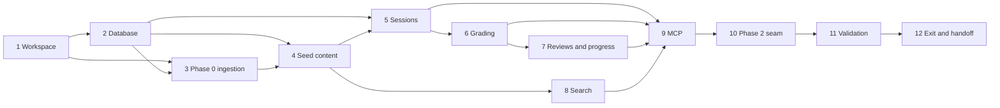

# Implementation Plan

## Overview

Implement the durable local study engine from persistence upward, expose the six Phase 1 tools, validate restart-safe behavior, and publish the reserved lab/validator seam for Phase 2. Database, content, and domain work are staged so independently testable capabilities converge before transport and release gates.

## Phase Prerequisites

- Phase 0 has emitted an accepted, versioned handoff containing objective, source, profile, safety, baseline, and seed-admission contracts.
- The handoff covers all 20 AIP task IDs and defines the ≥2-original-scenarios-per-task admission rule.
- Python 3.12 and `uv` are available. Runtime state will be stored only under gitignored `data/`.
- No Streamlit, boto3, hosted service, vector database, or AWS resource mutation is required in this phase.

## Task Dependency Graph



```json
{
  "waves": [
    {"wave": 1, "tasks": ["1"]},
    {"wave": 2, "tasks": ["2"]},
    {"wave": 3, "tasks": ["3"]},
    {"wave": 4, "tasks": ["4"]},
    {"wave": 5, "tasks": ["5", "8"]},
    {"wave": 6, "tasks": ["6"]},
    {"wave": 7, "tasks": ["7"]},
    {"wave": 8, "tasks": ["9"]},
    {"wave": 9, "tasks": ["10"]},
    {"wave": 10, "tasks": ["11"]},
    {"wave": 11, "tasks": ["12"]}
  ]
}
```

## Notes

- Parent checkboxes group work; each numbered child is an executable leaf with explicit requirements and dependencies.
- `next_question` is a write because served state is persisted and therefore uses a request ID.
- No AWS/network call belongs in a SQLite transaction or in this phase's runtime path.

## Tasks

- [ ] 1. Bootstrap the layered Python workspace
  - [ ] 1.1 Create `pyproject.toml`, exact runtime/development dependencies, Python 3.12 constraint, and committed `uv.lock`
    - **Outcome:** The project installs reproducibly; dependency purposes are documented and no unapproved platform dependency is present.
    - **Requirements:** P1-R1
    - **Depends on:** Phase 0 accepted handoff
  - [ ] 1.2 Create package boundaries for `study_core`, `study_mcp`, `study_aws`, `app`, `scripts`, `content`, `labs`, `migrations`, and gitignored `data`
    - **Outcome:** Logical package/directory boundaries match steering and contain no import-time I/O.
    - **Requirements:** P1-R1, P1-R10
    - **Depends on:** 1.1
  - [ ] 1.3 Add architecture/import checks and typed non-secret settings
    - **Outcome:** Validation rejects forbidden `study_core` imports and unsupported dependencies; database/search settings are typed and local-first.
    - **Requirements:** P1-R1, P1-R10
    - **Depends on:** 1.2

- [ ] 2. Implement database lifecycle and migrations
  - [ ] 2.1 Implement the SQLite connection factory with foreign-key verification, WAL request, busy timeout, row handling, and explicit transaction ownership
    - **Outcome:** Every connection proves foreign keys are enabled and has bounded concurrency behavior without a mutable global connection.
    - **Requirements:** P1-R3, P1-R10
    - **Depends on:** 1.3
  - [ ] 2.2 Implement the numbered forward migration runner with checksums and transactional rollback
    - **Outcome:** Migrations apply once in order, checksum drift is refused, and a failed migration preserves the prior usable schema.
    - **Requirements:** P1-R3
    - **Depends on:** 2.1
  - [ ] 2.3 Create migrations for blueprint/source/profile/safety/baseline/content/question/answer/session/attempt/misconception/review/idempotency tables
    - **Outcome:** Stable IDs, UTC timestamps, uniqueness, and foreign keys encode the Phase 1 relational invariants, including private answer separation.
    - **Requirements:** P1-R2, P1-R3, P1-R4, P1-R5, P1-R6, P1-R7
    - **Depends on:** 2.2
  - [ ] 2.4 Create and maintain the SQLite FTS5 material index and metadata-filter support
    - **Outcome:** Permitted local lesson/source text is searchable without indexing private answer/rubric fields.
    - **Requirements:** P1-R3, P1-R8
    - **Depends on:** 2.3

- [ ] 3. Ingest Phase 0 artifacts transactionally
  - [ ] 3.1 Implement strict Pydantic v2 models for the supported Phase 0 handoff/artifact schema versions
    - **Outcome:** Unsupported versions, malformed fields, unknown objectives, and hash mismatches fail before database writes.
    - **Requirements:** P1-R2
    - **Depends on:** 1.3
  - [ ] 3.2 Implement objective, source, learner profile, safety policy, and baseline repositories and ingestion unit of work
    - **Outcome:** A coherent handoff is normalized in one controlled transaction with provenance/history preserved.
    - **Requirements:** P1-R2, P1-R3
    - **Depends on:** 2.3, 3.1
  - [ ] 3.3 Implement ingestion idempotency and immutable-history conflict handling
    - **Outcome:** Identical artifact versions do not duplicate state; conflicting rewrites fail without altering historical attempt references.
    - **Requirements:** P1-R2, P1-R3
    - **Depends on:** 3.2

- [ ] 4. Ingest and validate the seed content bank
  - [ ] 4.1 Implement Markdown/YAML parsing and Pydantic metadata validation for content and questions
    - **Outcome:** Authored material is normalized only after source/objective/review/scenario constraints validate.
    - **Requirements:** P1-R2, P1-R4, P1-R8
    - **Depends on:** 2.4, 3.3
  - [ ] 4.2 Implement distinct public question and private answer/rubric repositories and DTOs
    - **Outcome:** The `UnansweredQuestion` type and its serialization cannot carry correct answers, rubric text, correct-option flags, or hidden mock data.
    - **Requirements:** P1-R4, P1-R9, P1-R10
    - **Depends on:** 2.3, 4.1
  - [ ] 4.3 Author or ingest at least two original attributable scenario prompts for each of all 20 task IDs
    - **Outcome:** The usable seed corpus contains at least 40 prompts with no task below two and every prompt has a material scenario constraint.
    - **Requirements:** P1-R4, P1-R11
    - **Depends on:** Phase 0 seed-admission contract, 4.2
  - [ ] 4.4 Implement content-health and scored-bank admission reporting
    - **Outcome:** Missing metadata, invalid references, insufficient coverage, and unreviewed scored items are excluded and reported explicitly.
    - **Requirements:** P1-R4, P1-R7
    - **Depends on:** 4.3

- [ ] 5. Build durable sessions and adaptive selection
  - [ ] 5.1 Define session, served-item, mode/filter, and idempotency domain models with legal states
    - **Outcome:** Active, paused, completed, and abandoned states and payload-hash retry semantics are explicit and validated.
    - **Requirements:** P1-R5
    - **Depends on:** 2.3
  - [ ] 5.2 Implement `start_session` and active-session resume with request-ID idempotency
    - **Outcome:** Same-ID/same-payload retries return one committed session; mismatched reuse returns conflict.
    - **Requirements:** P1-R5, P1-R10
    - **Depends on:** 3.3, 5.1
  - [ ] 5.3 Implement deterministic eligible-question selection with injected random source
    - **Outcome:** Due reviews, high-priority misconceptions, weak tasks, uncovered tasks, and reinforcement are ordered without ever selecting ineligible/unattributed content.
    - **Requirements:** P1-R4, P1-R5, P1-R7
    - **Depends on:** 4.4, 5.2
  - [ ] 5.4 Implement `next_question` as an idempotent served-item write returning only `UnansweredQuestion`
    - **Outcome:** Serving survives restart, duplicate retries are safe, no-content returns a typed gap, and no answer material is returned.
    - **Requirements:** P1-R4, P1-R5
    - **Depends on:** 5.3

- [ ] 6. Implement atomic grading and review scheduling
  - [ ] 6.1 Define attempt, confidence, grading outcome, misconception, review, and scheduling-policy domain models
    - **Outcome:** `grading_uncertain`, confidence, policy version, UTC clock, and closed state transitions are represented explicitly.
    - **Requirements:** P1-R6, P1-R7
    - **Depends on:** 2.3, 4.2
  - [ ] 6.2 Implement deterministic grading and scheduling with injected clock
    - **Outcome:** Repeatable inputs produce repeatable grade/schedule outcomes and impossible transitions are rejected.
    - **Requirements:** P1-R6
    - **Depends on:** 6.1
  - [ ] 6.3 Implement `grade_and_record` as one transaction across attempt, misconception, review, and idempotency result
    - **Outcome:** Success is returned only after commit; an injected failure at any write rolls back every effect.
    - **Requirements:** P1-R6, P1-R9, P1-R10
    - **Depends on:** 5.4, 6.2

- [ ] 7. Implement evidence-derived reviews and progress
  - [ ] 7.1 Implement `get_due_reviews` with UTC due semantics, deterministic ordering, filters, and explicit empty results
    - **Outcome:** Only committed due reviews are returned and no-data is distinguishable from zero due work caused by filters.
    - **Requirements:** P1-R7
    - **Depends on:** 6.3
  - [ ] 7.2 Implement per-task/domain progress, delayed recall, confidence calibration, misconception recurrence, and coverage calculations
    - **Outcome:** Reports derive only from committed evidence and represent unmeasured values explicitly.
    - **Requirements:** P1-R7
    - **Depends on:** 4.4, 6.3
  - [ ] 7.3 Implement internal aggregate labeling and readiness-gap reporting
    - **Outcome:** Any aggregate exposes inputs, never claims an AWS score, and surfaces source/question/review gaps.
    - **Requirements:** P1-R7, P1-R10
    - **Depends on:** 7.2

- [ ] 8. Implement local FTS5 search
  - [ ] 8.1 Implement safe validated query parsing, objective/source/service filters, and deterministic pagination
    - **Outcome:** Searches use parameterized SQL, bounded input/results, stable order, and never silently drop filters.
    - **Requirements:** P1-R8, P1-R10
    - **Depends on:** 2.4, 4.1
  - [ ] 8.2 Implement attributed result DTOs, snippets, freshness, empty states, and offline behavior
    - **Outcome:** Results provide local source context without network calls and malformed/no-match cases remain explicit.
    - **Requirements:** P1-R8
    - **Depends on:** 8.1

- [ ] 9. Expose the six-tool FastMCP server
  - [ ] 9.1 Define strict Pydantic v2 request/response and stable error envelope models for all six tools
    - **Outcome:** Boundary schemas cover validation, conflict, unavailable dependency, authorization, not-found, persistence, and internal failures.
    - **Requirements:** P1-R9
    - **Depends on:** 5.4, 6.3, 7.1, 7.3, 8.2
  - [ ] 9.2 Implement thin handlers for `start_session`, `next_question`, `grade_and_record`, `get_due_reviews`, `get_progress`, and `search_local_material`
    - **Outcome:** The stdio server exposes exactly six Phase 1 tools, each invoking one core use case with no embedded business rules.
    - **Requirements:** P1-R9
    - **Depends on:** 9.1
  - [ ] 9.3 Implement safe error mapping, structured redacted logging, and disconnect/retry semantics
    - **Outcome:** Known errors map stably, unexpected errors expose only correlation IDs, and committed results remain retryable after disconnect.
    - **Requirements:** P1-R9, P1-R10
    - **Depends on:** 9.2

- [ ] 10. Define the Phase 2 extension seam
  - [ ] 10.1 Define transport-independent `LabService` and `ReadOnlyValidator` protocols plus evidence/result placeholders
    - **Outcome:** Phase 2 has stable core ports for `start_lab`, `record_lab_checkpoint`, `complete_lab`, and read-only validation without any Phase 1 false verification claim.
    - **Requirements:** P1-R1, P1-R11
    - **Depends on:** 1.3, 9.1
  - [ ] 10.2 Document the Phase 2 API/database extension rules and truthfulness invariants
    - **Outcome:** The handoff specifies commit-before-success, evidence-before-verification, separate answer material, and migration-forward-only rules.
    - **Requirements:** P1-R3, P1-R4, P1-R9, P1-R11
    - **Depends on:** 10.1

- [ ] 11. Validate the local study core
  - [ ] 11.1 Add targeted repository/migration/ingestion tests including foreign keys on every connection and rollback fault injection
    - **Outcome:** Tests prove migration safety, referential integrity, immutable history, seed coverage, idempotency, and no partial writes.
    - **Requirements:** P1-R2, P1-R3, P1-R4, P1-R10
    - **Depends on:** 10.2
  - [ ] 11.2 Add targeted domain/search/MCP tests for selection, restart, atomic grading, review, progress, FTS5, schemas, and tool allowlist
    - **Outcome:** Happy/unhappy paths, answer secrecy, offline operation, six-tool scope, SQL safety, deterministic clocks/randomness, and retry conflicts are demonstrated.
    - **Requirements:** P1-R4, P1-R5, P1-R6, P1-R7, P1-R8, P1-R9, P1-R10
    - **Depends on:** 11.1
  - [ ] 11.3 Run Ruff, formatting, mypy, and targeted pytest checks and resolve every failure
    - **Outcome:** `uv run ruff check .`, `uv run ruff format --check .`, `uv run mypy study_core study_mcp study_aws app`, and relevant tests pass.
    - **Requirements:** P1-R1, P1-R10
    - **Depends on:** 11.2
  - [ ] 11.4 Run the process-restart grill smoke test
    - **Outcome:** A complete grill session survives shutdown/restart with identical committed attempts, misconceptions, reviews, served state, and no lost data.
    - **Requirements:** P1-R5, P1-R6, P1-R11
    - **Depends on:** 11.3

- [ ] 12. Complete Phase 1 handoff and exit gate
  - [ ] 12.1 Execute coverage, attribution, and answer-separation gates against production-intended seed data and schemas
    - **Outcome:** Evidence proves all 20 tasks have ≥2 original scenarios, no selectable question lacks objective/source metadata, and unanswered DTOs cannot contain answer keys/rubrics.
    - **Requirements:** P1-R4, P1-R11
    - **Depends on:** 11.4
  - [ ] 12.2 Publish the stable Phase 1 core/MCP/schema handoff for Phase 2
    - **Outcome:** Phase 2 receives accepted six-tool contracts, core services, forward migration state, reserved lab/validator ports, and all exit evidence; any failed gate blocks acceptance.
    - **Requirements:** P1-R11
    - **Depends on:** 12.1
