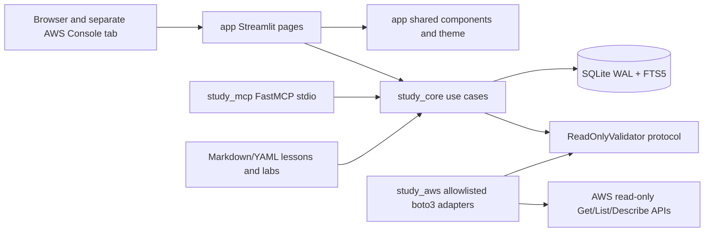
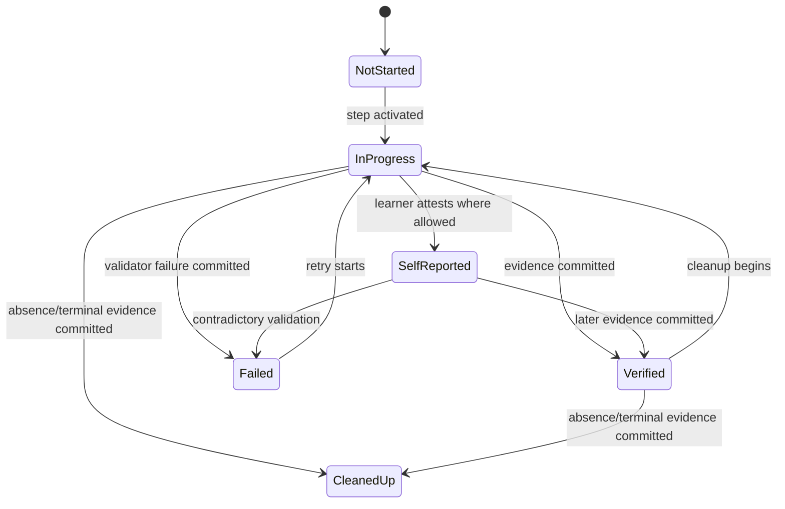
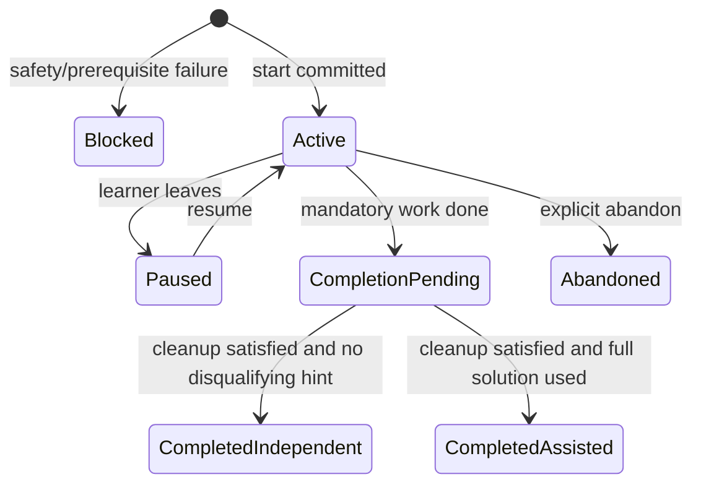
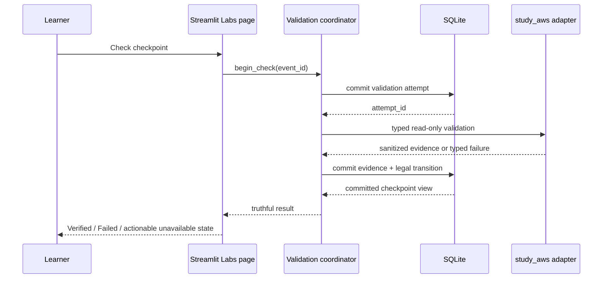

# Phase 02 Learning Workspace UI Design

## Overview

Phase 2 presents Phase 1 capabilities through an original Streamlit multipage workspace and adds the durable lab lifecycle. Streamlit pages remain declarative: validate UI inputs, call `study_core` use cases, and render committed results. `study_aws` implements explicit read-only validation adapters behind a core protocol. `study_mcp` adds the three lab tools without exposing AWS, SQL, filesystem, or shell primitives.

## Goals

- Deliver all eight connected views with durable resume context.
- Provide concise source-attributed lessons and immediate linked practice.
- Implement an evidence-based, resizable lab workflow with separate-tab AWS Console companion.
- Preserve strict distinctions among self-report, validation, failure, and verified cleanup.
- Meet practical WCAG 2.2 AA, keyboard, responsive, offline, and originality requirements.

## Non-Goals

- KodeKloud imitation, embedded AWS Console, mutating validators, hosted deployment, or an extra frontend/API layer.
- Full Phase 8 exam-readiness implementation or AWS-score prediction.
- Moving scheduling, grading, retrieval, persistence, or state transition rules into Streamlit.

## Upstream and Downstream Contracts

### Consumed contracts

- Phase 0: blueprint/version, source/freshness, learner profile, lab safety, and evidence definitions.
- Phase 1: `StudyService`, safe DTOs, SQLite unit-of-work/repository patterns, six MCP tools, and local search.
- Content: Markdown/YAML lessons and labs with objective/source metadata and complete lab safety envelope.

### Added contracts

- `LabService.start_lab`, `record_lab_checkpoint`, and `complete_lab`.
- Three corresponding typed FastMCP tools with request/event IDs.
- `ReadOnlyValidator` protocol in `study_core`; allowlisted boto3 implementation in `study_aws`.
- Durable UI resume models for active lesson/session/lab navigation.

Later domain phases add content and validator implementations without changing checkpoint truth semantics or tool names.

## Architecture



No credentials pass through browser state or MCP JSON. `study_core` receives a validator result model, not boto3 types. Pages do not issue SQL or AWS SDK calls.

## Components and Interfaces

| View | Primary responsibility | Core calls |
|---|---|---|
| Today | due work, recommended next action, blockers, resume | progress, due reviews, active context |
| Learn | curriculum rail and lesson player | content/curriculum queries, resume update |
| Grill | one-at-a-time adaptive practice and committed feedback | Phase 1 session/question/grade |
| Labs | lab catalog, lifecycle, split workspace, evidence | lab service and validator orchestration |
| Review | due recall flow | due reviews, question, grade |
| Mock | timed delayed-feedback shell | durable session/attempt APIs with mock policy |
| Knowledge | attributable local search | Phase 1 FTS search |
| Progress | multidimensional evidence/readiness risks | Phase 1 progress plus lab evidence |

`app` uses shared `navigation`, `curriculum_rail`, `lesson_player`, `question_canvas`, `lab_workspace`, `evidence_panel`, `status_badge`, `source_citation`, `error_state`, and `theme` components. Custom CSS is centralized and targets stable app-owned selectors only. A small custom component may be justified for pane resizing, but it must have a no-JavaScript/fixed-layout fallback and must not become a general frontend framework.

## Lab Components

### Lab service

- Validates lab availability, Phase 0 safety fields, learner prerequisites, Region allowlist, cost acknowledgement, and idempotency.
- Creates durable runs and checkpoints in SQLite.
- Owns all legal checkpoint and run state transitions.
- Tracks hints, independence, active step, timer basis, notes, evidence references, and cleanup obligations.
- Completes only after mandatory checkpoints and cleanup policy are satisfied.

### Validation coordinator

Validation is a two-stage operation to avoid holding a database transaction over AWS:

1. Commit a validation-attempt record and obtain a stable attempt ID.
2. Call the allowlisted validator outside any SQLite transaction with Region and bounded timeout/retries.
3. Sanitize the result.
4. In a new short transaction, atomically attach evidence and transition the checkpoint if the attempt is still current.

Late/stale results cannot overwrite a newer attempt. UI success is shown only after step 4 commits.

### `study_aws` adapters

- Build boto3 sessions with explicit Region and optional named profile, otherwise standard credential chain.
- Map each validator ID to a hard-coded service/action allowlist.
- Permit only specified read-only `Get`, `List`, and `Describe` operations.
- Use bounded botocore retries/timeouts and classify credentials, authorization, throttling, timeout, validation, and unavailable errors.
- Return minimal sanitized evidence fields; never log raw credentials, request signatures, full private responses, or sensitive content.

### Lab MCP adapter

Adds `start_lab`, `record_lab_checkpoint`, and `complete_lab`. Each handler validates one Pydantic request, calls one core use case, and maps known errors. It does not expose arbitrary AWS invocation; Check remains a use-case operation tied to a declared checkpoint validator.

## Interfaces

```python
from dataclasses import dataclass
from datetime import datetime
from enum import StrEnum
from typing import Protocol


class CheckpointState(StrEnum):
    NOT_STARTED = "not_started"
    IN_PROGRESS = "in_progress"
    SELF_REPORTED = "self_reported"
    VERIFIED = "verified"
    FAILED = "failed"
    CLEANED_UP = "cleaned_up"


class EvidenceKind(StrEnum):
    SELF_REPORT = "self_report"
    RESOURCE_PRESENT = "resource_present"
    RESOURCE_ABSENT = "resource_absent"
    TERMINAL_DELETION = "terminal_deletion"
    VALIDATION_FAILURE = "validation_failure"


@dataclass(frozen=True)
class ValidationRequest:
    validator_id: str
    region: str
    profile_name: str | None
    resource_locator: dict[str, str]
    timeout_seconds: float


@dataclass(frozen=True)
class ValidationEvidence:
    attempt_id: str
    kind: EvidenceKind
    observed_at: datetime
    summary: str
    sanitized_attributes: dict[str, str]


class ReadOnlyValidator(Protocol):
    def validate(self, request: ValidationRequest) -> ValidationEvidence: ...


class LabService(Protocol):
    def start_lab(self, request: "StartLabRequest") -> "LabRunView": ...
    def record_lab_checkpoint(self, request: "CheckpointEventRequest") -> "CheckpointView": ...
    def complete_lab(self, request: "CompleteLabRequest") -> "LabCompletionView": ...
```

Pydantic boundary counterparts set `extra="forbid"`, validate IDs/Region/timeouts, and constrain resource locator keys per validator. Profile names are configuration references; no credential values are accepted.

## Data Models

### New persisted entities

| Entity | Key fields / invariants |
|---|---|
| `curriculum_items` | stable item ID/type/order/objectives/prerequisites/content link |
| `learner_content_state` | learner/item/status/position/updated UTC |
| `learner_notes` | learner/context/text/updated UTC; local private data |
| `lab_definitions` | lab metadata, safety envelope, validator references, cleanup rules |
| `lab_steps` | ordered active tasks, prompts, reflection, mandatory flag |
| `lab_checkpoints` | stable checkpoint, allowed validator, cleanup flag |
| `lab_runs` | learner/lab/Region/state/active step/timer/hint-assistance |
| `checkpoint_events` | append-only requested transition, event ID, evidence ID |
| `validation_attempts` | validator, current token, started/completed, classified outcome |
| `validation_evidence` | sanitized kind, summary, observed UTC, attributes |
| `hint_events` | run/step/level/revealed UTC |
| `ui_resume_state` | learner/view/entity/position/updated UTC |

Notes and state are server-side SQLite records, not durable `st.session_state`.

### Checkpoint transitions



`CleanedUp` is allowed only for cleanup checkpoints with `RESOURCE_ABSENT` or `TERMINAL_DELETION`. Navigation/click events never cause `Verified` or `CleanedUp`. A regular verified checkpoint cannot be downgraded by a stale validator result.

### Lab run transitions



Blocked is represented as a start result, not a persisted active run. Completed-assisted remains truthful; later independent repetition is a separate run/evidence event.

### Hint progression

Levels 1–4 are monotonic per run/step. The event is committed before content is returned. Level 4 sets `full_solution_used = true`. Repeated reads do not create new events; the same request ID returns the recorded level.

## UI Interaction Sequences

### Check action



### Lesson-to-practice navigation

The lesson page first persists position/notes, then requests a filtered session or lab run, then updates resume state. If any durable action fails, the current lesson remains and the UI offers retry; it never navigates to a fabricated active entity.

## Responsive and Accessible Visual System

- Original product identity and semantic tokens: background, elevated surface, text, muted text, border, action, success, warning, danger, focus.
- Dense professional 4/8px spacing and restrained radii; no copied KodeKloud colors/layout/assets.
- Status badges always include icon/text; contrast targets WCAG 2.2 AA.
- Native Streamlit controls are preferred. Controls have visible labels/help and stable keys.
- Desktop: collapsible rail, central canvas, contextual utility area; lab has resizable instructions/evidence.
- Narrow screens: active content first, then evidence/context; curriculum becomes an expander/drawer-like section.
- Resizing has keyboard-accessible presets (`Instructions wide`, `Balanced`, `Workspace wide`) in addition to pointer control.
- Reduced motion requires no animation. Mermaid diagrams include a text summary.

## Error Handling

The UI maps typed errors to components:

- Validation: field-level correction.
- Conflict: reload durable state and explain competing/stale event.
- Unavailable dependency: distinguish offline, credentials, throttling, timeout, and source staleness.
- Authorization: show required read-only permission/service without exposing account details.
- Persistence: retain visible inputs, do not advance, offer safe retry with same ID.
- Internal: correlation ID and recovery action; sanitized server log.

Page-level exception boundaries preserve navigation and resume state. No raw traceback, AWS response, SQL, answer key, or credential detail is rendered.

## Security, Privacy, and Cost

- AWS access is read-only, allowlisted, Region-specific, timeout-bound, and uses named profile/standard chain.
- Resource creation/deletion remains learner-operated in AWS Console. Console URLs are HTTPS and opened with safe separate-tab semantics.
- Profile names may be stored as non-secret preference; credentials/tokens never enter SQLite, logs, browser state, or MCP payloads.
- Validation evidence is minimized and sanitized; private content is not copied into evidence.
- Cost class, Region, prerequisites, and cleanup acknowledgment are required before start. UI does not guarantee actual charges.
- Runtime notes/evidence/database remain under gitignored `data/`.
- Answer keys, rubrics, and hidden mock feedback are server-side only before allowed reveal.

## Performance and Offline Behavior

- Cache only safe immutable curriculum/content metadata; do not cache credentials or private boto3 results.
- Use bounded FTS result pages, lazy lesson/lab sections, and no import-time I/O.
- Target local navigation/active-view render from available local data without network dependency; validation alone may await AWS.
- Validator timeout and retry budgets are explicit and surfaced.
- Streamlit reruns query durable active context using indexed stable IDs; large logs/evidence are summarized and paginated.

## Testing Strategy

The validation strategy combines model, integration, failure-injection, security, and release-gate checks.

1. Navigation/component tests cover all eight views, invalid routes, empty/offline/stale states, and durable resume.
2. Lesson tests cover required blocks, attribution, Mermaid text alternatives, notes/position persistence, and linked practice.
3. Lab service tests cover safety blocks, idempotency conflicts, legal/illegal checkpoint and run transitions, completion, and full-solution assistance.
4. Validator contract tests use fakes for success, absent resource, terminal deletion, authorization, credentials, throttle, timeout, malformed response, stale result, and prohibited action.
5. Transaction tests verify no Verified/Cleaned up UI before evidence transition commit and no transaction remains open during AWS calls.
6. MCP tests verify nine total intended tools after extension, typed lab schemas, stable names, and absence of generic AWS/SQL/shell tools.
7. Streamlit smoke tests cover refresh/rerun restoration, lesson→grill→lab context, stable widget keys, answer secrecy, and persistence-failure UI.
8. Accessibility review covers keyboard flow, focus, labels, text+icon status, contrast, responsive stack, resizing presets, and reduced motion.
9. Originality review inventories names, copy, CSS tokens, icons, images, diagrams, and layouts against the prohibition list.
10. Performance smoke checks measure local view rendering with representative curriculum/search/evidence volumes and verify bounded operations.
11. Quality gates: `uv run ruff check .`, `uv run ruff format --check .`, `uv run mypy study_core study_mcp study_aws app`, and targeted pytest suites.

## Requirement Traceability

| Requirement | Components / models | Validation evidence |
|---|---|---|
| P2-R1 | multipage router, shared states | eight-view navigation smoke tests |
| P2-R2 | Today, curriculum rail, resume | prerequisite/responsive/context tests |
| P2-R3 | lesson player, citations, content state | block/attribution/linkage tests |
| P2-R4 | LabService, lab tables, MCP handlers | idempotency/lifecycle/contract tests |
| P2-R5 | lab workspace, pane presets, resume state | desktop/mobile/refresh tests |
| P2-R6 | validator coordinator, evidence model, state machine | allowlist/evidence/cleanup tests |
| P2-R7 | hint events and assistance rules | progression/persistence/repeat tests |
| P2-R8 | question canvas, review/mock policies | pregrade secrecy/delayed-feedback tests |
| P2-R9 | Knowledge and Progress components | attribution/evidence-limitation tests |
| P2-R10 | theme/components/responsive system | WCAG/originality/manual review |
| P2-R11 | view cache policy, typed errors, bounded I/O | failure/offline/security/performance tests |
| P2-R12 | release-gate journey | lesson→practice→lab, refresh, evidence, originality audit |

## Risks and Decisions

| Topic | Decision | Risk / mitigation |
|---|---|---|
| Streamlit reruns | Durable state in core; session state is cache only | Stable IDs and idempotent events |
| Resizable panes | Minimal isolated component plus accessible presets/fallback | Avoid a frontend framework and unstable DOM selectors |
| AWS latency | Two-transaction validation sequence with bounded call | Attempt tokens reject stale results |
| Verification truth | Evidence kind + legal transition, commit before render | Fault injection and stale-result tests |
| Cleanup | Only absence/terminal evidence supports Cleaned up | Self-report remains visibly separate |
| Mock leakage | Server-side answer material and delayed policy | Browser-state inspection tests |
| Originality | Original tokens/copy/layout expression and asset inventory | Formal release audit |
| Phase scope | Mock shell is truthful but not Phase 8 readiness | Explicit incomplete/practice label |
