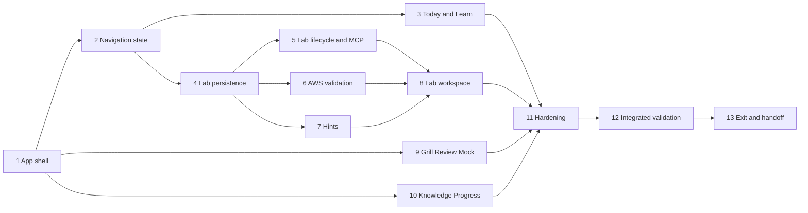

# Implementation Plan

## Overview

Build the original eight-view Streamlit workspace, extend the core with a durable lab lifecycle and read-only evidence validation, then prove accessibility, refresh durability, truthfulness, and originality. UI, lab persistence, validation adapters, and practice views expose parallel work after the shared shell and schemas exist.

## Phase Prerequisites

- Phase 0 safety, source, blueprint, profile, and evidence contracts are accepted.
- Phase 1 exit evidence proves restart durability, objective/source attribution, answer-key separation, and ≥2 original prompts for every one of the 20 task IDs.
- Phase 1 exposes the six typed study MCP tools and transport-independent core services; Phase 2 will add the three lab lifecycle tools.
- AWS validation, when configured, uses a named profile or standard credential chain and explicit read-only action/Region allowlists. Resource creation/deletion remains learner-operated.

## Task Dependency Graph



```json
{
  "waves": [
    {"wave": 1, "tasks": ["1"]},
    {"wave": 2, "tasks": ["2"]},
    {"wave": 3, "tasks": ["3", "4", "9", "10"]},
    {"wave": 4, "tasks": ["5", "6", "7"]},
    {"wave": 5, "tasks": ["8"]},
    {"wave": 6, "tasks": ["11"]},
    {"wave": 7, "tasks": ["12"]},
    {"wave": 8, "tasks": ["13"]}
  ]
}
```

## Notes

- Parent checkboxes group work; each numbered child is an executable leaf with explicit requirements and dependencies.
- Validator calls are read-only and occur outside SQLite transactions; evidence must commit before success renders.
- The mock workspace is explicitly not the Phase 8 full readiness implementation.

## Tasks

- [ ] 1. Establish the Streamlit application shell and original design system
  - [ ] 1.1 Add pinned Streamlit/UI dependencies through `uv` and document each runtime dependency
    - **Outcome:** The lockfile reproduces an approved minimal UI stack with no frontend framework or separate API server.
    - **Requirements:** P2-R10, P2-R11
    - **Depends on:** Phase 1 accepted handoff
  - [ ] 1.2 Create the multipage shell for Today, Learn, Grill, Labs, Review, Mock, Knowledge, and Progress
    - **Outcome:** All eight stable views route safely with current path, blueprint version, due-review context, and invalid-route recovery.
    - **Requirements:** P2-R1
    - **Depends on:** 1.1
  - [ ] 1.3 Define centralized original semantic tokens, typography, spacing, focus, status, and responsive CSS
    - **Outcome:** Shared styling targets stable app-owned selectors, supports text/icon statuses and visible focus, and contains no copied KodeKloud assets/trade dress.
    - **Requirements:** P2-R10
    - **Depends on:** 1.2
  - [ ] 1.4 Implement shared loading, empty, stale, offline, unavailable-AWS, validation, conflict, and internal-error components
    - **Outcome:** Every view can render actionable non-success states without raw traces or sensitive details.
    - **Requirements:** P2-R1, P2-R11
    - **Depends on:** 1.3

- [ ] 2. Add durable navigation and curriculum context
  - [ ] 2.1 Create forward migrations/repositories for curriculum items, content progress, notes, and UI resume state
    - **Outcome:** Stable entity IDs and UTC state survive reruns/restarts without treating `st.session_state` as durable storage.
    - **Requirements:** P2-R1, P2-R2, P2-R3, P2-R11
    - **Depends on:** 1.4
  - [ ] 2.2 Implement the collapsible curriculum rail with domains, modules, lessons, labs, prerequisites, completion, and due-review badges
    - **Outcome:** Desktop and narrow layouts preserve active-task priority and distinguish blocked/progress states with text/icon plus color.
    - **Requirements:** P2-R2, P2-R10
    - **Depends on:** 2.1
  - [ ] 2.3 Implement persist-before-navigation and resume-context orchestration
    - **Outcome:** View/entity/position/notes are committed before navigation success; failed writes retain the current context and safe retry ID.
    - **Requirements:** P2-R1, P2-R2, P2-R11
    - **Depends on:** 2.1

- [ ] 3. Build Today and Learn workflows
  - [ ] 3.1 Implement Today recommendations from due reviews, progress, active sessions/labs, and blockers
    - **Outcome:** Today shows due work, one recommended lesson/lab, session target, resume action, and evidence-derived blockers without fabricated work.
    - **Requirements:** P2-R2, P2-R9
    - **Depends on:** 2.2, 2.3
  - [ ] 3.2 Implement the short lesson player and contextual source/objective utility panel
    - **Outcome:** Lessons render concept, decision, example, failure mode, recall, and practice blocks with attribution/freshness/classification and readable line lengths.
    - **Requirements:** P2-R3, P2-R10
    - **Depends on:** 2.2
  - [ ] 3.3 Implement accessible Mermaid/original architecture visuals with text summaries
    - **Outcome:** Lessons display maintainable non-proprietary diagrams that remain understandable without color or animation.
    - **Requirements:** P2-R3, P2-R10
    - **Depends on:** 3.2
  - [ ] 3.4 Implement lesson-to-filtered-Grill and lesson-to-associated-Lab transitions
    - **Outcome:** The learner can start/resume relevant practice after lesson position/notes commit and can return without lost context.
    - **Requirements:** P2-R3, P2-R12
    - **Depends on:** 2.3, 3.2, 5.4, 8.2

- [ ] 4. Extend persistence for the lab domain
  - [ ] 4.1 Create forward migrations for lab definitions, steps, checkpoints, runs, checkpoint events, validation attempts/evidence, and hint events
    - **Outcome:** The schema stores append-only evidence, request/event IDs, active step, timer basis, notes, hints, cleanup obligations, and independent/assisted completion.
    - **Requirements:** P2-R4, P2-R5, P2-R6, P2-R7, P2-R11
    - **Depends on:** 2.1
  - [ ] 4.2 Implement strict Markdown/YAML lab ingestion using the Phase 0 safety envelope
    - **Outcome:** Labs lacking prerequisites, objectives, architecture, cost, Region, predictions, validation, failure injection, reflection, cleanup, or delayed recall are blocked.
    - **Requirements:** P2-R4, P2-R6
    - **Depends on:** 4.1
  - [ ] 4.3 Implement lab/checkpoint/run domain models and legal state transitions
    - **Outcome:** Only Not started, In progress, Self-reported, Verified, Failed, and Cleaned up checkpoint states and valid lab run transitions are accepted.
    - **Requirements:** P2-R4, P2-R6
    - **Depends on:** 4.1
  - [ ] 4.4 Implement lab repositories and idempotency/event payload-hash behavior
    - **Outcome:** Same-ID/same-payload retries return committed results; mismatched reuse conflicts without duplicate or overwritten evidence.
    - **Requirements:** P2-R4, P2-R11
    - **Depends on:** 4.3

- [ ] 5. Implement the lab lifecycle service and MCP tools
  - [ ] 5.1 Implement `start_lab` with prerequisite, cost, Region, safety, and cleanup-definition gates
    - **Outcome:** One durable run starts only after all required acknowledgements/gates; blocked starts explain every reason.
    - **Requirements:** P2-R4
    - **Depends on:** 4.2, 4.4
  - [ ] 5.2 Implement `record_lab_checkpoint` with explicit event/evidence validation and conflict handling
    - **Outcome:** Checkpoint transitions commit atomically and navigation/click/self-report cannot create Verified or Cleaned up.
    - **Requirements:** P2-R4, P2-R6
    - **Depends on:** 4.4, 5.1
  - [ ] 5.3 Implement `complete_lab` with mandatory checkpoint, cleanup, and independent-versus-assisted rules
    - **Outcome:** Completion occurs only after required evidence and labels hint assistance truthfully; later independent repetition remains a separate run.
    - **Requirements:** P2-R4, P2-R6, P2-R7
    - **Depends on:** 5.2, 7.2
  - [ ] 5.4 Add thin typed FastMCP handlers for `start_lab`, `record_lab_checkpoint`, and `complete_lab`
    - **Outcome:** The server extends to the intended nine narrow tools with Pydantic v2 contracts, stable names, post-commit success, and no generic AWS/SQL/shell capability.
    - **Requirements:** P2-R4, P2-R11
    - **Depends on:** 5.1, 5.2, 5.3

- [ ] 6. Implement read-only AWS validation and evidence handling
  - [ ] 6.1 Define validator-specific Pydantic requests, sanitized evidence models, action allowlists, Region policy, and error taxonomy
    - **Outcome:** Resource locator keys, timeout, Region, profile reference, evidence kind, and credential/authorization/throttle/timeout errors are explicit; mutation is unrepresentable.
    - **Requirements:** P2-R6, P2-R11
    - **Depends on:** Phase 0 safety policy, 4.3
  - [ ] 6.2 Implement `study_aws` boto3 session/client construction through named profiles or the standard credential chain
    - **Outcome:** Clients are bounded to an application session and explicit Region/retry/timeout settings with no credential storage or import-time side effects.
    - **Requirements:** P2-R6, P2-R11
    - **Depends on:** 6.1
  - [ ] 6.3 Implement the validator registry and explicit read-only adapters required by initial lab definitions
    - **Outcome:** Every validator ID resolves only to documented `Get`/`List`/`Describe`-style actions and returns minimal sanitized evidence.
    - **Requirements:** P2-R6
    - **Depends on:** 4.2, 6.2
  - [ ] 6.4 Implement the two-transaction validation coordinator with stale-attempt protection
    - **Outcome:** The database is never held open across AWS calls; evidence/transition commits before success UI; late results cannot overwrite newer attempts.
    - **Requirements:** P2-R6, P2-R11
    - **Depends on:** 4.4, 5.2, 6.3
  - [ ] 6.5 Implement cleanup verification restricted to observed absence or terminal deletion evidence
    - **Outcome:** Cleaned up is impossible from self-report, click, navigation, present-resource evidence, or an unavailable validator.
    - **Requirements:** P2-R6, P2-R12
    - **Depends on:** 6.4

- [ ] 7. Implement progressive hints
  - [ ] 7.1 Implement monotonic four-level hint retrieval with commit-before-reveal
    - **Outcome:** Concept, service/architecture, procedure, and full solution reveal in order with idempotent UTC hint events.
    - **Requirements:** P2-R7, P2-R11
    - **Depends on:** 4.1, 4.4
  - [ ] 7.2 Implement assisted-completion and later-independent-repeat evidence rules
    - **Outcome:** Level 4 permanently marks that run assisted and does not count as independent until a separate unassisted completion.
    - **Requirements:** P2-R7, P2-R9
    - **Depends on:** 7.1

- [ ] 8. Build the split lab workspace and Console companion
  - [ ] 8.1 Implement the instruction pane with one active task, objective, rationale, prediction, hints, Check, reflection, and cleanup context
    - **Outcome:** The learner has a focused step flow with stable widget keys and no premature verification state.
    - **Requirements:** P2-R5, P2-R6, P2-R7
    - **Depends on:** 5.4, 6.5, 7.2
  - [ ] 8.2 Implement the evidence/workspace pane, checkpoint statuses, validation output, notes, and architecture context
    - **Outcome:** Sanitized evidence and all six explicit states are visible using text/icon and color; self-report and verification remain distinct.
    - **Requirements:** P2-R5, P2-R6, P2-R10
    - **Depends on:** 8.1
  - [ ] 8.3 Implement resizable desktop panes with keyboard presets and a fixed/stacked fallback
    - **Outcome:** Pointer and keyboard users can choose pane balance; unsupported/narrow environments keep the active task first without content loss.
    - **Requirements:** P2-R5, P2-R10
    - **Depends on:** 1.3, 8.2
  - [ ] 8.4 Implement explicit safe separate-tab AWS Console links
    - **Outcome:** Approved HTTPS Console targets open outside the app without iframe embedding or credential transmission.
    - **Requirements:** P2-R5, P2-R11
    - **Depends on:** 8.1
  - [ ] 8.5 Implement refresh/rerun restoration of active step, notes, timer basis, hints, and evidence
    - **Outcome:** Browser refresh, Streamlit rerun, and focus changes restore committed lab context exactly.
    - **Requirements:** P2-R5, P2-R11, P2-R12
    - **Depends on:** 2.3, 8.2

- [ ] 9. Build Grill, Review, and Mock views
  - [ ] 9.1 Implement the one-question Grill canvas with pregrade confidence/timing and server-side answer secrecy
    - **Outcome:** Only unanswered DTO data is browser-visible before a committed grade.
    - **Requirements:** P2-R8, P2-R11
    - **Depends on:** 1.4, Phase 1 study service
  - [ ] 9.2 Implement ordered committed Grill feedback and targeted next action
    - **Outcome:** Status, decisive requirement, reasoning, distractors, source, and follow-up render only after persistence succeeds.
    - **Requirements:** P2-R8
    - **Depends on:** 9.1
  - [ ] 9.3 Implement Review from committed due-review evidence with clear empty/error states
    - **Outcome:** Review never fabricates due work and remains resumable.
    - **Requirements:** P2-R8
    - **Depends on:** 2.3, 9.1
  - [ ] 9.4 Implement the truthful Mock workspace with delayed feedback and Phase 8 scope labeling
    - **Outcome:** Active mocks hide objective cues where practical, answers, hints, and correctness until submission and do not claim full readiness capability.
    - **Requirements:** P2-R8, P2-R11
    - **Depends on:** 9.1

- [ ] 10. Build Knowledge and Progress views
  - [ ] 10.1 Implement Knowledge search with local FTS5 filters, pagination, attribution, freshness, and offline/empty/error states
    - **Outcome:** Search remains local and source-traceable without silently broadening filters.
    - **Requirements:** P2-R9, P2-R11
    - **Depends on:** 1.4, Phase 1 search service
  - [ ] 10.2 Implement multidimensional Progress components from committed study and lab evidence
    - **Outcome:** Task/domain accuracy, delayed recall, confidence, misconceptions, reviews, lab independence, cleanup, speed, unanswered rate, source freshness, and uncovered tasks are shown where measured.
    - **Requirements:** P2-R9
    - **Depends on:** 5.3, 7.2, Phase 1 progress service
  - [ ] 10.3 Implement internal-estimate disclosures and self-reported/stale/unreviewed evidence limitations
    - **Outcome:** Aggregates expose inputs and cannot visually or textually misrepresent limited evidence as AWS scoring or verified mastery.
    - **Requirements:** P2-R9
    - **Depends on:** 10.2

- [ ] 11. Harden accessibility, privacy, and performance
  - [ ] 11.1 Audit keyboard flow, visible focus, labels, validation association, status redundancy, contrast, reduced motion, and responsive ordering
    - **Outcome:** Practical WCAG 2.2 AA issues within Streamlit control are fixed and remaining platform limitations are documented.
    - **Requirements:** P2-R10
    - **Depends on:** 3.4, 8.5, 9.4, 10.3
  - [ ] 11.2 Audit browser/session/log state for credentials, answer keys, rubrics, hidden mock feedback, private AWS data, and sensitive prompts
    - **Outcome:** Prohibited data is absent or redacted; `st.session_state` remains only a view cache.
    - **Requirements:** P2-R6, P2-R8, P2-R11
    - **Depends on:** 11.1
  - [ ] 11.3 Bound and measure local navigation, content, search, evidence, and validator operations using representative data
    - **Outcome:** Primary local views require no network, avoid import/rerun I/O, paginate large data, and expose explicit validator timeout/retry budgets.
    - **Requirements:** P2-R11
    - **Depends on:** 11.2
  - [ ] 11.4 Perform the originality inventory and remove any copied branding, wording, assets, screenshots, palette, or trade dress
    - **Outcome:** Names, copy, tokens, icons, diagrams, images, and layouts are demonstrably original and no KodeKloud-prohibited material remains.
    - **Requirements:** P2-R10, P2-R12
    - **Depends on:** 11.3

- [ ] 12. Validate integrated UI and lab behavior
  - [ ] 12.1 Add targeted domain/repository/MCP tests for lab lifecycle, idempotency, hints, evidence transitions, completion, and nine-tool scope
    - **Outcome:** Legal/unhappy paths prove no false Verified/Cleaned up state, no generic AWS/SQL/shell tool, and success only after commit.
    - **Requirements:** P2-R4, P2-R6, P2-R7, P2-R11
    - **Depends on:** 11.4
  - [ ] 12.2 Add fake-AWS validator tests for presence, absence, terminal deletion, credentials, authorization, throttle, timeout, malformed output, prohibited action, and stale result
    - **Outcome:** Every validator outcome maps safely and no SQLite transaction spans the external call.
    - **Requirements:** P2-R6, P2-R11
    - **Depends on:** 12.1
  - [ ] 12.3 Add Streamlit smoke tests for all eight views, empty/error/offline states, responsive fallbacks, answer secrecy, and refresh restoration
    - **Outcome:** Navigation and durable context work without false success across representative desktop/narrow scenarios.
    - **Requirements:** P2-R1, P2-R2, P2-R3, P2-R5, P2-R8, P2-R9, P2-R10, P2-R11
    - **Depends on:** 12.2
  - [ ] 12.4 Run Ruff, formatting, mypy, and targeted pytest checks and resolve every failure
    - **Outcome:** `uv run ruff check .`, `uv run ruff format --check .`, `uv run mypy study_core study_mcp study_aws app`, and relevant tests pass.
    - **Requirements:** P2-R11
    - **Depends on:** 12.3

- [ ] 13. Complete Phase 2 handoff and exit gate
  - [ ] 13.1 Execute the lesson-to-Grill-to-Lab acceptance journey with a refresh during active study and active lab work
    - **Outcome:** Evidence proves no lesson/session/lab context or committed progress is lost across transitions and refresh.
    - **Requirements:** P2-R3, P2-R5, P2-R12
    - **Depends on:** 12.4
  - [ ] 13.2 Execute evidence-truthfulness and cleanup acceptance scenarios
    - **Outcome:** Verified, Self-reported, Failed, and not-yet-checked states are visibly/semantically distinct, and Cleaned up appears only from absence or terminal-deletion evidence.
    - **Requirements:** P2-R6, P2-R12
    - **Depends on:** 13.1
  - [ ] 13.3 Sign off accessibility/responsive and originality release audits
    - **Outcome:** Release evidence confirms operable responsive/keyboard behavior and no KodeKloud logos, copied screenshots, proprietary wording, cloned assets, or brand styling.
    - **Requirements:** P2-R10, P2-R12
    - **Depends on:** 13.2
  - [ ] 13.4 Publish the accepted Phase 2 handoff for domain-content phases
    - **Outcome:** The handoff includes all eight views, lab tool/validator contracts, schema versions, acceptance evidence, known limitations, and blockers; any failed exit gate prevents acceptance.
    - **Requirements:** P2-R12
    - **Depends on:** 13.3
