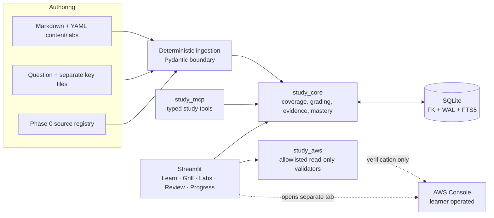
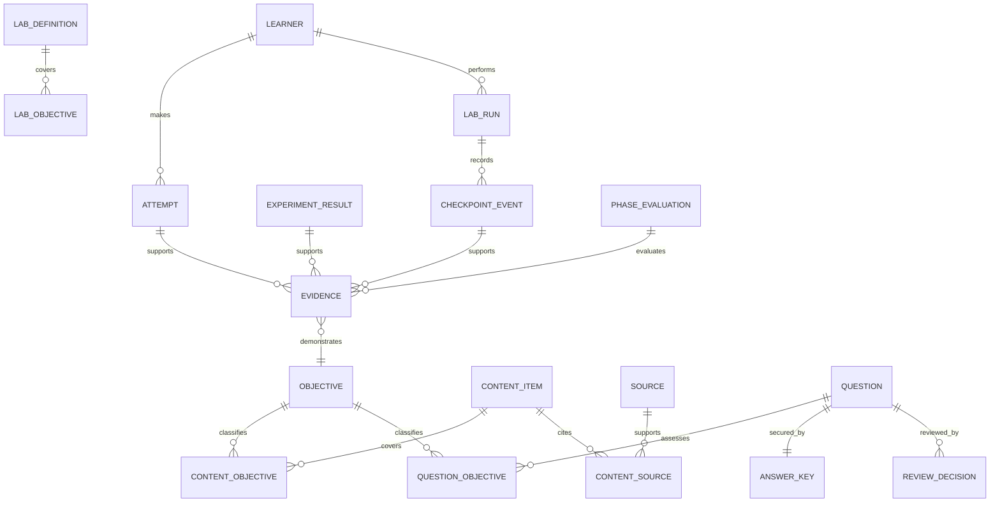
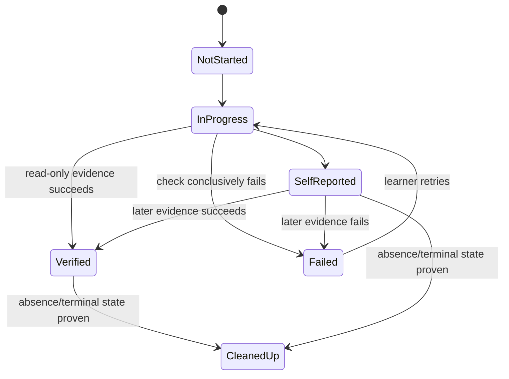
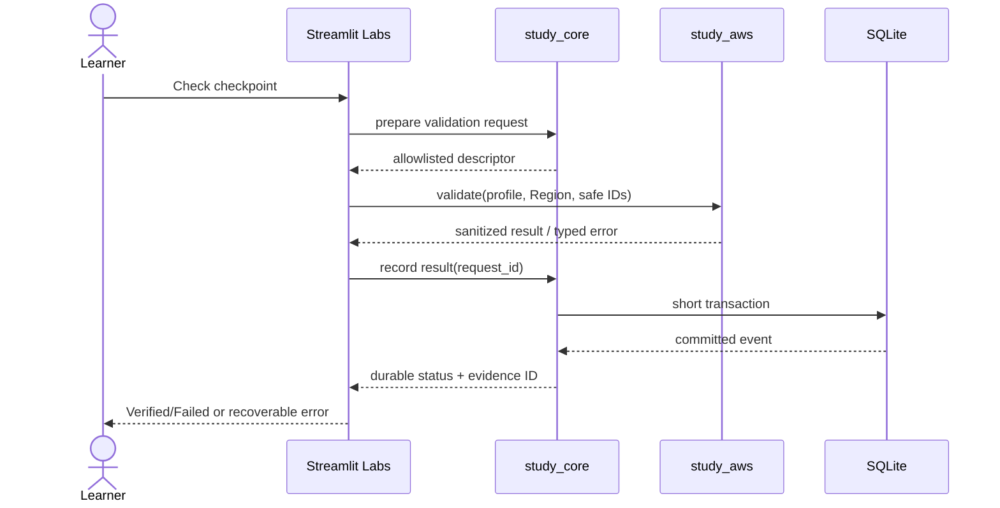

# Phase 3 Design — Domain 1 Foundations, RAG, and Prompts

**Status:** Proposed

## Overview

Phase 3 extends the local-first study platform with complete, source-reviewed Domain 1 curricula, original scored questions, Labs 1–4, experiment evidence, and deterministic exit-gate evaluation. It reuses Phase 0–2 ingestion, SQLite, scheduling, MCP, UI, lab, and AWS-validator contracts. Where those contracts do not yet exist, implementation is blocked by a prerequisite gate; this design names semantic interfaces, not assumed files or migration numbers.

## Goals

- Cover `AIP-1.1`–`AIP-1.6` in concept, scenario, troubleshooting, and hands-on forms.
- Teach architecture/model decisions, multimodal data preparation, vector/RAG design, retrieval diagnosis, and governed prompting.
- Produce the exact roadmap proof for Labs 1–4.
- Keep sources, independent review, learner evidence, safety, cost, and cleanup auditable.
- Gate completion on ≥80% fresh delayed scenario accuracy and unaided trade-off explanations.

## Non-goals

- Changing the platform’s FTS5 retrieval baseline or adding a local/hosted vector database.
- Adding a hosted API, queue, frontend framework, container platform, local model, or superficial async layer.
- Giving the platform broad AWS mutation authority. Lab resource actions remain explicit learner actions.
- Delivering later-domain labs merely because Labs 1–4 have cross-domain mappings.

## Upstream and downstream contracts

### Required upstream contracts

| Source phase | Contract consumed | Required behavior |
|---|---|---|
| Phase 0 | Objective manifest/source registry | Stable objective IDs, primary-source lineage, retrieval date, freshness state |
| Phase 0 | Learner profile/lab safety policy | Region, profile/credential-chain choice, budget, tags, allowed lab conditions |
| Phase 1 | Repositories and unit of work | FK/WAL SQLite, UTC timestamps, transactional attempts and idempotent events |
| Phase 1 | Content/question ingestion and FTS5 search | Boundary validation, answer separation, metadata filters, deterministic reports |
| Phase 1 | Session/review/grading services and MCP | Stable narrow study operations; no raw SQL/filesystem/shell/AWS access |
| Phase 2 | Learn/Grill/Labs/Review/Progress UI | Durable navigation, explicit checkpoint states, hint records, accessible statuses |
| Phase 2 | Lab run and AWS validator gateway | Evidence-based read-only checks and evidence-based cleanup confirmation |

A startup/ingestion readiness check reports missing contract names and prevents partial publication. Phase 3 extends upstream schemas through new numbered forward migrations only.

### Downstream handoff

The `PhaseHandoff` export supplies Phases 4, 6, 7, and 8 with versioned Domain 1 coverage, approved artifact IDs, source snapshots, experiment results, misconception/review state, lab proof, cleanup evidence, mastery calculations, unresolved risks, and schema versions. Cross-domain lab mappings create evidence links but do not automatically satisfy a later phase’s full coverage gate.

## Architecture



`study_core` owns publication rules, coverage calculation, evidence state, delayed/fresh eligibility, and exit evaluation. `app` renders these use cases. `study_aws` performs only explicit read-only validation. No SQLite transaction remains open during AWS calls: the validator returns a sanitized result, then a short transaction records it.

## Components and Interfaces

### Content and coverage

- **Domain1ContentIngestor:** validates stable IDs, exact objective IDs, source metadata, claim labels, trade-offs, failures, and verification methods.
- **CoverageService:** computes the four-form matrix (`concept`, `scenario`, `troubleshooting`, `hands_on`) for each objective from approved evidence only.
- **SourceFreshnessService:** consumes Phase 0 registry status; stale/conflicted items remain traceable but cannot newly enter scored publication.
- **LocalMaterialSearch:** continues SQLite FTS5 plus objective/service/freshness filters.

Suggested authored IDs use stable names such as `p3-aip-1-4-vector-store-design`; IDs are immutable after publication. Markdown/YAML remains human-reviewable and normalized into SQLite.

### Questions and grading

- **QuestionPublisher:** admits only original, sourced, independently reviewed questions. Draft/rejected/retired items cannot contribute to readiness.
- **QuestionDeliveryService:** projects an `UnansweredQuestion` without key/rubric fields.
- **GradeAndRecord:** uses the upstream transaction to persist attempt, confidence, elapsed time, misconceptions, and reschedule.
- **FreshnessEligibilityPolicy:** classifies questions as fresh per learner exposure history and review approval, not by a client flag.

### Labs and experiments

| Lab | Objective mapping | Required proof adapter |
|---|---|---|
| Lab 1 — Bedrock model comparison | `AIP-1.1`, `AIP-1.2`, `AIP-2.2`, `AIP-4.1` | Quality/latency/cost observations and selection rationale |
| Lab 2 — Prompt lifecycle and structured output | `AIP-1.6`, `AIP-5.1`, `AIP-5.2` | Immutable prompt version, schema checks, regression comparison |
| Lab 3 — Knowledge Base baseline RAG | `AIP-1.3`, `AIP-1.4`, `AIP-1.5` | Ingestion state, retrieval results, citations, freshness check |
| Lab 4 — Advanced retrieval | `AIP-1.4`, `AIP-1.5`, `AIP-4.2`, `AIP-5.1`, `AIP-5.2` | Dataset/config version and measured chunk/search/rerank relevance/latency |

Each lab definition contains prerequisites, objectives, Mermaid architecture, cost class, Region, steps, predictions, validation descriptors, failure injection, reflection, cleanup, and delayed recall. Validators identify exact service/action/Region allowlists. Resource-creating or deleting directions are learner-operated and document cost/reversibility; the platform does not invoke mutation APIs.

### Mastery and exit evaluation

- **EvidenceService:** records immutable evidence observations and assistance/verification state.
- **DelayedAssessmentPolicy:** receives an injected clock and upstream delayed-window configuration.
- **MasteryCalculator:** returns numerator, denominator, exclusions, per-objective results, and confidence calibration; it never reduces readiness to completion.
- **ExplanationAssessment:** applies independently reviewed rubrics for retrieval failure and model-selection trade-offs; answer reveals or procedural/full-solution hints make evidence assisted.
- **Phase3ExitEvaluator:** returns pass/fail plus unmet gate IDs and remediation actions.

## Data Models



Existing Phase 0–2 tables are extended rather than duplicated. Proposed additions are normalized experiment results, immutable prompt versions, review decisions, and phase evaluations. Sensitive prompt bodies, private retrieved content, AWS responses, credentials, and answer keys are not stored in general evidence payloads.

## Interfaces and schemas

The names below are semantic Python contracts. Final module locations and migration numbers are fixed during implementation after upstream contract discovery.

```python
from dataclasses import dataclass
from datetime import datetime
from enum import StrEnum
from typing import Mapping, Protocol, Sequence

class CoverageForm(StrEnum):
    CONCEPT = "concept"
    SCENARIO = "scenario"
    TROUBLESHOOTING = "troubleshooting"
    HANDS_ON = "hands_on"

class EvidenceVerification(StrEnum):
    SELF_REPORTED = "self_reported"
    VERIFIED = "verified"
    FAILED = "failed"
    CLEANED_UP = "cleaned_up"

@dataclass(frozen=True)
class SourceRef:
    source_id: str
    url: str
    title: str
    publisher: str
    retrieved_at: datetime
    freshness_status: str

@dataclass(frozen=True)
class ExperimentResult:
    result_id: str
    lab_run_id: str
    dataset_version: str
    configuration: Mapping[str, str]
    metrics: Mapping[str, float]
    conclusion: str

@dataclass(frozen=True)
class MasteryResult:
    phase_id: str
    numerator: int
    denominator: int
    accuracy: float | None
    exclusions: Mapping[str, int]
    objective_accuracy: Mapping[str, float | None]
    passed: bool
    unmet_gate_ids: tuple[str, ...]

class EvidenceRepository(Protocol):
    def add(self, evidence: "EvidenceRecord", request_id: str) -> None: ...
    def list_for_phase(self, learner_id: str, phase_id: str) -> Sequence["EvidenceRecord"]: ...

class LabValidator(Protocol):
    def validate(self, request: "ValidationRequest") -> "SanitizedValidationResult": ...
```

Boundary models are Pydantic v2 with `extra="forbid"`, objective-ID validation, timezone-aware timestamps, bounded strings/collections, explicit Region, and discriminated evidence payloads. `ValidationRequest` contains only profile name/reference, Region, lab/checkpoint IDs, and safe resource identifiers. It never accepts credentials or arbitrary service/action names.

### Lab state and evidence transitions



Unknown transitions are rejected. A click cannot create `Verified`; a cleanup instruction completion cannot create `Cleaned up`. Every event has an idempotency/request ID and UTC timestamp. Contradictory concurrent transitions return conflict.

### Verification sequence



## Error handling

| Error | Behavior |
|---|---|
| Validation | Reject malformed IDs/front matter/metrics; show exact safe field failures |
| Not found | Preserve context; identify missing objective/content/lab/run without fallback invention |
| Conflict/idempotency | Return prior result for same request payload; reject mismatched replay or invalid transition |
| Authorization | Do not retry blindly; explain profile/action requirement without credential detail |
| Unavailable dependency | Preserve local progress and mark AWS/source check unavailable, never verified |
| Throttling/transient AWS | Apply bounded SDK retry policy outside DB transactions and expose inconclusive state |
| Persistence/internal | Roll back, avoid success UI, log event and non-sensitive IDs only |
| Stale/conflicting source | Quarantine new scored use and create review work item |

## Security, privacy, and cost

- Normal AWS credential chain or dedicated named profile only; no credential storage.
- Validators use code-defined `Get`/`List`/`Describe` allowlists and explicit Region. No raw AWS CLI/shell or caller-selected actions.
- Evidence stores hashes, counts, sanitized identifiers, metrics, and conclusions—not full private prompts, model payloads, retrieved documents, signatures, PII, or secrets.
- Answer keys/rubrics remain separately authorized and never appear in unanswered/browser-visible state.
- Lab start requires cost class, budget acknowledgment, Region, tags where supported, and cleanup plan. Cost observations are labeled estimates unless backed by a specified measurement source.
- Logs use event names and stable non-sensitive IDs. Runtime state remains under gitignored `data/`.

## Testing Strategy

- **Schema:** ingestion tests for valid/invalid objective IDs, source metadata, question-key separation, complete lab front matter, and unknown fields.
- **Persistence:** migration tests, FK-on-every-connection, WAL, UTC round trips, idempotency, invalid transition rejection, and no transaction across AWS calls.
- **Content integrity:** deterministic coverage audit for all 24 objective/form cells; source freshness and independent-review publication checks.
- **Questions:** payload contract tests prove unanswered DTOs lack secret fields; grading transaction and fresh-per-learner eligibility tests.
- **Labs:** validator allowlist tests with stubbed AWS gateways; evidence/cleanup state tests; exact objective/proof mapping audits.
- **Metrics:** fixed datasets and injected clocks test delayed/fresh inclusion, exclusions, zero denominator, ≥0.80 boundary, and assisted evidence handling.
- **UI/MCP:** typed contract tests and smoke tests for offline, stale, unavailable-AWS, failed, empty, and success states; keyboard/status text checks.
- **Quality checks:** Ruff, Ruff format, mypy, targeted pytest, deterministic ingestion dry run, source/coverage audit, and manual content review.

## Requirement traceability

| Requirement | Components | Data/evidence | Validation |
|---|---|---|---|
| P3-R1 | ContentIngestor, Coverage, SourceFreshness | sources, content, form matrix | schema + freshness + 24-cell audit |
| P3-R2 | curriculum, scenarios, grading | ADR/model comparison evidence | content review + rubric tests |
| P3-R3 | curriculum, ExperimentResult, search | ingestion/retrieval metrics, citations | metric/schema + FTS5 boundary audit |
| P3-R4 | prompt lifecycle, publisher | prompt versions, regression results | schema/output/regression gate tests |
| P3-R5 | QuestionPublisher, delivery, grading | review decisions, attempts, keys | secret-field + transaction + review tests |
| P3-R6 | Labs 1–4, validators, checkpoints | proof, checkpoint events, cleanup | mapping + allowlist + transition tests |
| P3-R7 | Evidence, Mastery, ExplanationAssessment | delayed attempts, rubric/hint state | clock/freshness/threshold tests |
| P3-R8 | ExitEvaluator, PhaseHandoff | phase evaluation and artifact versions | fail/pass fixtures + handoff schema |

## Risks and decisions

| Topic | Decision | Risk and mitigation |
|---|---|---|
| Missing Phase 0–2 implementation | Block on named readiness checks; do not invent incompatible APIs | Schedule uncertainty; resolve contracts before migrations |
| RAG subject matter vs platform search | Keep local FTS5; AWS vector systems exist only in labs | Learners may conflate layers; label platform/lab boundaries |
| AWS change operations | Learner-operated documented actions only | Manual variance; use predictions, read-only checks, evidence, cleanup |
| Model/provider drift | Source versions and freshness gates | Retire stale scored artifacts and preserve lineage |
| Metric comparability | Version datasets/configurations and units | Reject incomparable/missing metric sets |
| Cross-domain lab credit | Link evidence, do not auto-complete later phases | Later phases independently evaluate coverage |
| Mastery inflation | Fresh, delayed, reviewed, unaided eligibility | Show exclusions/denominators and remediation |
| Sensitive evidence | Store sanitized structured proof only | Redaction tests and explicit payload schemas |
## Correctness Properties

### Property 1: Publication integrity

For any content or question record, readiness eligibility implies valid objective/source metadata, current approval, required rationales, and independent review; removing any prerequisite makes it ineligible without deleting lineage. **Validates: Requirements 1.1, 1.2, 1.4, 5.1, 5.3** (stable IDs `P3-R1.1`, `P3-R1.2`, `P3-R1.4`, `P3-R5.1`, `P3-R5.3`).

### Property 2: Secret-free delivery

For every unanswered-question serialization, the field set is disjoint from answer keys, rubrics, correctness markers, and hidden feedback. **Validates: Requirements 5.2** (stable ID `P3-R5.2`).

### Property 3: Coverage exactness

For any approved artifact set, reported Domain 1 coverage equals the set of objective/form pairs supported by eligible evidence; Phase 3 cannot pass unless all 24 pairs exist. **Validates: Requirements 1.3, 8.1** (stable IDs `P3-R1.3`, `P3-R8.1`).

### Property 4: Evidence-state safety

For every legal checkpoint history, `Verified` has prior committed successful validation and `Cleaned up` has committed absence/terminal evidence; failures, self-reports, and clicks cannot establish either state. **Validates: Requirements 6.7, 6.8, 7.1** (stable IDs `P3-R6.7`, `P3-R6.8`, `P3-R7.1`).

### Property 5: Experiment comparability

Any passing retrieval or prompt-regression result has versioned dataset/configuration, required valid metrics/checks, and conclusion; invalid, missing, or incomparable proof cannot pass. **Validates: Requirements 3.4, 3.5, 4.3, 4.4** (stable IDs `P3-R3.4`, `P3-R3.5`, `P3-R4.3`, `P3-R4.4`).

### Property 6: Atomic study update

For any grading persistence failure, attempt, confidence/time, misconception, and review schedule are either all committed once or all absent. **Validates: Requirements 5.4** (stable ID `P3-R5.4`).

### Property 7: Mastery eligibility

For any learner history, the delayed-accuracy numerator and denominator contain only current, reviewed, unseen, delayed scenarios, and assisted explanation evidence never satisfies unaided gates. **Validates: Requirements 7.2, 7.3, 7.4, 7.5** (stable IDs `P3-R7.2`–`P3-R7.5`).

### Property 8: Exit conjunction

Phase 3 passes if and only if all 24 coverage cells, accuracy ≥0.80, both unaided explanations, Labs 1–4 proof/required cleanup, and integrity gates pass; each failed conjunct yields remediation. **Validates: Requirements 8.1, 8.2, 8.3, 8.4, 8.5** (stable IDs `P3-R8.1`–`P3-R8.5`).
