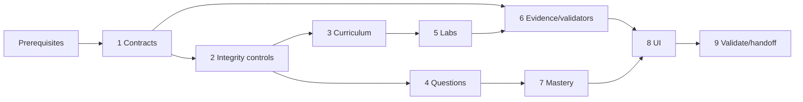

# Implementation Plan

## Overview

Implement Phase 3 as contract reconciliation, source/content/question work, Labs 1–4, evidence/mastery services, UI integration, validation, and a versioned downstream handoff.

## Task Dependency Graph



```json
{
  "waves": [
    {"wave": 1, "tasks": ["1"]},
    {"wave": 2, "tasks": ["2"]},
    {"wave": 3, "tasks": ["3", "4"]},
    {"wave": 4, "tasks": ["5", "6"]},
    {"wave": 5, "tasks": ["7"]},
    {"wave": 6, "tasks": ["8"]},
    {"wave": 7, "tasks": ["9"]}
  ]
}
```

## Prerequisites

- Phase 0 objective manifest, source registry, learner profile/diagnostic, and lab-safety policy exist and pass their exit gate.
- Phase 1 project, SQLite/migrations, repositories, ingestion, FTS5, grading/review/session services, and study MCP contracts exist and pass their exit gate.
- Phase 2 Streamlit workflows, durable lab/checkpoint/hint state, evidence-aware validator boundary, and accessibility baseline exist and pass their exit gate.
- Confirm actual upstream public symbols and latest migration number before implementation; update references in the implementation PR without rewriting applied migrations.
- Revalidate the active AIP-C01 Domain 1 blueprint and primary-source freshness before publishing scored material.

## Tasks

- [ ] 1. Establish Phase 3 contracts and persistence
  - [ ] 1.1 Reconcile upstream interfaces and record the Phase 3 contract map
    - **Outcome:** A checked-in contract note identifies actual repositories, boundary models, MCP/UI use cases, migration baseline, and every prerequisite gap; work blocks on missing critical contracts.
    - **Requirements:** P3-R1, P3-R5, P3-R6, P3-R8
    - **Depends on:** Prerequisites
  - [ ] 1.2 Define typed core evidence, coverage, experiment, prompt-version, and phase-evaluation models
    - **Outcome:** Domain models/enums enforce exact objective IDs, immutable stable IDs, UTC timestamps, assistance, verification, and explicit form/state sets without Streamlit/FastMCP/boto3 imports.
    - **Requirements:** P3-R1, P3-R3, P3-R4, P3-R6, P3-R7, P3-R8
    - **Depends on:** 1.1
  - [ ] 1.3 Add Pydantic v2 ingestion/UI/MCP/AWS boundary schemas
    - **Outcome:** Boundary schemas reject unknown fields, malformed IDs, naive timestamps, arbitrary AWS actions, credentials, unbounded evidence, and incomplete source/lab/question metadata.
    - **Requirements:** P3-R1, P3-R4, P3-R5, P3-R6
    - **Depends on:** 1.2
  - [ ] 1.4 Add the next numbered forward SQLite migration and repositories
    - **Outcome:** Normalized prompt versions, experiment results, review decisions, evidence links, and phase evaluations persist with foreign keys, idempotency constraints, UTC values, and no secret/general-evidence fields.
    - **Requirements:** P3-R3, P3-R4, P3-R5, P3-R6, P3-R7, P3-R8
    - **Depends on:** 1.2, 1.3

- [ ] 2. Build source, content, and coverage controls
  - [ ] 2.1 Extend deterministic ingestion for Phase 3 Markdown/YAML
    - **Outcome:** Content and lab ingestion requires stable IDs, `AIP-1.1`–`AIP-1.6`, complete primary-source metadata, claim labels, trade-offs, failures, verification, and common lab sections.
    - **Requirements:** P3-R1, P3-R6
    - **Depends on:** 1.3, 1.4
  - [ ] 2.2 Implement source freshness and publication policy
    - **Outcome:** Stale, superseded, unavailable, or conflicting sources retain lineage but block new scored publication and create review reasons; approved cached content remains usable offline with status.
    - **Requirements:** P3-R1, P3-R5
    - **Depends on:** 2.1
  - [ ] 2.3 Implement the Domain 1 four-form coverage audit
    - **Outcome:** A deterministic report shows approved concept, scenario, troubleshooting, and hands-on coverage for all six objectives and lists missing cells and fresh-question capacity.
    - **Requirements:** P3-R1, P3-R5, P3-R8
    - **Depends on:** 2.1, 2.2
  - [ ] 2.4 Preserve FTS5-only local source retrieval with metadata filters
    - **Outcome:** Domain 1 materials are searchable by objective/service/freshness using existing FTS5, with no embedding or vector-database dependency.
    - **Requirements:** P3-R1, P3-R3
    - **Depends on:** 2.1

- [ ] 3. Author and review Domain 1 curriculum
  - [ ] 3.1 Author `AIP-1.1` and `AIP-1.2` learning units and evidence activities
    - **Outcome:** Approved concept, architecture decision, constrained model-selection, PoC evaluation, troubleshooting, and hands-on-linked material covers every P3-R2 decision dimension with primary-source lineage.
    - **Requirements:** P3-R1, P3-R2
    - **Depends on:** 2.1, 2.2
  - [ ] 3.2 Author `AIP-1.3` multimodal data-pipeline units and malformed-input drill
    - **Outcome:** Approved materials cover quality, modality processing, request formatting, normalization/enrichment/classification/extraction, monitoring, and controlled diagnosis.
    - **Requirements:** P3-R1, P3-R3
    - **Depends on:** 2.1, 2.2
  - [ ] 3.3 Author `AIP-1.4` and `AIP-1.5` vector/retrieval units
    - **Outcome:** Approved materials cover store and metadata architecture, scale/freshness/tenant controls, chunking/embeddings/search/reranking/query transformation, stable exposure, and retrieval-failure diagnosis.
    - **Requirements:** P3-R1, P3-R3
    - **Depends on:** 2.1, 2.2
  - [ ] 3.4 Author `AIP-1.6` prompt engineering and governance units
    - **Outcome:** Approved materials cover prompt structure/state, schemas, versions, approval/audit/rollback, edge/regression testing, feedback, and bounded chains.
    - **Requirements:** P3-R1, P3-R4
    - **Depends on:** 2.1, 2.2
  - [ ] 3.5 Independently review curriculum and close all coverage gaps
    - **Outcome:** A reviewer other than the author approves source accuracy, originality, claim labeling, trade-offs, failure modes, and every one of the 24 objective/form coverage cells.
    - **Requirements:** P3-R1, P3-R2, P3-R3, P3-R4, P3-R8
    - **Depends on:** 2.3, 3.1, 3.2, 3.3, 3.4

- [ ] 4. Build and review the Domain 1 question bank
  - [ ] 4.1 Extend question ingestion, key separation, and publication states
    - **Outcome:** Questions require full metadata/rationales and independently stored keys; only current, independently approved items can be scored.
    - **Requirements:** P3-R5
    - **Depends on:** 1.3, 1.4, 2.2
  - [ ] 4.2 Author original concept and scenario questions for every Domain 1 objective
    - **Outcome:** Each objective has sufficient approved, materially constrained items to support learning and a fresh delayed assessment without item reuse.
    - **Requirements:** P3-R2, P3-R3, P3-R4, P3-R5, P3-R7
    - **Depends on:** 3.1, 3.2, 3.3, 3.4, 4.1
  - [ ] 4.3 Author original troubleshooting and hands-on evidence prompts for every Domain 1 objective
    - **Outcome:** Controlled failure cases and evidence prompts assess diagnosis/verification rather than service-name recall, including retrieval and model-selection explanations.
    - **Requirements:** P3-R2, P3-R3, P3-R4, P3-R5, P3-R7
    - **Depends on:** 3.1, 3.2, 3.3, 3.4, 4.1
  - [ ] 4.4 Complete independent question review and freshness-capacity audit
    - **Outcome:** Separate reviewers approve sources, answer/rubric, all distractor/criterion rationales, originality, and scenario constraints; the audit proves enough unseen items for exit evaluation.
    - **Requirements:** P3-R5, P3-R7, P3-R8
    - **Depends on:** 4.2, 4.3
  - [ ] 4.5 Integrate grading feedback and atomic misconception/review updates
    - **Outcome:** Permitted feedback follows the required order, and attempt/confidence/time/misconception/reschedule writes commit atomically before success is shown.
    - **Requirements:** P3-R2, P3-R5
    - **Depends on:** 1.4, 4.1

- [ ] 5. Implement Labs 1–4 definitions and proof
  - [ ] 5.1 Author Lab 1 Bedrock model comparison
    - **Outcome:** The complete lab maps exactly to `AIP-1.1`, `AIP-1.2`, `AIP-2.2`, `AIP-4.1` and captures comparable quality/latency/cost observations and selection rationale.
    - **Requirements:** P3-R2, P3-R6
    - **Depends on:** 2.1, 3.1
  - [ ] 5.2 Author Lab 2 prompt lifecycle and structured output
    - **Outcome:** The complete lab maps exactly to `AIP-1.6`, `AIP-5.1`, `AIP-5.2` and captures immutable prompt versions, schema checks, edge cases, baseline comparison, regression result, and rollback decision.
    - **Requirements:** P3-R4, P3-R6
    - **Depends on:** 2.1, 3.4
  - [ ] 5.3 Author Lab 3 Knowledge Base baseline RAG
    - **Outcome:** The complete lab maps exactly to `AIP-1.3`, `AIP-1.4`, `AIP-1.5` and captures ingestion, retrieval, citations, freshness, failure injection, and cleanup proof.
    - **Requirements:** P3-R3, P3-R6
    - **Depends on:** 2.1, 3.2, 3.3
  - [ ] 5.4 Author Lab 4 advanced retrieval experiment
    - **Outcome:** The complete lab maps exactly to `AIP-1.4`, `AIP-1.5`, `AIP-4.2`, `AIP-5.1`, `AIP-5.2` and records versioned chunk/search/rerank relevance/latency comparisons and tenant/freshness checks.
    - **Requirements:** P3-R3, P3-R6
    - **Depends on:** 2.1, 3.3
  - [ ] 5.5 Independently review lab safety, cost, proof, and cleanup instructions
    - **Outcome:** Every lab passes source/originality review, has explicit cost/Region/profile/tag gates, learner-only mutations, read-only validator descriptors, recoverable failure paths, cleanup verification, and delayed recall.
    - **Requirements:** P3-R1, P3-R6
    - **Depends on:** 5.1, 5.2, 5.3, 5.4

- [ ] 6. Implement lab validation and evidence services
  - [ ] 6.1 Add explicit read-only Phase 3 validator adapters
    - **Outcome:** Each check has code-defined service/action/Region boundaries, standard-chain/profile auth, bounded retries, sanitized results, and typed validation/authorization/unavailable errors.
    - **Requirements:** P3-R3, P3-R6
    - **Depends on:** 1.3, 5.5
  - [ ] 6.2 Implement idempotent checkpoint/evidence transition handling
    - **Outcome:** Only legal six-state transitions persist; duplicate requests are safe; verification follows successful evidence; cleanup follows proven absence/terminal state; no AWS call occurs in a DB transaction.
    - **Requirements:** P3-R6, P3-R7
    - **Depends on:** 1.4, 6.1
  - [ ] 6.3 Implement experiment and prompt-regression result recording
    - **Outcome:** Versioned datasets/configurations/metrics/results persist as sanitized evidence, and invalid or incomparable proof produces `Failed` rather than false success.
    - **Requirements:** P3-R3, P3-R4, P3-R6, P3-R7
    - **Depends on:** 1.4, 5.2, 5.4
  - [ ] 6.4 Integrate Labs UI and narrow MCP use cases
    - **Outcome:** Stable-key UI and existing allowlisted lab tools expose durable progress, predictions, hints, typed failures, proof, and cleanup without raw AWS/SQL/shell access or browser-visible secrets.
    - **Requirements:** P3-R6, P3-R7
    - **Depends on:** 6.2, 6.3

- [ ] 7. Implement mastery, explanation, and exit evaluation
  - [ ] 7.1 Implement fresh delayed scenario eligibility and mastery calculation
    - **Outcome:** Injected-clock logic includes only reviewed, unseen, delayed Domain 1 scenarios and reports numerator, denominator, exclusions, per-objective accuracy, confidence, and the exact 80% boundary.
    - **Requirements:** P3-R5, P3-R7, P3-R8
    - **Depends on:** 1.4, 4.4, 4.5
  - [ ] 7.2 Implement unaided explanation assessments
    - **Outcome:** Reviewed rubrics produce durable pass/fail evidence for retrieval-failure diagnosis and model-selection trade-offs; revealed/procedural/full-solution attempts remain assisted.
    - **Requirements:** P3-R2, P3-R3, P3-R7, P3-R8
    - **Depends on:** 4.3, 4.4, 6.2
  - [ ] 7.3 Implement Phase 3 exit evaluator and remediation
    - **Outcome:** The evaluator requires 24-form coverage, ≥80% fresh delayed accuracy, both unaided explanations, Labs 1–4 proof/cleanup, and no critical integrity failure; failed gates yield objective-specific actions.
    - **Requirements:** P3-R8
    - **Depends on:** 2.3, 6.4, 7.1, 7.2
  - [ ] 7.4 Implement the versioned downstream handoff export
    - **Outcome:** A validated handoff records artifacts, objective/form coverage, evidence IDs, metrics/exclusions, migrations/contracts, source versions, and open risks without granting later-phase completion.
    - **Requirements:** P3-R8
    - **Depends on:** 7.3

- [ ] 8. Complete UI, accessibility, and operational states
  - [ ] 8.1 Connect Domain 1 Learn/Grill/Review/Knowledge/Progress views
    - **Outcome:** Learners move among approved content, linked practice, reviews, source search, and multidimensional progress without losing durable context or exposing keys.
    - **Requirements:** P3-R1, P3-R2, P3-R3, P3-R4, P3-R5, P3-R7
    - **Depends on:** 2.4, 3.5, 4.5, 7.1
  - [ ] 8.2 Render explicit offline, stale, unavailable-AWS, failed, empty, and conflict states
    - **Outcome:** Every state gives safe recovery guidance, status text/icons, and no false persistence/verification/cleanup claim.
    - **Requirements:** P3-R1, P3-R5, P3-R6, P3-R7
    - **Depends on:** 6.4, 8.1
  - [ ] 8.3 Verify responsive, keyboard, focus, contrast, and non-color status behavior
    - **Outcome:** Phase 3 workflows meet the Phase 2 accessibility/originality contract where Streamlit permits and use no copied assets/trade dress.
    - **Requirements:** P3-R5, P3-R6, P3-R7
    - **Depends on:** 8.2

- [ ] 9. Validate and hand off Phase 3
  - [ ] 9.1 Run automated quality and targeted behavior checks
    - **Outcome:** Ruff check/format, mypy, targeted pytest, migration/FK/WAL/idempotency tests, ingestion dry run, secret-field checks, and validator-allowlist tests pass without watch mode.
    - **Requirements:** P3-R1, P3-R3, P3-R4, P3-R5, P3-R6, P3-R7
    - **Depends on:** 1.4, 6.4, 7.4, 8.3
  - [ ] 9.2 Run source, coverage, review, lab-proof, and privacy audits
    - **Outcome:** Audits show current lineage, independent scored review, all 24 form cells, exact Labs 1–4 mappings/proof, evidence-based cleanup, and no credentials/keys/private payloads in repository, logs, browser state, or general evidence.
    - **Requirements:** P3-R1, P3-R5, P3-R6, P3-R8
    - **Depends on:** 3.5, 4.4, 5.5, 9.1
  - [ ] 9.3 Execute the Phase 3 acceptance and exit-gate run
    - **Outcome:** A reproducible run demonstrates restart-safe progress, failure paths, ≥80% fresh delayed accuracy, passing unaided explanations, complete lab evidence/cleanup, and generated remediation for a failing fixture.
    - **Requirements:** P3-R7, P3-R8
    - **Depends on:** 7.4, 9.2
  - [ ] 9.4 Publish the Phase 3 handoff and implementation record
    - **Outcome:** Maintainers receive the passing gate record, versioned handoff, migration/schema versions, validation commands/results, artifact inventory, deferred risks, and explicit inputs for Phases 4, 6, 7, and 8.
    - **Requirements:** P3-R8
    - **Depends on:** 9.3

## Exit gate

Phase 3 is complete only when task 9.4 is done and the committed evaluation proves: every `AIP-1.1`–`AIP-1.6` objective has approved concept, scenario, troubleshooting, and hands-on evidence; fresh delayed Domain 1 scenario accuracy is at least 80%; the learner passes unaided retrieval-failure and model-selection trade-off explanations; Labs 1–4 have exact roadmap proof and verified cleanup where required; and no critical source, security, privacy, cost, or evidence-integrity issue remains.
## Notes

- Parent checkboxes summarize workstreams; numbered child checkboxes are the implementable leaf tasks.
- Tasks sharing the same predecessor may proceed in parallel when they do not mutate the same artifact.
- No task authorizes modification of roadmap/steering files or expansion beyond the design’s non-goals.
