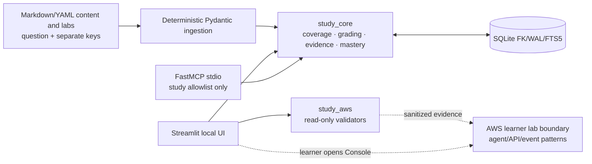
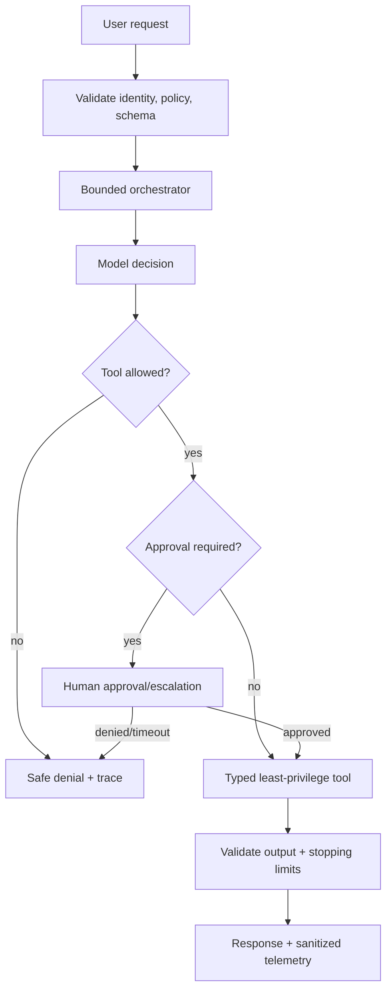
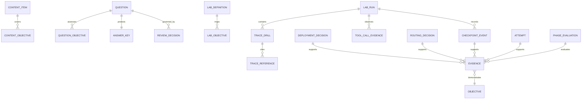
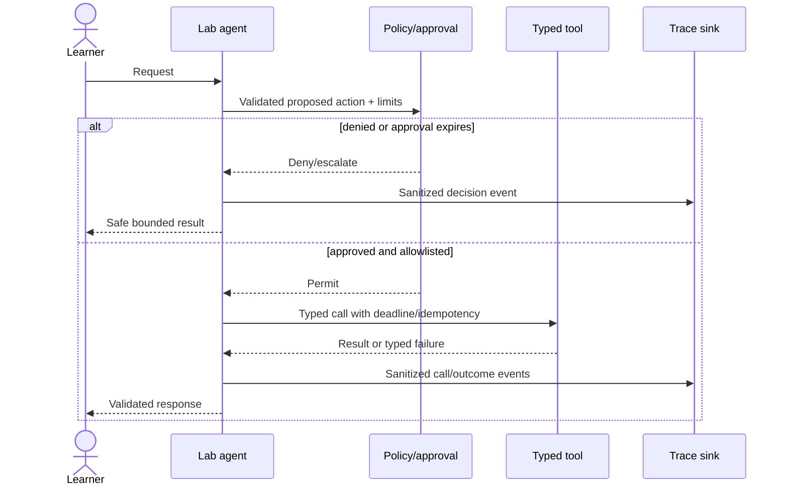
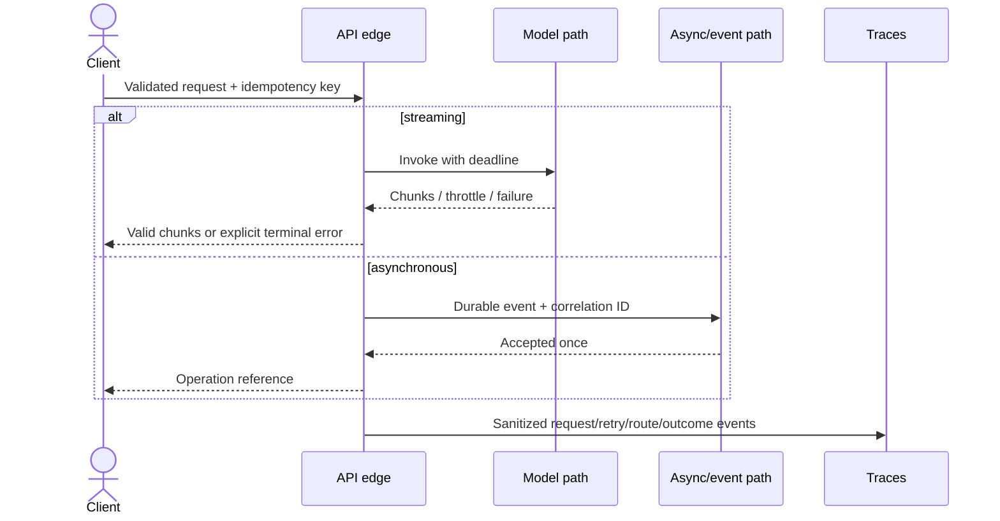

# Phase 4 Design — Domain 2 Agents, APIs, and Integration

**Status:** Proposed

## Overview

Phase 4 adds complete Domain 2 curriculum, independently reviewed questions, bounded-agent and deployment exercises, Labs 6–7, trace-led failure drills, and a deterministic completion gate. Agent/API/queue/container patterns are learning subjects in authored content and learner-operated AWS labs; they do not change the local platform architecture or its MCP allowlist.

## Goals

- Cover `AIP-2.1`–`AIP-2.5` in concept, scenario, troubleshooting, and hands-on forms.
- Teach bounded autonomy, typed tools/MCP, deployment/capacity choices, enterprise integration, streaming/asynchronous AWS patterns, resilient APIs/routing, CI/CD controls, and logs/traces.
- Produce exact roadmap proof for Labs 6 and 7.
- Measure fresh delayed accuracy and evidence-led failure diagnosis, with an 80% exit threshold.

## Non-goals

- A general-purpose platform agent, arbitrary MCP tool execution, or raw SQL/filesystem/shell/AWS access.
- A hosted platform API, queue, container runtime, model endpoint, or background async subsystem.
- Platform-performed AWS mutations or unattended production deployment.
- Treating hidden chain-of-thought as an application or evidence contract.

## Contracts

### Upstream

| Contract | Consumption |
|---|---|
| Phase 0 manifests/safety policy | Domain 2 IDs, source freshness, Region/profile/budget/tag/cleanup gates |
| Phase 1 core and SQLite | transactional attempts/evidence, deterministic scheduling, FTS5, typed errors, idempotency |
| Phase 1 study MCP | unchanged narrow allowlist; lab tools coordinate study use cases only |
| Phase 2 UI/lab state | durable six-state checkpoints, hints, explicit verification, accessible operational states |
| Phase 3 artifact/evidence handoff | source/review schemas, experiment evidence, prompt/model/retrieval concepts, mastery contract |

The implementation discovers and binds actual upstream symbols before migration work. Missing critical contracts produce a prerequisite failure, not duplicate services.

### Downstream

A versioned `PhaseHandoff` supplies Phase 5 security/threat-model work, Phase 6 operations, Phase 7 evaluation/troubleshooting, and Phase 8 mocks with approved artifact versions, trace-drill evidence, Lab 6–7 proof, source/review state, mastery calculations, contracts, and risks. Cross-domain Lab 6 links are evidence references only.

## Architecture



Inside Lab 6, authored architecture may use a model, orchestrator, typed tools, approval gate, and observability. Inside Lab 7, authored architecture may use API Gateway/Lambda/Bedrock/EventBridge/queues/workflows. These are external lab resources created and removed by the learner under explicit instructions; they are not platform dependencies.



## Components and Interfaces

### Content, questions, and coverage

- **Domain2ContentIngestor** extends established source/claim metadata checks for all five objective IDs.
- **CoverageService** emits a 20-cell objective/form matrix and only counts approved/current artifacts.
- **QuestionPublisher** enforces independent review and physically separate answers/rubrics.
- **QuestionDelivery/GradeAndRecord** reuse the secure unanswered DTO and atomic attempt/misconception/review transaction.

### Agent design exercises

- **AgentContractAssessment:** evaluates bounded state/memory, typed tools, allowlists, IAM, limits, timeouts, retries, idempotency, circuit breakers, safe failure, human decisions, and traceability.
- **ToolCallEvidence:** stores schemas, safe parameter/result summaries, policy decision, attempt count, duration, outcome, and correlation IDs—not private payloads or hidden reasoning.
- **UnsafeDesignDrill:** injects malformed, unauthorized, repeated, expensive, or ambiguous tool requests and requires evidence-based rejection/escalation.
- Platform study MCP remains exactly the approved narrow operations; no dynamic lab tool is registered into it.

### Deployment and enterprise exercises

- **DeploymentDecisionRecord:** versioned workload assumptions/units, options, capacity math, quality/latency/cost/availability analysis, and conclusion.
- **EnterpriseArchitectureReview:** evaluates boundaries, identity propagation, event semantics, data jurisdiction, failure isolation, and centralized policy.
- **DeliveryControlReview:** evaluates artifact versions, scans, evaluation gates, canary thresholds, telemetry, rollback triggers/procedure, and approvals.

### API and routing exercises

- **ApiResilienceAssessment:** checks schemas, timeout/deadline, retry classification/backoff/jitter, idempotency, fallback, stream cancellation/partial output, and trace IDs.
- **RoutingDecisionRecord:** captures policy inputs, selected route, reason code, fallback/no-route behavior, version, and quality/cost constraints.
- **AsyncPatternEvidence:** captures queued/event architecture semantics (delivery, deduplication, correlation, poison/dead-letter handling, expiry) as lab evidence. It does not introduce Python async into the platform.

### Labs

| Lab | Mapping | Proof |
|---|---|---|
| Lab 6 — Bounded tool-using agent | `AIP-2.1`, `AIP-3.1`, `AIP-4.3`, `AIP-5.1` | Tool schema, IAM boundary, timeout, trace, escalation, unsafe-call failure drill |
| Lab 7 — Production API integration | `AIP-2.3`, `AIP-2.4`, `AIP-2.5` | Streaming, asynchronous path, retries, routing, enterprise event integration, traces, throttling/fallback |

Both lab documents carry all common lab sections, explicit cost/Region/profile/tag conditions, learner-only resource changes, read-only validator descriptors, cleanup checks, and delayed recall.

### Observability and mastery

- **TraceDrillService:** stores fault definition, sanitized log/trace references, diagnosis, rejected hypotheses, remediation, and recovery check.
- **FreshDelayedPolicy/MasteryCalculator:** reuse Phase 3 rules with Domain 2 objective filtering and injected clock.
- **Phase4ExitEvaluator:** requires 20 form cells, ≥80% fresh delayed scenario accuracy, unsafe-design evidence, trace-led agent/API drills, Labs 6–7 proof/cleanup, and integrity gates.

## Data Models



New records use the next forward migration and reference, rather than duplicate, upstream objective/source/content/question/lab/evidence tables. Telemetry references are bounded structured summaries; raw private logs belong neither in authored content nor SQLite evidence.

## Interfaces and schemas

```python
from dataclasses import dataclass
from datetime import datetime
from enum import StrEnum
from typing import Mapping, Protocol, Sequence

class AgentOutcome(StrEnum):
    SUCCEEDED = "succeeded"
    DENIED = "denied"
    ESCALATED = "escalated"
    TIMED_OUT = "timed_out"
    FAILED = "failed"

@dataclass(frozen=True)
class AgentLimits:
    max_steps: int
    timeout_seconds: float
    max_tool_calls: int
    cost_limit_label: str

@dataclass(frozen=True)
class TraceDrillRecord:
    drill_id: str
    lab_run_id: str
    fault_id: str
    correlation_ids: tuple[str, ...]
    evidence_refs: tuple[str, ...]
    diagnosis: str
    rejected_hypotheses: tuple[str, ...]
    remediation: str
    recovery_verified: bool
    recorded_at: datetime

@dataclass(frozen=True)
class DeploymentDecision:
    decision_id: str
    assumptions: Mapping[str, str]
    option_metrics: Mapping[str, Mapping[str, float]]
    selected_option: str
    rationale: str

class ReadOnlyLabValidator(Protocol):
    def validate(self, request: "ValidationRequest") -> "SanitizedValidationResult": ...

class PhaseEvaluator(Protocol):
    def evaluate(self, learner_id: str, phase_id: str) -> "PhaseEvaluation": ...
```

Pydantic v2 boundary models forbid extras and validate objective IDs, Regions, aware UTC timestamps, correlation identifiers, positive bounded limits, retry bounds, metric units, and discriminated outcomes. No schema accepts arbitrary code, shell, service/action names, credentials, raw private prompts, hidden reasoning, or unrestricted telemetry queries.

## Lab state and sequences

The upstream six-state checkpoint machine is unchanged. `Verified` follows successful read-only evidence committed to SQLite. `Cleaned up` follows a committed absence/terminal-state result. Self-report, button clicks, successful navigation, and the learner’s own delete action are insufficient.

### Bounded tool sequence



### Streaming/asynchronous failure sequence



## Error handling

| Category | Required response |
|---|---|
| Validation/schema | Reject before model/tool; identify safe field errors |
| Policy/authorization | Deny or escalate; do not retry as transient |
| Timeout/step/cost limit | Stop bounded workflow, record terminal outcome, avoid false completion |
| Throttle/transient | Bounded classified retry with jitter outside DB transactions |
| Duplicate event/request | Return prior idempotent result or deduplicate; reject payload mismatch |
| Partial stream/disconnect | Mark explicit incomplete outcome; cancel where supported; never present partial as complete |
| Tool/model/downstream unavailable | Apply defined fallback/no-route or fail safely with correlation ID |
| Missing/unsafe telemetry | Mark drill proof incomplete and protect sensitive data |
| Persistence | Roll back local state and show no recorded success |
| Source conflict/staleness | Quarantine new scored publication and retain lineage |

## Security, privacy, and cost

- Agent tool schemas, identities, resources, actions, and limits are allowlisted. No arbitrary MCP or shell bridge.
- Human approval is explicit for material cost, privilege, irreversible action, ambiguity, or low confidence; approval has scope and expiry.
- AWS credentials use the normal chain or named profile and are never stored. Platform validators remain read-only.
- Logs/traces contain correlation IDs, timing, reason codes, route/tool names, and sanitized outcomes, not credentials, signatures, PII, full prompts, private retrieved content, hidden reasoning, or answer keys.
- Lab start enforces cost class, budget acknowledgment, Region, tags, prerequisites, and cleanup plan. Learner mutations are documented with reversibility and cleanup; the platform only observes.
- Retries have maximum attempts/deadline and do not multiply side effects or cost silently.

## Testing Strategy

- Ingestion/source/review tests for all required metadata and 20 objective/form cells.
- Unanswered-question structural tests and transactional grade/misconception/review tests.
- Pure policy tests for agent limits, tool allowlists, approval rules, retries, idempotency, routing, stream terminal states, and no-route behavior.
- Fixed workload fixtures for deployment/capacity decisions, including missing units and boundary conditions.
- Trace fixtures for throttling, timeout, invalid schema, unsafe tool, partial stream, duplicate event, fallback, and authorization; diagnosis evidence must match cause.
- Stubbed read-only AWS validators test exact actions/Regions, sanitized output, unavailable/authorization mapping, and no DB transaction across AWS calls.
- Lab schema/mapping/proof/cleanup audits for exact Lab 6–7 requirements.
- Injected-clock mastery tests for unseen/delayed/reviewed eligibility, exclusions, zero denominator, and ≥0.80.
- Ruff check/format, mypy, targeted pytest, ingestion dry run, privacy scan, and accessible UI smoke tests.

## Requirement traceability

| Requirement | Components | Evidence | Verification |
|---|---|---|---|
| P4-R1 | ingestion, freshness, coverage | sources/content/form matrix | schema, stale-source, 20-cell audits |
| P4-R2 | agent assessment, unsafe drill | tool/policy/approval/trace records | policy and failure fixtures |
| P4-R3 | deployment/capacity exercises | workload assumptions, decision records | unit/boundary/capacity fixtures |
| P4-R4 | enterprise/delivery reviews | architecture, CI/CD/canary/rollback records | rubric and incomplete-design tests |
| P4-R5 | API/routing assessments | retry/stream/event/route evidence | resilience and idempotency fixtures |
| P4-R6 | TraceDrillService | sanitized logs/traces and diagnosis | cause-evidence/privacy tests |
| P4-R7 | question publisher, Labs 6–7, validators | reviews, proof, checkpoints, cleanup | secret-field, mapping, allowlist tests |
| P4-R8 | mastery, ExitEvaluator, handoff | delayed attempts and phase evaluation | clock/threshold/pass-fail fixtures |

## Risks and decisions

| Topic | Decision | Risk/mitigation |
|---|---|---|
| Agent enthusiasm vs safety | Bound tools/steps/time/cost and require approvals | Unsafe pattern normalization; failure drills must test denial/escalation |
| Lab MCP vs platform MCP | Never dynamically add lab tools to study MCP | Label trust boundaries in content and UI |
| Async AWS subject vs local runtime | Teach queued/event patterns in Lab 7; retain synchronous platform | Prevent architecture leakage with dependency checks |
| Hosted patterns vs local-first app | Treat APIs/queues/containers as lab subjects only | No runtime dependency is added by content |
| Telemetry value vs privacy | Store sanitized summaries/references | Redaction schema/tests and reject raw payloads |
| Retry cost/duplication | Bounded, classified retries plus idempotency | Failure fixtures verify duplicate prevention |
| Cross-domain Lab 6 credit | Link but do not satisfy Domains 3–5 automatically | Later phase gates evaluate their own evidence |
| Provider/service drift | Version and freshness-gate sources | Quarantine stale scored artifacts |
## Correctness Properties

### Property 1: Publication and coverage integrity

Readiness-eligible artifacts are current, source-complete, independently reviewed where scored, and coverage reports exactly their objective/form pairs; all 20 pairs are necessary for exit. **Validates: Requirements 1.1, 1.3, 7.1, 8.1, 8.3** (stable IDs `P4-R1.1`, `P4-R1.3`, `P4-R7.1`, `P4-R8.1`, `P4-R8.3`).

### Property 2: Bounded-agent safety

For every proposed tool action, execution eligibility implies valid schema, allowlisted tool/resource, authorized identity, remaining step/time/cost bounds, and required approval; violation yields denial/escalation/typed failure, never execution success. **Validates: Requirements 2.2, 2.3, 2.4** (stable IDs `P4-R2.2`–`P4-R2.4`).

### Property 3: MCP isolation

No lab tool schema or authored agent configuration can add raw SQL, filesystem, Python, shell, AWS CLI, or dynamic operations to the platform study MCP allowlist. **Validates: Requirements 2.5** (stable ID `P4-R2.5`).

### Property 4: Resilient side effects

Across retry/duplicate-event sequences, bounded attempts and idempotency ensure at most one logical side effect; authorization/validation failures are not retried as transient. **Validates: Requirements 5.2, 5.5** (stable IDs `P4-R5.2`, `P4-R5.5`).

### Property 5: Stream outcome honesty

A timeout, disconnect, invalid chunk, or partial stream cannot be classified as a complete successful response unless the defined terminal success condition occurred. **Validates: Requirements 5.2, 5.5** (stable IDs `P4-R5.2`, `P4-R5.5`).

### Property 6: Trace-proof consistency

A failure drill passes only when sanitized correlated telemetry supports its diagnosis and recovery; missing, unsafe, or contradictory evidence cannot pass. **Validates: Requirements 6.2, 6.3, 6.4, 6.5** (stable IDs `P4-R6.2`–`P4-R6.5`).

### Property 7: Lab evidence safety

`Verified` and `Cleaned up` are reachable only from committed success and absence/terminal evidence respectively, and Lab 6/7 proof maps exactly to the roadmap objectives. **Validates: Requirements 7.3, 7.4, 7.7** (stable IDs `P4-R7.3`, `P4-R7.4`, `P4-R7.7`).

### Property 8: Exit conjunction

Phase 4 passes if and only if all 20 cells, accuracy ≥0.80, unaided unsafe-design and trace drills, Labs 6–7 proof/cleanup, and integrity gates pass; every failed conjunct produces remediation. **Validates: Requirements 8.2, 8.3, 8.4, 8.5, 8.6** (stable IDs `P4-R8.2`–`P4-R8.6`).
