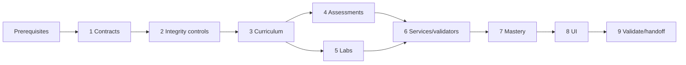

# Implementation Plan

## Overview

Implement Phase 4 as contract reconciliation, complete Domain 2 content and assessments, bounded agent/API evidence, Labs 6–7, mastery evaluation, UI integration, and handoff.

## Task Dependency Graph



```json
{
  "waves": [
    {"wave": 1, "tasks": ["1"]},
    {"wave": 2, "tasks": ["2"]},
    {"wave": 3, "tasks": ["3"]},
    {"wave": 4, "tasks": ["4", "5"]},
    {"wave": 5, "tasks": ["6"]},
    {"wave": 6, "tasks": ["7"]},
    {"wave": 7, "tasks": ["8"]},
    {"wave": 8, "tasks": ["9"]}
  ]
}
```

## Prerequisites

- Phase 0–2 artifacts and exit gates are complete and their actual interfaces/migration baseline are identified.
- Phase 3 handoff is available with approved source/content/question/evidence models and no unresolved blocking risk.
- The active AIP-C01 Domain 2 blueprint and AWS service sources are revalidated before scored publication.
- Lab 6–7 service actions, Regions, costs, identity requirements, resource tags, reversibility, and cleanup checks are reviewed under the Phase 0 safety policy.

## Tasks

- [ ] 1. Establish Phase 4 contracts and storage
  - [ ] 1.1 Reconcile Phase 0–3 contracts and record prerequisite gaps
    - **Outcome:** A contract map identifies actual models/repositories/services/MCP/UI symbols, latest migration, Phase 3 reuse points, and blockers; no parallel agent or evidence subsystem is invented.
    - **Requirements:** P4-R1, P4-R7, P4-R8
    - **Depends on:** Prerequisites
  - [ ] 1.2 Define core agent-limit, tool-evidence, deployment, routing, trace-drill, and phase-evaluation types
    - **Outcome:** Typed, deterministic `study_core` contracts represent bounded outcomes, units, evidence, assistance, and UTC timestamps without transport/AWS dependencies or hidden-reasoning fields.
    - **Requirements:** P4-R2, P4-R3, P4-R4, P4-R5, P4-R6, P4-R8
    - **Depends on:** 1.1
  - [ ] 1.3 Add strict Pydantic v2 schemas at ingestion/UI/MCP/AWS boundaries
    - **Outcome:** Schemas forbid unknown/arbitrary tools, actions, code, credentials, raw telemetry, naive times, malformed IDs, unbounded retries/limits, and incomplete artifacts.
    - **Requirements:** P4-R1, P4-R2, P4-R5, P4-R6, P4-R7
    - **Depends on:** 1.2
  - [ ] 1.4 Add the next forward migration and repository adapters
    - **Outcome:** Normalized decisions, tool-call summaries, trace drills/references, evidence links, and evaluations persist with FKs/idempotency and no raw private payloads.
    - **Requirements:** P4-R2, P4-R3, P4-R4, P4-R5, P4-R6, P4-R8
    - **Depends on:** 1.2, 1.3

- [ ] 2. Extend content, question, and coverage controls
  - [ ] 2.1 Extend deterministic ingestion for Domain 2 and Labs 6–7
    - **Outcome:** Ingestion enforces stable IDs, exact objectives, primary-source metadata, claim labels, trade-offs/failures/verification, and all common lab sections.
    - **Requirements:** P4-R1, P4-R7
    - **Depends on:** 1.3, 1.4
  - [ ] 2.2 Extend freshness and independent publication policy
    - **Outcome:** Stale/conflicting material and unreviewed/incomplete questions retain lineage but cannot newly contribute to scored publication.
    - **Requirements:** P4-R1, P4-R7
    - **Depends on:** 2.1
  - [ ] 2.3 Implement the 20-cell Domain 2 coverage and fresh-capacity audit
    - **Outcome:** Deterministic output lists approved concept/scenario/troubleshooting/hands-on evidence and unseen delayed-question capacity for each objective.
    - **Requirements:** P4-R1, P4-R8
    - **Depends on:** 2.1, 2.2
  - [ ] 2.4 Extend secure question delivery and atomic grading
    - **Outcome:** Unanswered DTOs remain key/rubric-free; grading commits attempt/confidence/time/misconception/reschedule before feedback or success.
    - **Requirements:** P4-R7, P4-R8
    - **Depends on:** 1.4, 2.2

- [ ] 3. Author Domain 2 curriculum and decision exercises
  - [ ] 3.1 Author `AIP-2.1` bounded-agent, tool, and MCP units
    - **Outcome:** Source-reviewed concept/scenario/troubleshooting/hands-on-linked content covers memory/state, boundaries, orchestration, typed tools, limits, IAM, retries, safe failure, traces, and human escalation without hidden reasoning.
    - **Requirements:** P4-R1, P4-R2
    - **Depends on:** 2.1, 2.2
  - [ ] 3.2 Author `AIP-2.2` deployment and capacity units
    - **Outcome:** Reviewed decision matrices and capacity scenarios compare all required deployment patterns, workload assumptions/units, accelerators/memory/tokens/scaling, and smaller/cascade/hybrid choices.
    - **Requirements:** P4-R1, P4-R3
    - **Depends on:** 2.1, 2.2
  - [ ] 3.3 Author `AIP-2.3` enterprise integration and CI/CD units
    - **Outcome:** Reviewed architectures cover legacy/API/event/sync boundaries, hybrid/regional constraints, identity/authorization, delivery scans/gates, canary, observability, and rollback.
    - **Requirements:** P4-R1, P4-R4
    - **Depends on:** 2.1, 2.2
  - [ ] 3.4 Author `AIP-2.4` and `AIP-2.5` API/application integration units
    - **Outcome:** Reviewed materials cover sync/stream/async AWS patterns, resilience/routing, accessible/API-first/no-code/document workflows, Amazon Q Developer, orchestration, and evidence-led diagnostics.
    - **Requirements:** P4-R1, P4-R5, P4-R6
    - **Depends on:** 2.1, 2.2
  - [ ] 3.5 Independently review curriculum and close all 20 coverage cells
    - **Outcome:** A non-author reviewer approves source accuracy, originality, claim labels, architecture trade-offs, failure paths, verification, and every Domain 2 objective/form cell.
    - **Requirements:** P4-R1, P4-R2, P4-R3, P4-R4, P4-R5, P4-R6, P4-R8
    - **Depends on:** 2.3, 3.1, 3.2, 3.3, 3.4

- [ ] 4. Build and review Domain 2 assessments
  - [ ] 4.1 Author original reviewed questions for `AIP-2.1`–`AIP-2.5`
    - **Outcome:** Each objective has materially constrained concept, scenario, troubleshooting, and hands-on prompts with separate keys/rubrics, complete rationales, current sources, and enough unseen scenarios for delayed assessment.
    - **Requirements:** P4-R2, P4-R3, P4-R4, P4-R5, P4-R6, P4-R7, P4-R8
    - **Depends on:** 2.2, 3.1, 3.2, 3.3, 3.4
  - [ ] 4.2 Author unsafe-autonomy and unsafe-integration design assessments
    - **Outcome:** Rubrics assess tools, IAM, limits, approvals, retries/idempotency, streaming/events, routing, release gates, and rollback from decisive constraints.
    - **Requirements:** P4-R2, P4-R4, P4-R5, P4-R8
    - **Depends on:** 4.1
  - [ ] 4.3 Author trace-led agent and API failure drills
    - **Outcome:** Sanitized fixtures inject unsafe calls, invalid schemas, authorization, throttling, timeout, duplicate events, partial streams, routing/fallback, and telemetry gaps with evidence-grounded diagnoses.
    - **Requirements:** P4-R2, P4-R5, P4-R6, P4-R8
    - **Depends on:** 3.1, 3.4
  - [ ] 4.4 Complete independent review and fresh-capacity audit
    - **Outcome:** Separate reviewers approve originality, source support, keys/rubrics, every rationale, constraints, privacy-safe fixtures, and sufficient unseen delayed items.
    - **Requirements:** P4-R1, P4-R6, P4-R7, P4-R8
    - **Depends on:** 4.1, 4.2, 4.3

- [ ] 5. Author Labs 6 and 7
  - [ ] 5.1 Author Lab 6 bounded tool-using agent
    - **Outcome:** The complete lab maps exactly to `AIP-2.1`, `AIP-3.1`, `AIP-4.3`, `AIP-5.1` and proves schema, IAM boundary, timeout, trace, escalation, and unsafe-tool rejection/failure handling.
    - **Requirements:** P4-R2, P4-R6, P4-R7
    - **Depends on:** 2.1, 3.1, 4.3
  - [ ] 5.2 Author Lab 7 production API integration
    - **Outcome:** The complete lab maps exactly to `AIP-2.3`, `AIP-2.4`, `AIP-2.5` and proves streaming, asynchronous path, retries, routing, enterprise events, traces, throttling, fallback, and duplicate/partial failure handling.
    - **Requirements:** P4-R4, P4-R5, P4-R6, P4-R7
    - **Depends on:** 2.1, 3.3, 3.4, 4.3
  - [ ] 5.3 Independently review lab architecture, safety, cost, evidence, and cleanup
    - **Outcome:** Both labs have all mandatory sections, source/originality approval, learner-only mutations, explicit profile/Region/budget/tag/reversibility gates, read-only validators, failure paths, cleanup proof, and delayed recall.
    - **Requirements:** P4-R1, P4-R7
    - **Depends on:** 5.1, 5.2

- [ ] 6. Implement bounded evidence and validator services
  - [ ] 6.1 Implement pure agent/tool policy and evidence assessment
    - **Outcome:** Deterministic rules assess allowlists, schemas, limits, approval/escalation, retries/idempotency, outcomes, and trace correlation without executing arbitrary tools or storing hidden reasoning.
    - **Requirements:** P4-R2, P4-R6
    - **Depends on:** 1.2, 1.4, 4.2
  - [ ] 6.2 Implement deployment, CI/CD, resilience, and routing assessment services
    - **Outcome:** Typed rubrics reject missing assumptions/units/gates/fallbacks and record versioned, explainable decisions for capacity, enterprise delivery, API behavior, and routing.
    - **Requirements:** P4-R3, P4-R4, P4-R5
    - **Depends on:** 1.2, 1.4, 3.2, 3.3, 3.4
  - [ ] 6.3 Implement trace-drill recording and privacy validation
    - **Outcome:** Fault/evidence/diagnosis/hypothesis/remediation/recovery records are idempotent and sanitized; missing or inconsistent evidence fails the drill.
    - **Requirements:** P4-R6
    - **Depends on:** 1.3, 1.4, 4.3
  - [ ] 6.4 Add explicit read-only Lab 6–7 validator adapters
    - **Outcome:** Validators use named profile/standard chain, code-defined actions, explicit Region, bounded retries, sanitized outputs, typed failures, and no database transaction during AWS calls.
    - **Requirements:** P4-R6, P4-R7
    - **Depends on:** 1.3, 5.3
  - [ ] 6.5 Integrate checkpoint transitions, cleanup evidence, UI, and existing lab MCP tools
    - **Outcome:** Durable six-state transitions, hints, validation, failure diagnostics, and cleanup are exposed with stable keys and no arbitrary MCP/AWS/SQL/shell capability or false success.
    - **Requirements:** P4-R7
    - **Depends on:** 6.3, 6.4

- [ ] 7. Implement mastery and phase evaluation
  - [ ] 7.1 Implement fresh delayed Domain 2 mastery calculations
    - **Outcome:** Injected-clock logic includes only current, independently reviewed, unseen, delayed scenarios and reports numerator/denominator/exclusions/per-objective accuracy/confidence at the 80% boundary.
    - **Requirements:** P4-R8
    - **Depends on:** 2.4, 4.4
  - [ ] 7.2 Implement unaided unsafe-design and trace-drill evidence checks
    - **Outcome:** Exit-eligible evidence proves the learner identifies unsafe autonomy/integration and diagnoses agent/API faults from logs/traces without answer reveal or prohibited hints.
    - **Requirements:** P4-R2, P4-R6, P4-R8
    - **Depends on:** 4.4, 6.1, 6.2, 6.3
  - [ ] 7.3 Implement Phase 4 exit evaluator and remediation
    - **Outcome:** Evaluation requires 20 form cells, ≥80% accuracy, unsafe-design and trace-drill passes, Labs 6–7 proof/cleanup, and integrity gates; failures yield objective-specific actions.
    - **Requirements:** P4-R8
    - **Depends on:** 2.3, 6.5, 7.1, 7.2
  - [ ] 7.4 Implement the versioned Phase 4 handoff
    - **Outcome:** The export includes approved artifacts/sources, coverage, reviews, lab/evidence/trace IDs, mastery math, migrations/contracts, and open risks without auto-crediting later phases.
    - **Requirements:** P4-R8
    - **Depends on:** 7.3

- [ ] 8. Complete UI and operational behavior
  - [ ] 8.1 Connect Domain 2 Learn/Grill/Labs/Review/Knowledge/Progress workflows
    - **Outcome:** Learners can study, assess, execute labs, inspect sanitized evidence, resume, and view multidimensional progress without exposed answers or private telemetry.
    - **Requirements:** P4-R1, P4-R2, P4-R3, P4-R4, P4-R5, P4-R6, P4-R7, P4-R8
    - **Depends on:** 3.5, 4.4, 6.5, 7.1
  - [ ] 8.2 Render explicit denial, escalation, timeout, throttle, partial, duplicate, fallback, offline, unavailable-AWS, and persistence states
    - **Outcome:** Text/icon states explain safe recovery and never claim completion, verification, cleanup, or diagnosis without committed evidence.
    - **Requirements:** P4-R2, P4-R5, P4-R6, P4-R7
    - **Depends on:** 8.1
  - [ ] 8.3 Verify accessibility, responsiveness, originality, and secret-safe state
    - **Outcome:** Stable controls support keyboard/focus/contrast/non-color status and no copied trade dress, keys, credentials, raw private logs, or hidden model state reaches browser-visible storage.
    - **Requirements:** P4-R6, P4-R7
    - **Depends on:** 8.2

- [ ] 9. Validate and hand off Phase 4
  - [ ] 9.1 Run automated quality and targeted tests
    - **Outcome:** Ruff check/format, mypy, targeted pytest, migrations, schemas, key separation, transactions, agent limits, retries/idempotency, routing, stream/event failures, trace privacy, and validator allowlists pass.
    - **Requirements:** P4-R1, P4-R2, P4-R3, P4-R4, P4-R5, P4-R6, P4-R7
    - **Depends on:** 1.4, 6.5, 7.4, 8.3
  - [ ] 9.2 Run content, source, coverage, review, lab-proof, and privacy audits
    - **Outcome:** Audits prove all 20 cells, exact Lab 6–7 mappings/proof, independent scored review, current lineage, evidence cleanup, and absence of secrets/private payloads or new prohibited platform architecture.
    - **Requirements:** P4-R1, P4-R7, P4-R8
    - **Depends on:** 3.5, 4.4, 5.3, 9.1
  - [ ] 9.3 Execute Phase 4 acceptance and exit-gate scenarios
    - **Outcome:** Reproducible scenarios demonstrate ≥80% fresh delayed accuracy, unaided unsafe-design detection, trace-led agent/API diagnoses, exact lab proof/cleanup, restart safety, and failing-gate remediation.
    - **Requirements:** P4-R8
    - **Depends on:** 7.4, 9.2
  - [ ] 9.4 Publish the Phase 4 implementation record and handoff
    - **Outcome:** Maintainers receive the passing evaluation, versioned handoff, artifact and migration inventory, validation results, residual risks, and explicit Phase 5–8 inputs.
    - **Requirements:** P4-R8
    - **Depends on:** 9.3

## Exit gate

Phase 4 is complete only when every `AIP-2.1`–`AIP-2.5` objective has approved concept, scenario, troubleshooting, and hands-on evidence; fresh delayed Domain 2 scenario accuracy is at least 80%; the learner demonstrates unaided recognition of unsafe autonomy/integration and completes agent/API failure drills from logs/traces; Labs 6–7 have exact roadmap proof and evidence-based cleanup; and no critical source, safety, security, privacy, cost, or evidence issue remains.
## Notes

- Parent checkboxes summarize workstreams; numbered child checkboxes are the implementable leaf tasks.
- Independent content, question, and lab branches may run in parallel after their listed contracts are stable.
- Lab architecture does not authorize equivalent hosted/async/general-agent dependencies in the local platform.
