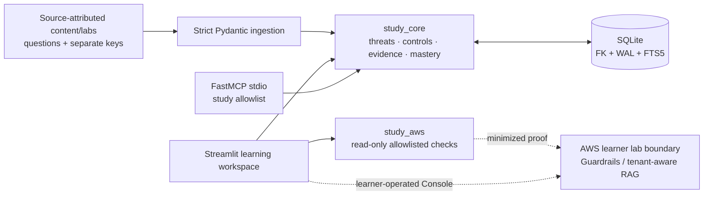
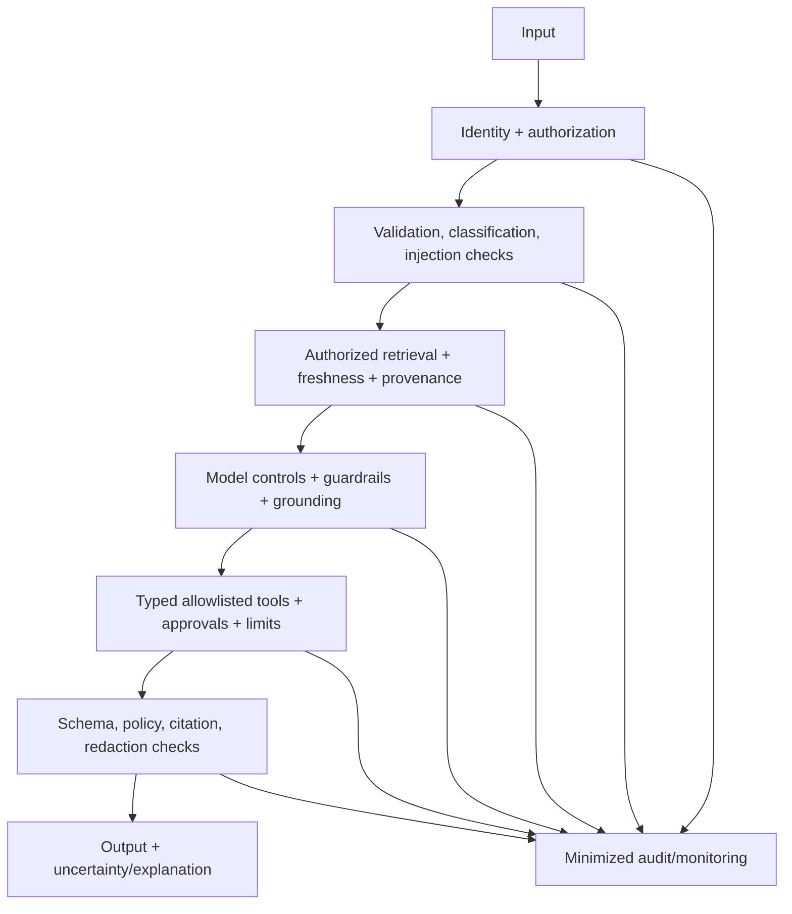
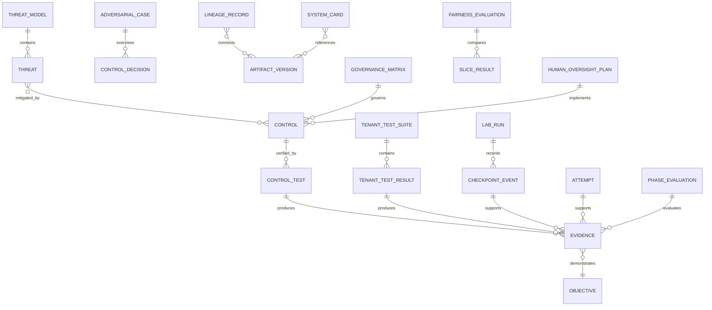
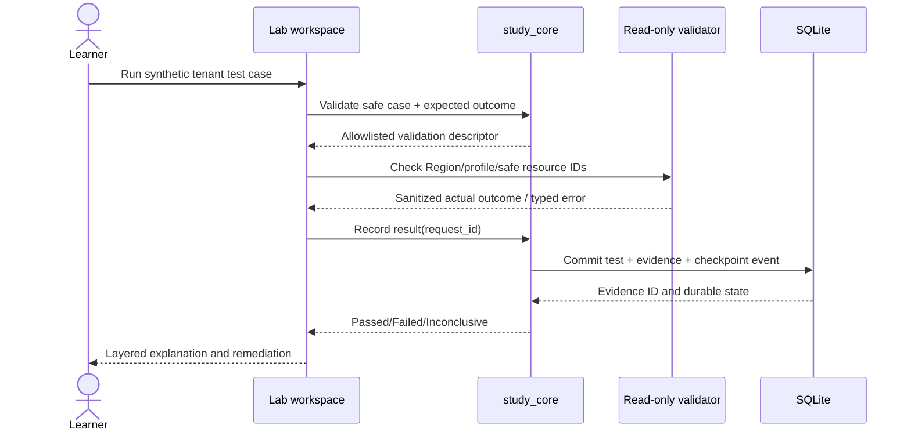
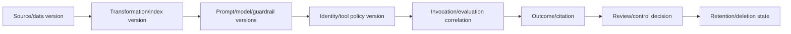

# Phase 5 Design — Domain 3 Safety, Security, and Governance

**Status:** Proposed

## Overview

Phase 5 adds complete Domain 3 curricula and assessments, a reusable threat/control evidence model, Labs 5 and 8, governance/lineage exercises, responsible-AI/fairness/human-oversight artifacts, and a deterministic exit gate. It builds on Phase 3 retrieval/prompt contracts and Phase 4 agent/tool/API/trace contracts while preserving the local-first platform and read-only validator boundary.

## Goals

- Cover `AIP-3.1`–`AIP-3.4` in concept, scenario, troubleshooting, and hands-on forms.
- Teach layered safety, direct/indirect prompt injection, tool misuse, poisoned retrieval, tenant isolation, PII/privacy, lineage/audit, responsible AI, fairness, and human oversight.
- Produce exact roadmap proof for Labs 5 and 8 using safe synthetic data and evidence-based cleanup.
- Require ≥80% fresh delayed scenario accuracy plus validated controls across identity, data, retrieval, model, tool, output, and audit layers.

## Non-goals

- Security, privacy, fairness, legal, or compliance certification/advice.
- Live offensive exploitation, real PII, broad monitoring, secrets, destructive payloads, or broad AWS mutation.
- A hosted policy/security service, SIEM, identity provider, vector database, API server, or local model.
- Claiming that one guardrail, prompt, network, encryption, or IAM control is sufficient.

## Contracts

### Upstream

| Source | Contract consumed |
|---|---|
| Phase 0 | objective/source lineage; learner/safety profile; Region, budget, tag, cleanup rules |
| Phase 1 | local SQLite/FTS5, secure question delivery, transactional grading, typed errors/MCP |
| Phase 2 | explicit lab/hint/checkpoint UI, evidence statuses, read-only validation, accessibility |
| Phase 3 | RAG metadata/freshness/tenant concepts, prompt versions, citations, experiment/evidence/mastery schemas |
| Phase 4 | agent/tool policy and limits, identity propagation, API/event patterns, trace drills and sanitized telemetry |

Actual symbols and migration versions are reconciled before implementation. Security work extends common models through forward migrations; it does not fork them.

### Downstream

The Phase 5 handoff provides Phases 6–8 with approved threat/control IDs, source/content/question versions, lab and cleanup evidence, privacy-safe trace/lineage references, governance/system-card/fairness/oversight artifacts, mastery results, limitations, contracts, and unresolved risks. It states clearly that passing is an internal study gate, not compliance certification.

## Architecture



### Defense-in-depth reference model



No layer is marked sufficient alone. Assessments require prevention, detection, response, and evidence across relevant layers.

## Components and Interfaces

### Content, questions, and coverage

- **Domain3ContentIngestor:** validates objective/source/claim/threat/limitation metadata and rejects unsafe fixture material.
- **CoverageService:** computes the 16-cell objective/form matrix from current, approved artifacts.
- **SecurityQuestionPublisher:** extends independent review with checks for unsupported absolutes, dangerous/private fixtures, single-control claims, and unscoped compliance language.
- **SecureDelivery/GradeAndRecord:** reuses answer separation and the atomic attempt/misconception/review transaction.

### Threat and control model

- **ThreatModelService:** records assets, actors, boundaries, flows, threats, mitigations, owners, and residual risk. Threat categories include direct/indirect injection, jailbreak, exfiltration, unsafe tool use, poisoned retrieval, isolation failure, and privacy leakage.
- **ControlRegistry:** maps stable control IDs to policy objective, owner, layer, scope, test, cadence, evidence, pass criteria, exceptions, and mapped AIP objectives.
- **AdversarialCaseEvaluator:** compares expected/actual outcomes over benign synthetic fixtures and records layer decisions plus false positives/negatives.
- **LayerCoverageEvaluator:** determines whether identity, data, retrieval, model, tool, output, and audit controls have current passing evidence; it does not infer one layer from another.

### Tenant isolation and privacy

- **TenantIsolationSuite:** versioned positive and negative tests for authorization, missing/forged context, filter bypass, memory/cache bleed, citation leakage, and audit correlation.
- **PrivacyAssessment:** evaluates classification, minimization, detection, redaction/anonymization, retention/deletion, access, and audit choices using synthetic data.
- **SanitizationPolicy:** allows only bounded identifiers, categories, counts, hashes, decision codes, timestamps, and approved synthetic snippets in evidence. Raw logs/private payloads are rejected.

### Governance and responsible AI

- **LineageService:** links source/data/transformation/index/prompt/model/guardrail/tool-policy versions to invocation/evaluation, output/citation, review, and retention state.
- **GovernanceMatrixService:** records control owners, scope, cadence, criteria, evidence, and exceptions/expiry.
- **SystemCardService:** composes intended use, exclusions, limitations, architecture, sources, controls, evaluation, monitoring, human oversight, and open risks.
- **FairnessEvaluationService:** validates versioned approved/synthetic datasets, slices, metrics, thresholds, coverage/sample limitations, results, confounders, and decisions.
- **HumanOversightService:** validates triggers, authority, context, deadline, escalation, override/appeal, audit, and fail-safe behavior.

### Labs

| Lab | Mapping | Required proof |
|---|---|---|
| Lab 5 — Guardrails and adversarial inputs | `AIP-3.1`, `AIP-3.4`, `AIP-5.1` | Safe attack set, layered controls, expected/actual outcomes, false-positive analysis |
| Lab 8 — Secure multi-tenant RAG | `AIP-1.4`, `AIP-2.3`, `AIP-3.2`, `AIP-3.3` | Identity-aware positive/negative retrieval tests and sanitized audit evidence |

Each lab includes all common sections, safe failure injection, synthetic-data rules, explicit Region/profile/cost/tag conditions, learner-only resource changes, read-only validators, evidence-based cleanup, and delayed recall.

### Mastery and exit

- **FreshDelayedPolicy/MasteryCalculator:** reuses reviewed/unseen/delayed eligibility and reports denominator/exclusions/per-objective results.
- **UnaidedSecurityAssessment:** requires defense-in-depth and threat-model reasoning without answer reveal/procedural/full-solution hints.
- **Phase5ExitEvaluator:** requires 16 form cells, ≥80% accuracy, seven-layer control evidence, Labs 5/8 proof/cleanup, governance matrix, lifecycle/lineage, system card, fairness evaluation, human oversight, and no critical unresolved issue.

## Data Models



Common upstream source/content/question/lab/evidence tables are referenced. Proposed records use stable IDs, aware UTC times, explicit versions and review state, FKs, and idempotency. No generic JSON bucket may bypass payload-specific Pydantic validation or sanitization.

## Interfaces and schemas

```python
from dataclasses import dataclass
from datetime import datetime
from enum import StrEnum
from typing import Protocol, Sequence

class ControlLayer(StrEnum):
    IDENTITY = "identity"
    DATA = "data"
    RETRIEVAL = "retrieval"
    MODEL = "model"
    TOOL = "tool"
    OUTPUT = "output"
    AUDIT = "audit"

class TestOutcome(StrEnum):
    PASSED = "passed"
    FAILED = "failed"
    INCONCLUSIVE = "inconclusive"
    UNAVAILABLE = "unavailable"

@dataclass(frozen=True)
class ControlDefinition:
    control_id: str
    policy_objective: str
    layer: ControlLayer
    owner: str
    scope: str
    test_cadence: str
    pass_criteria: str

@dataclass(frozen=True)
class AdversarialCaseResult:
    case_id: str
    fixture_version: str
    attack_category: str
    expected_outcome: str
    actual_outcome: str
    control_ids: tuple[str, ...]
    outcome: TestOutcome
    recorded_at: datetime

@dataclass(frozen=True)
class LayerCoverage:
    layer: ControlLayer
    passing_evidence_ids: tuple[str, ...]
    passed: bool
    limitation: str | None

class SanitizationPolicy(Protocol):
    def validate(self, evidence: "EvidencePayload") -> None: ...

class ControlRepository(Protocol):
    def add_test_result(self, result: "ControlTestResult", request_id: str) -> None: ...
    def current_layer_coverage(self, learner_id: str) -> Sequence[LayerCoverage]: ...
```

Boundary Pydantic models use `extra="forbid"`, strict objective/control/lab IDs, aware timestamps, explicit Region, bounded synthetic text, enums for outcomes/layers, hashes instead of sensitive values, and discriminated evidence variants. They reject credential fields, raw prompts/documents/logs, arbitrary actions/queries/code, real-person identifiers, and unbounded collections.

## Lab state and evidence

The Phase 2 six-state machine remains authoritative. `Verified` requires a successful current control/isolation check committed to SQLite. `Cleaned up` requires a separate absence or terminal-state validator event. A failed isolation/redaction test cannot be overridden by self-report; correction and retest produce new immutable evidence while preserving the failure.

### Tenant-isolation sequence



AWS calls occur outside SQLite transactions. Authorization/unavailable/inconclusive results are not passing evidence.

### Governance lineage



## Error handling

| Category | Behavior |
|---|---|
| Validation/unsafe fixture | Reject with safe field/category error; never persist prohibited content |
| Authorization/policy denial | Do not retry as transient; preserve sanitized denial evidence |
| Cross-tenant/redaction/control failure | Mark failed, block completion, preserve evidence, require correction/retest |
| Inconclusive/unavailable | Preserve progress but do not mark verified or passing |
| Missing/conflicting lineage | Mark control unverified and create remediation |
| Expired exception/review | Exclude from current pass status until renewed through review |
| Source stale/conflict | Quarantine new scored use and retain lineage |
| Persistence/conflict | Roll back and show no success; idempotent replay returns prior equivalent result |
| Cleanup uncertainty | Keep prior state; never infer cleanup from learner action |

## Security, privacy, and cost

- All adversarial and privacy fixtures are benign, synthetic, versioned, and reviewed. Real credentials/PII/private content are forbidden.
- Normal AWS credential chain/named profile only; validators are explicit read-only `Get`/`List`/`Describe` calls with Region and safe identifiers.
- Learners perform any resource mutation from documented lab instructions after cost/reversibility acknowledgment. The platform never executes broad mutation.
- Evidence/logs use minimization and redaction; hashes or categories are preferred. No secrets, signatures, full prompts, retrieved documents, hidden reasoning, answer keys, or sensitive model outputs.
- Tenant ID is authorized server-side/in core contracts, never trusted solely from a UI filter. Negative tests cover identity/filter/memory/cache/citation/audit paths.
- Governance language declares scope, assumptions, jurisdiction, limitations, and need for qualified real-world review.
- Lab costs and cleanup are gated and auditable; failed control or cleanup checks prevent completion.

## Testing Strategy

- Schema/ingestion tests for source metadata, safe fixtures, objective/control IDs, lab sections, and prohibited sensitive fields.
- Publication tests for independent review, answer separation, source currency, unsafe absolutes, and scoped claims.
- Pure threat/control tests for seven-layer mapping, single-control rejection, exception expiry, false-positive/negative recording, and missing evidence.
- Tenant suite fixtures for allowed access, cross-tenant denial, missing/forged identity, filter bypass, cache/memory/citation leak, and audit mismatch.
- Sanitization/privacy tests seed credential/PII/private-prompt patterns and require rejection/redaction without persisting originals.
- Lineage tests detect missing version edges, inconsistent times/correlation, retention gaps, and stale reviews.
- Fairness fixtures test slice/metric/threshold/sample limitations and prohibit unsupported no-harm conclusions.
- Human-oversight tests require every trigger/authority/deadline/escalation/appeal/audit/fail-safe field.
- Stubbed read-only AWS validator tests for exact actions/Regions, typed errors, minimized output, and no DB transaction across calls.
- Lab mapping/proof/cleanup audits; injected-clock mastery tests for reviewed/unseen/delayed eligibility, exclusions, zero denominator, and ≥0.80.
- Ruff check/format, mypy, targeted pytest, deterministic audits, privacy scan, and accessible UI smoke tests.

## Requirement traceability

| Requirement | Components | Evidence | Validation |
|---|---|---|---|
| P5-R1 | ingestion, freshness, coverage | source/content/form matrix | schema, freshness, 16-cell audits |
| P5-R2 | threat model, adversarial evaluator | cases, controls, layer decisions | attack fixtures, single-layer rejection |
| P5-R3 | tenant suite, privacy assessment, sanitization | isolation/redaction results | positive/negative leak and privacy tests |
| P5-R4 | control registry, lineage, governance matrix | control tests, version graph, audit drill | gap/expiry/correlation tests |
| P5-R5 | system card, fairness, oversight | slice results, limitations, oversight plan | schema/rubric/unsupported-claim tests |
| P5-R6 | question publisher/delivery/grading | reviews, keys, attempts | review, secret-field, transaction tests |
| P5-R7 | Labs 5/8, validators, checkpoints | attack/isolation proof and cleanup | mapping, allowlist, transition, absence tests |
| P5-R8 | layer evaluator, mastery, exit/handoff | delayed attempts, layer coverage, evaluation | clock/threshold/pass-fail/handoff tests |

## Risks and decisions

| Topic | Decision | Risk/mitigation |
|---|---|---|
| Unsafe adversarial content | Benign synthetic reviewed fixtures only | Schema rejects secrets/real PII/destructive payloads |
| Security theater | Seven explicit layers; no single-control pass | Threat/control rubrics and negative tests |
| Tenant-test contamination | Synthetic tenants and minimized evidence | Isolation reset/cleanup and leak-pattern scans |
| Compliance overclaim | Scope/jurisdiction/limitations labels | Review gate rejects guarantees |
| Fairness overclaim | Versioned slices/metrics plus sample limits | Require qualified conclusions and open risks |
| Auditability vs privacy | Store structured summaries and version links | Reject raw private logs/content |
| AWS mutation | Learner-operated only; validators read-only | Cost/reversibility/cleanup gates |
| Cross-domain evidence | Link Labs 5/8 mappings without auto-credit | Each later/earlier phase owns its exit decision |
| Service/policy drift | Version and freshness-gate sources/controls | Expire stale reviews and exceptions |
## Correctness Properties

### Property 1: Publication safety

Any scored artifact is current, source-complete, independently reviewed, scoped, and free of prohibited sensitive/unsafe fixtures; removing any prerequisite makes it ineligible while preserving lineage. **Validates: Requirements 1.1, 1.4, 6.1, 6.2, 6.5** (stable IDs `P5-R1.1`, `P5-R1.4`, `P5-R6.1`, `P5-R6.2`, `P5-R6.5`).

### Property 2: Defense-in-depth necessity

No single control or control layer can satisfy a multi-layer threat or Phase 5 exit; relevant identity, data, retrieval, model, tool, output, and audit evidence is evaluated independently. **Validates: Requirements 2.1, 2.4, 8.4** (stable IDs `P5-R2.1`, `P5-R2.4`, `P5-R8.4`).

### Property 3: Tenant noninterference

For any tenant test, changing the authenticated/authorized tenant cannot expose another tenant’s retrieval, context, memory/cache, log, citation, tool, or output data; any leak yields failed evidence and blocks completion. **Validates: Requirements 3.3, 3.4, 3.5** (stable IDs `P5-R3.3`–`P5-R3.5`).

### Property 4: Evidence minimization

Every persisted evidence payload excludes credentials, signatures, secrets, real PII, full private prompts/documents/logs, and answer keys; rejected prohibited input is not retained in diagnostics. **Validates: Requirements 3.6, 4.4** (stable IDs `P5-R3.6`, `P5-R4.4`).

### Property 5: Lineage completeness

Any verified governed outcome has an unbroken versioned path from source/data through transformations and runtime policies to outcome/review/retention; missing, conflicting, or expired edges make it unverified. **Validates: Requirements 4.3, 4.5** (stable IDs `P5-R4.3`, `P5-R4.5`).

### Property 6: Qualified responsible-AI claims

Fairness/safety/suitability output cannot assert absence of harm when dataset, slices, metrics, thresholds, coverage/sample limitations, or confounders are missing. **Validates: Requirements 5.2, 5.4** (stable IDs `P5-R5.2`, `P5-R5.4`).

### Property 7: Lab state safety

Lab 5/8 `Verified` requires committed current control/isolation proof and `Cleaned up` requires committed absence/terminal evidence; self-report, learner action, or inconclusive checks cannot establish success. **Validates: Requirements 7.5, 7.6, 7.7** (stable IDs `P5-R7.5`–`P5-R7.7`).

### Property 8: Exit conjunction

Phase 5 passes if and only if all 16 cells, accuracy ≥0.80, unaided threat evidence, all seven layers, Labs 5/8 proof/cleanup, required governance/responsible-AI artifacts, and integrity gates pass; every failure yields scoped remediation. **Validates: Requirements 8.2, 8.3, 8.4, 8.5, 8.6** (stable IDs `P5-R8.2`–`P5-R8.6`).
