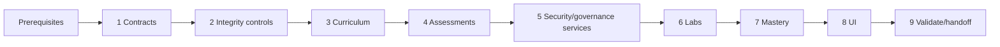

# Implementation Plan

## Overview

Implement Phase 5 as contract reconciliation, safe Domain 3 content and assessments, threat/control/privacy/governance services, Labs 5/8, mastery evaluation, UI integration, and handoff.

## Task Dependency Graph



```json
{
  "waves": [
    {"wave": 1, "tasks": ["1"]},
    {"wave": 2, "tasks": ["2"]},
    {"wave": 3, "tasks": ["3"]},
    {"wave": 4, "tasks": ["4"]},
    {"wave": 5, "tasks": ["5"]},
    {"wave": 6, "tasks": ["6"]},
    {"wave": 7, "tasks": ["7"]},
    {"wave": 8, "tasks": ["8"]},
    {"wave": 9, "tasks": ["9"]}
  ]
}
```

## Prerequisites

- Phase 0–2 artifacts and exit gates are complete; actual models, repositories, MCP/UI contracts, lab state, safety policy, and latest migration are identified.
- Phase 3 handoff supplies approved prompt/RAG/source/evidence contracts and relevant Lab 3–4 retrieval evidence.
- Phase 4 handoff supplies approved agent/tool/API/identity/trace contracts and relevant Lab 6–7 evidence.
- Revalidate the active AIP-C01 Domain 3 blueprint and AWS primary sources before scored publication.
- Approve benign synthetic adversarial/tenant/PII fixtures and Lab 5/8 Region/profile/cost/tag/reversibility/cleanup controls before learner use.

## Tasks

- [ ] 1. Establish Phase 5 contracts and storage
  - [ ] 1.1 Reconcile Phase 0–4 contracts and document prerequisite gaps
    - **Outcome:** A contract map identifies actual source/content/question/evidence/lab/security-adjacent symbols, migration baseline, reuse points, and blockers; no parallel store or tool surface is created.
    - **Requirements:** P5-R1, P5-R6, P5-R7, P5-R8
    - **Depends on:** Prerequisites
  - [ ] 1.2 Define core threat, control, layer, privacy, lineage, fairness, oversight, and evaluation types
    - **Outcome:** Strict `study_core` models represent stable IDs, versions, owners, outcomes, limitations, assistance, UTC timestamps, and seven control layers without Streamlit/FastMCP/boto3 or sensitive payloads.
    - **Requirements:** P5-R2, P5-R3, P5-R4, P5-R5, P5-R8
    - **Depends on:** 1.1
  - [ ] 1.3 Add strict Pydantic v2 schemas and sanitization policy at every boundary
    - **Outcome:** Schemas reject unknown fields, malformed IDs, arbitrary actions/queries/code, credentials, real PII, raw prompts/documents/logs, destructive fixtures, naive timestamps, and unbounded collections.
    - **Requirements:** P5-R1, P5-R2, P5-R3, P5-R4, P5-R5, P5-R7
    - **Depends on:** 1.2
  - [ ] 1.4 Add the next numbered migration and repository adapters
    - **Outcome:** Normalized threat/control/test/lineage/governance/system-card/fairness/oversight/evaluation records use FKs, versions, idempotency, and minimized payloads while reusing upstream artifacts.
    - **Requirements:** P5-R2, P5-R3, P5-R4, P5-R5, P5-R8
    - **Depends on:** 1.2, 1.3

- [ ] 2. Extend integrity, publication, and coverage controls
  - [ ] 2.1 Extend deterministic ingestion for Domain 3 and Labs 5/8
    - **Outcome:** Stable IDs, exact objectives, complete source/claim/threat/limitation metadata, safe fixtures, and every common lab section are mandatory.
    - **Requirements:** P5-R1, P5-R7
    - **Depends on:** 1.3, 1.4
  - [ ] 2.2 Implement security-specific source/review publication policy
    - **Outcome:** Stale/conflicting/jurisdiction-mismatched sources, dangerous/private fixtures, unsupported absolutes, single-control claims, and unscoped compliance claims cannot enter scored publication.
    - **Requirements:** P5-R1, P5-R6
    - **Depends on:** 2.1
  - [ ] 2.3 Implement the 16-cell Domain 3 coverage and fresh-capacity audit
    - **Outcome:** A deterministic report lists approved concept/scenario/troubleshooting/hands-on evidence and unseen delayed-question capacity for all four objectives.
    - **Requirements:** P5-R1, P5-R8
    - **Depends on:** 2.1, 2.2
  - [ ] 2.4 Extend secure question delivery and atomic grading
    - **Outcome:** Unanswered DTOs remain incapable of keys/rubrics/private fixtures; attempts/confidence/time/misconceptions/reviews commit atomically before success.
    - **Requirements:** P5-R6, P5-R8
    - **Depends on:** 1.4, 2.2

- [ ] 3. Author and review Domain 3 curriculum
  - [ ] 3.1 Author `AIP-3.1` defense-in-depth and adversarial-safety units
    - **Outcome:** Reviewed four-form content covers all seven layers, guardrails/grounding/schema controls, direct/indirect injection, jailbreaks, exfiltration, tool misuse, poisoned retrieval, and safe response/escalation.
    - **Requirements:** P5-R1, P5-R2
    - **Depends on:** 2.1, 2.2
  - [ ] 3.2 Author `AIP-3.2` data-security, privacy, and tenant-isolation units
    - **Outcome:** Reviewed content covers IAM/network/encryption/data authorization, provider handling/retention, synthetic PII lifecycle, and identity binding through retrieval/context/memory/cache/log/model/tool/citation/output paths.
    - **Requirements:** P5-R1, P5-R3
    - **Depends on:** 2.1, 2.2
  - [ ] 3.3 Author `AIP-3.3` governance, lineage, audit, and monitoring units
    - **Outcome:** Reviewed content covers system cards, catalogs/tags/citations/CloudTrail, version lineage, policy-control mappings, owners/cadence/exceptions, and privacy-safe reconstruction/monitoring.
    - **Requirements:** P5-R1, P5-R4
    - **Depends on:** 2.1, 2.2
  - [ ] 3.4 Author `AIP-3.4` responsible-AI, fairness, and human-oversight units
    - **Outcome:** Reviewed content covers intended use/limits, uncertainty/explanations, fairness slices/metrics/limitations, policy enforcement, human decisions/escalation/appeal, and qualified claims.
    - **Requirements:** P5-R1, P5-R5
    - **Depends on:** 2.1, 2.2
  - [ ] 3.5 Independently review curriculum and close all 16 coverage cells
    - **Outcome:** A non-author reviewer approves source accuracy, originality, safe fixtures, scoped claims, limitations, trade-offs, failure paths, verification, and all objective/form cells.
    - **Requirements:** P5-R1, P5-R2, P5-R3, P5-R4, P5-R5, P5-R8
    - **Depends on:** 2.3, 3.1, 3.2, 3.3, 3.4

- [ ] 4. Build and review Domain 3 assessments
  - [ ] 4.1 Author original questions for `AIP-3.1`–`AIP-3.4`
    - **Outcome:** Each objective has materially constrained concept/scenario/troubleshooting/hands-on items with current sources, separate keys/rubrics, complete rationales, safe synthetic details, and sufficient unseen delayed capacity.
    - **Requirements:** P5-R2, P5-R3, P5-R4, P5-R5, P5-R6, P5-R8
    - **Depends on:** 2.2, 3.1, 3.2, 3.3, 3.4
  - [ ] 4.2 Author threat-model and seven-layer control assessments
    - **Outcome:** Rubrics require assets/actors/boundaries/flows/threats/owners/residual risk and passing identity/data/retrieval/model/tool/output/audit reasoning without single-control shortcuts.
    - **Requirements:** P5-R2, P5-R8
    - **Depends on:** 3.1, 4.1
  - [ ] 4.3 Author tenant-isolation, privacy, lineage, fairness, and oversight drills
    - **Outcome:** Safe fixtures test positive/negative isolation, redaction/lifecycle, audit gaps/expiry, qualified fairness analysis, and human trigger/authority/deadline/escalation/appeal/fail-safe design.
    - **Requirements:** P5-R3, P5-R4, P5-R5
    - **Depends on:** 3.2, 3.3, 3.4
  - [ ] 4.4 Complete independent review and fresh-capacity audit
    - **Outcome:** Separate reviewers approve originality, source support, answer/rubric/rationales, safe fixtures, scoped claims, and sufficient unseen delayed scenarios.
    - **Requirements:** P5-R1, P5-R6, P5-R8
    - **Depends on:** 4.1, 4.2, 4.3

- [ ] 5. Implement threat, control, privacy, and governance services
  - [ ] 5.1 Implement threat-model, control-registry, and layer-coverage services
    - **Outcome:** Versioned threats/mitigations/owners/residual risks and controls/tests/exceptions map deterministically to seven layers; one layer cannot satisfy another.
    - **Requirements:** P5-R2, P5-R4, P5-R8
    - **Depends on:** 1.2, 1.4, 4.2
  - [ ] 5.2 Implement adversarial-case evaluation with false-positive/negative evidence
    - **Outcome:** Reviewed synthetic cases record expected/actual outcomes and layer decisions; violations, missing grounding/schema, or single-layer designs fail safely.
    - **Requirements:** P5-R2
    - **Depends on:** 1.3, 1.4, 5.1
  - [ ] 5.3 Implement tenant-isolation suite and privacy assessment
    - **Outcome:** Versioned positive and negative tests detect identity/filter/context/memory/cache/log/citation/output leakage and validate minimization/redaction/lifecycle choices using synthetic data.
    - **Requirements:** P5-R3
    - **Depends on:** 1.3, 1.4, 4.3
  - [ ] 5.4 Implement lineage, governance matrix, and audit-drill services
    - **Outcome:** Version graphs and control records expose missing edges, inconsistent correlation/times, expired exceptions, ownership/cadence gaps, and privacy-safe reconstruction evidence.
    - **Requirements:** P5-R4
    - **Depends on:** 1.4, 4.3, 5.1
  - [ ] 5.5 Implement system-card, fairness-evaluation, and human-oversight services
    - **Outcome:** Validated artifacts require intended use/limits/sources/controls/risks, versioned slices/metrics/thresholds/sample limits/confounders, and complete human decision/fail-safe paths.
    - **Requirements:** P5-R5
    - **Depends on:** 1.4, 4.3, 5.1

- [ ] 6. Author and integrate Labs 5 and 8
  - [ ] 6.1 Author Lab 5 guardrails and adversarial inputs
    - **Outcome:** The complete lab maps exactly to `AIP-3.1`, `AIP-3.4`, `AIP-5.1` and proves a safe synthetic attack set, layered controls, expected/actual outcomes, and false-positive analysis.
    - **Requirements:** P5-R2, P5-R5, P5-R7
    - **Depends on:** 2.1, 3.1, 3.4, 5.2
  - [ ] 6.2 Author Lab 8 secure multi-tenant RAG
    - **Outcome:** The complete lab maps exactly to `AIP-1.4`, `AIP-2.3`, `AIP-3.2`, `AIP-3.3` and proves identity-aware positive/negative retrieval, leak resistance, citations, and privacy-safe audit evidence.
    - **Requirements:** P5-R3, P5-R4, P5-R7
    - **Depends on:** 2.1, 3.2, 3.3, 5.3, 5.4
  - [ ] 6.3 Independently review lab safety, cost, source, proof, and cleanup
    - **Outcome:** Both labs have every mandatory section, benign synthetic fixtures, learner-only mutations, explicit profile/Region/budget/tag/reversibility controls, read-only validators, failure paths, cleanup proof, and delayed recall.
    - **Requirements:** P5-R1, P5-R2, P5-R3, P5-R7
    - **Depends on:** 6.1, 6.2
  - [ ] 6.4 Add explicit read-only Lab 5/8 validator adapters
    - **Outcome:** Validators use standard-chain/named-profile auth, code-defined actions, explicit Region, bounded retries, minimized output, typed failures, and no AWS call inside a DB transaction.
    - **Requirements:** P5-R3, P5-R4, P5-R7
    - **Depends on:** 1.3, 6.3
  - [ ] 6.5 Integrate idempotent evidence/checkpoint/cleanup transitions with UI and existing lab MCP tools
    - **Outcome:** Only legal six-state transitions persist; failed isolation/control evidence remains immutable; verification and cleanup require committed proof; no arbitrary AWS/SQL/shell or sensitive browser state is exposed.
    - **Requirements:** P5-R2, P5-R3, P5-R4, P5-R7
    - **Depends on:** 5.2, 5.3, 5.4, 6.4

- [ ] 7. Implement mastery and exit evaluation
  - [ ] 7.1 Implement fresh delayed Domain 3 mastery calculation
    - **Outcome:** Injected-clock logic includes only current, independently reviewed, unseen, delayed scenarios and reports numerator/denominator/exclusions/per-objective accuracy/confidence at the 80% boundary.
    - **Requirements:** P5-R6, P5-R8
    - **Depends on:** 2.4, 4.4
  - [ ] 7.2 Implement unaided threat-model and seven-layer evidence eligibility
    - **Outcome:** Only non-revealed, non-procedural/full-solution evidence with current passing control tests counts toward defense-in-depth exit requirements.
    - **Requirements:** P5-R2, P5-R3, P5-R4, P5-R8
    - **Depends on:** 4.4, 5.1, 5.2, 5.3, 5.4, 6.5
  - [ ] 7.3 Implement Phase 5 exit evaluator and remediation
    - **Outcome:** Evaluation requires 16 form cells, ≥80% accuracy, unaided threat evidence, seven layers, Labs 5/8 proof/cleanup, governance/lifecycle/lineage/system-card/fairness/oversight artifacts, and no critical issue.
    - **Requirements:** P5-R8
    - **Depends on:** 2.3, 5.5, 7.1, 7.2
  - [ ] 7.4 Implement the versioned Phase 5 handoff
    - **Outcome:** The handoff contains artifact/source/review versions, coverage, minimized control/lab evidence IDs, mastery math, limitations, contracts/migrations, and open risks without compliance claims or cross-domain auto-credit.
    - **Requirements:** P5-R8
    - **Depends on:** 7.3

- [ ] 8. Complete UI, privacy, and accessibility states
  - [ ] 8.1 Connect Domain 3 Learn/Grill/Labs/Review/Knowledge/Progress views
    - **Outcome:** Learners can navigate source-grounded content, safe assessments, lab controls, governance artifacts, and multidimensional progress with durable state and no exposed keys/private payloads.
    - **Requirements:** P5-R1, P5-R2, P5-R3, P5-R4, P5-R5, P5-R6, P5-R7, P5-R8
    - **Depends on:** 3.5, 4.4, 5.5, 6.5, 7.1
  - [ ] 8.2 Render explicit denied, failed, leaked, redacted, inconclusive, expired, stale, offline, unavailable-AWS, and cleanup-pending states
    - **Outcome:** Text/icon statuses explain safe remediation and never imply security, verification, cleanup, fairness, or compliance beyond committed evidence.
    - **Requirements:** P5-R2, P5-R3, P5-R4, P5-R5, P5-R7
    - **Depends on:** 8.1
  - [ ] 8.3 Verify accessibility, responsiveness, originality, minimization, and secret-safe state
    - **Outcome:** Keyboard/focus/contrast/non-color status checks pass, content remains original, and browser/log/database scans find no credentials, real PII, private prompts/content, raw logs, or answer keys.
    - **Requirements:** P5-R3, P5-R6, P5-R7
    - **Depends on:** 8.2

- [ ] 9. Validate and hand off Phase 5
  - [ ] 9.1 Run automated quality and targeted behavior tests
    - **Outcome:** Ruff check/format, mypy, targeted pytest, migrations, strict schemas, key separation, transactions/idempotency, threat/control layers, isolation negatives, sanitization, lineage, exception expiry, fairness/oversight, and validator allowlists pass.
    - **Requirements:** P5-R1, P5-R2, P5-R3, P5-R4, P5-R5, P5-R6, P5-R7
    - **Depends on:** 1.4, 6.5, 7.4, 8.3
  - [ ] 9.2 Run source, coverage, review, lab-proof, privacy, and architecture audits
    - **Outcome:** Audits prove all 16 cells, independent scored review, exact Lab 5/8 mappings/proof, evidence cleanup, seven layers, and no prohibited data, broad mutation, hosted service, vector database, or unsafe fixture.
    - **Requirements:** P5-R1, P5-R6, P5-R7, P5-R8
    - **Depends on:** 3.5, 4.4, 6.3, 9.1
  - [ ] 9.3 Execute Phase 5 acceptance and exit-gate scenarios
    - **Outcome:** Reproducible runs demonstrate ≥80% fresh delayed accuracy, unaided threat/control reasoning, seven-layer evidence, Lab 5/8 proof/cleanup, governance and responsible-AI artifacts, restart safety, failure paths, and remediation.
    - **Requirements:** P5-R8
    - **Depends on:** 7.4, 9.2
  - [ ] 9.4 Publish the Phase 5 implementation record and handoff
    - **Outcome:** Maintainers receive the passing evaluation, versioned privacy-safe handoff, artifact/migration inventory, validation results, explicit limitations, residual risks, and inputs for Phases 6–8.
    - **Requirements:** P5-R8
    - **Depends on:** 9.3

## Exit gate

Phase 5 is complete only when every `AIP-3.1`–`AIP-3.4` objective has approved concept, scenario, troubleshooting, and hands-on evidence; fresh delayed Domain 3 scenario accuracy is at least 80%; the learner demonstrates unaided defense-in-depth and least-privilege reasoning; controls are validated at identity, data, retrieval, model, tool, output, and audit layers; Labs 5 and 8 have exact roadmap proof and evidence-based cleanup; governance, lineage/lifecycle, system card, fairness, and human-oversight artifacts are approved; and no critical source, safety, security, privacy, cost, or evidence issue remains.
## Notes

- Parent checkboxes summarize workstreams; numbered child checkboxes are the implementable leaf tasks.
- Independent content and safe-fixture work may run in parallel after boundary schemas are approved.
- Use only reviewed synthetic fixtures; no task authorizes real sensitive data, broad AWS mutation, or compliance claims.
