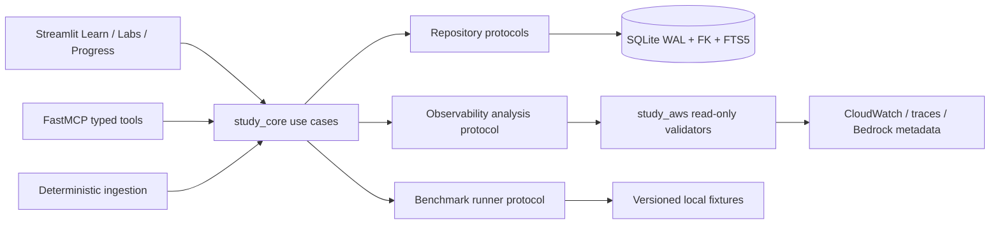
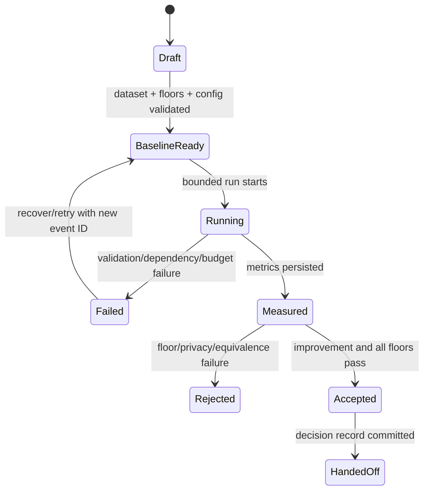

# Phase 6 — Domain 4 Operations, Performance, and Cost Design

## Overview

Phase 6 extends the local-first study platform with repeatable operational benchmarks, privacy-safe observability, evidence-first diagnosis, and Labs 9–10. Domain rules live in `study_core`; Streamlit and FastMCP remain thin adapters; AWS inspection remains allowlisted and read-only. SQLite remains authoritative.

## Goals

- Complete source-grounded mastery of `AIP-4.1`–`AIP-4.3`.
- Make quality-latency-cost decisions reproducible and floor-gated.
- Teach diagnosis from measurements before remediation.
- Produce the exact Lab 9 and Lab 10 proof required by the roadmap.
- Hand reliable operational evidence to Phase 7 evaluation and troubleshooting.

## Non-goals

- Production monitoring, resource provisioning, destructive cleanup automation, or billing reconciliation.
- New hosted infrastructure, vector database, frontend framework, separate API, or queue.
- Optimization by weakening safety, quality, privacy, or authorization controls.

## Upstream and downstream contracts

| Direction | Contract |
|---|---|
| Upstream Phase 0 | Objective/source manifests, learner constraints, Region/budget/safety policy |
| Upstream Phase 1 | SQLite repositories, migrations, attempts/reviews/sessions, source search, typed MCP errors |
| Upstream Phase 2 | Lab UI, evidence states, durable resume, hint ladder, accessibility |
| Upstream Phases 3–5 | Model/RAG baselines, API/agent traces, safety/privacy/governance controls |
| Downstream Phase 7 | Versioned datasets, benchmark runs, traces, incidents, diagnoses, quality/safety floors |
| Downstream Phase 8 | Reviewed questions, fresh-accuracy evidence, lab/cleanup status, misconception evidence |
| Optional Phase 9 | Retrieval and observability baseline measurements used only for admission decisions |

Missing upstream artifacts are blocking preconditions, not silently synthesized substitutes.

## Architecture





## Components and interfaces

### Core models

- `BenchmarkDefinition`: stable ID, workload/dataset versions, scenario segments, warm-up/sample policy, Region, pricing date, cost assumptions, target metric, numeric quality/safety floors, budget ceiling, and privacy constraints.
- `BenchmarkRun`: immutable configuration snapshot; p50/p95 latency, throughput, tokens, error/throttle counts, measured/estimated cost, quality/safety results, equivalence result, and status.
- `OptimizationCandidate`: lever type (`token`, `model_route`, `cache`, `streaming`, `concurrency`, `capacity`, `retrieval`), hypothesis, expected impact, rollback criterion, and candidate configuration.
- `TelemetryEvidence`: time window, correlation ID, signal class, redacted observation, source reference, retention class, and integrity hash.
- `Diagnosis`: symptom, affected SLO, hypotheses, discriminating evidence, bottleneck class, confidence, remediation, and limitations.
- `LabProof`: lab/checkpoint IDs, explicit evidence state, validator method, evidence references, hint usage, cleanup proof, and delayed recall.

All boundary inputs use Pydantic v2; core value objects may be frozen dataclasses/enums. UTC ISO 8601 timestamps and stable string IDs are mandatory.

### Use-case interfaces

```python
class BenchmarkService(Protocol):
    def create_baseline(self, definition: BenchmarkDefinition) -> BenchmarkRun: ...
    def record_candidate(self, event_id: str, result: CandidateResult) -> BenchmarkRun: ...
    def compare(self, baseline_id: str, candidate_id: str) -> OptimizationDecision: ...

class DiagnosisService(Protocol):
    def assemble_evidence(self, incident_id: str, window: TimeWindow) -> EvidenceBundle: ...
    def record_diagnosis(self, event_id: str, diagnosis: Diagnosis) -> DiagnosisResult: ...

class OperationsProgressService(Protocol):
    def get_phase6_gate(self, learner_id: str) -> PhaseGateResult: ...
```

Adapters SHALL not contain benchmark acceptance, floor evaluation, grading, or gate rules. Existing narrow MCP operations should be extended only with typed use-case operations justified by implementation; no raw telemetry, SQL, AWS, or shell escape hatch is permitted.

## Data Models

Forward-only migrations add normalized tables equivalent to:

- `benchmark_definitions`, `benchmark_runs`, `benchmark_metrics`, `optimization_decisions`
- `telemetry_evidence`, `incidents`, `diagnoses`, `diagnosis_evidence`
- `lab_proofs` and links to existing lab runs/checkpoints
- question/content objective and source links through existing contracts

Foreign keys are enabled for every connection; WAL mode remains enabled. Definition/config snapshots are immutable after a run starts. Event-like writes use unique event IDs. AWS/model calls occur before or after, never inside, a SQLite write transaction. Evidence records store redacted summaries and references rather than private payloads.

## Lab 9 design

Mappings: `AIP-2.5`, `AIP-4.3`, `AIP-5.2`. The learner predicts a failure signal, observes a bounded injected incident, follows alert → metric → trace → dependency evidence, records competing hypotheses, and submits a narrow diagnosis. Proof is dashboard + alert + trace-led diagnosis. Invocation logging examples default to redacted or synthetic payloads. Validators inspect only allowlisted metadata. Cleanup proof requires verified absence or a terminal deletion state for learner-created resources.

## Lab 10 design

Mappings: `AIP-1.2`, `AIP-2.2`, `AIP-2.4`, `AIP-4.1`, `AIP-4.2`. A versioned workload is baselined, then controlled candidates vary one declared lever or an explicitly modeled interaction. Comparison blocks on non-equivalent conditions, safety/quality floor failure, privacy failure, or budget breach. Proof is the before/after benchmark and decision record preserving floors.

## Error Handling

| Error | Behavior |
|---|---|
| Validation | Reject malformed IDs/config/floors before execution; no state change |
| Conflict/idempotency | Return the committed result for same event/payload; reject mismatched replay |
| Unavailable dependency | Preserve draft/run state and provide retryable recovery |
| Authorization/Region | Block AWS check; do not downgrade to self-reported verification |
| Budget/floor/privacy | Stop or reject candidate; retain evidence without acceptance |
| Persistence/internal | Roll back transaction; never report success |
| Insufficient evidence | Record `uncertain`; request next discriminating measurement |

## Security, privacy, and cost

- Standard AWS credential chain only; no credential persistence.
- Explicit service/action/Region allowlists; read-only inspection only.
- Correlation IDs and redacted aggregates replace raw prompts and private content.
- Cache experiments partition by learner/tenant and document TTL/invalidation.
- Bounded sample sizes, concurrency, timeouts, retries, and cost ceilings prevent runaway spend.
- Logs exclude credentials, signatures, tokens, PII, full prompts, answer keys, and sensitive retrievals.
- Status requires text/icon as well as color and follows Phase 2 accessibility contracts.

## Correctness Properties

### Property 1: Optimization acceptance

**Validates: Requirements 2.1, 5.1**

An optimization is accepted if and only if benchmark conditions are equivalent, the declared target improves, and every quality, safety, privacy, and budget floor passes.

### Property 2: Evidence-first diagnosis

**Validates: Requirements 3.1**

A diagnosis cannot be final without evidence for the affected time window and an identified bottleneck; insufficient evidence remains uncertain.

### Property 3: Evidence-authorized state

**Validates: Requirements 4.1, 6.1, 7.1**

`Verified` and `Cleaned up` states are reachable only from committed validator evidence and verified absence/terminal deletion evidence respectively.

### Property 4: Idempotent mutation

**Validates: Requirements 6.1**

Replaying an identical event is idempotent; replaying its ID with different content is a conflict.

## Testing Strategy

1. Schema/model tests reject malformed floors, objective IDs, transitions, and sensitive evidence fields.
2. Repository tests verify foreign keys, WAL, UTC timestamps, idempotency, rollback, and restart durability.
3. Deterministic metric tests validate p50/p95, token/cost calculations, equivalence, and floor-gating.
4. Privacy tests seed canary secrets/PII and assert their absence from logs, traces, UI DTOs, and exports.
5. Adapter tests verify AWS allowlists and typed error translation.
6. Lab acceptance walkthroughs prove all shared lab sections, exact mappings, evidence states, failure injection, and cleanup semantics.
7. Content/question audits validate source metadata, independent review, and answer-key isolation.
8. Exit-gate test uses a fresh reviewed set and requires ≥80% after delayed review.
9. Implementation validation runs targeted pytest for changed behavior, `uv run ruff check .`, `uv run ruff format --check .`, and `uv run mypy study_core study_mcp study_aws app`.

## Requirement traceability

| Requirement | Design elements | Primary validation |
|---|---|---|
| P6-R1 | ingestion/source links, content/question contracts | metadata and leakage audits |
| P6-R2 | BenchmarkDefinition/Run, floor comparator | deterministic metric/floor tests |
| P6-R3 | DiagnosisService, incident evidence model | hidden diagnosis scenarios |
| P6-R4 | Lab 9, TelemetryEvidence, read-only AWS adapter | privacy and lab walkthrough |
| P6-R5 | Lab 10, candidate levers, equivalence gate | controlled benchmark tests |
| P6-R6 | repositories, LabProof, progress gate | restart/idempotency/state tests |
| P6-R7 | allowlists, budgets, redaction | adapter/security tests |
| P6-R8 | OperationsProgressService, handoff record | full exit-gate acceptance |

## Risks and decisions

- **Noisy local/AWS measurements:** use warm-up, sample policy, distributions, and equivalence labels; never overstate precision.
- **Telemetry leakage:** prefer synthetic fixtures and aggregate/redacted evidence; fail privacy scans closed.
- **Cost drift:** record pricing date and assumptions; distinguish estimates from bills.
- **Optimization overfitting:** use segmented and fresh evaluation sets plus explicit floors.
- **False root cause confidence:** preserve competing hypotheses and an `uncertain` result.
- **Decision:** SQLite remains the source of truth; no observability backend is introduced for study evidence.
- **Decision:** Phase 7 consumes immutable evidence references rather than raw sensitive telemetry.
