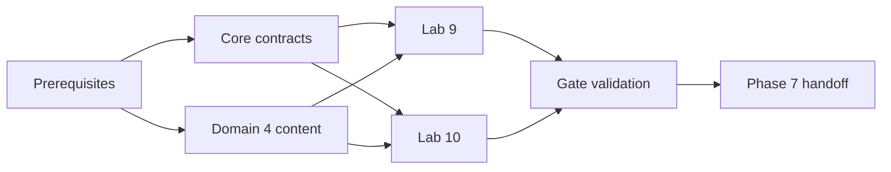

# Implementation Plan

## Overview

Implement Phase 6 through dependency-gated core, content, lab, validation, and handoff work. Leaf tasks name outcomes, requirements, and dependencies; parallel execution is limited to independent targets.

## Prerequisites

- [ ] 0. Confirm predecessor contracts and Phase 6 vocabulary
  - [ ] 0.1 Confirm Phase 0–5 predecessor contracts and record blockers
    - Outcome: A signed-off dependency matrix identifies available objective/source manifests, study repositories, UI/lab state, Labs 1–8 artifacts, safety controls, AWS profile/Region allowlist, and budget policy; absent items block only dependent work.
    - Requirements: P6-R1, P6-R2, P6-R4, P6-R5, P6-R7
    - Depends on: None
  - [ ] 0.2 Freeze Phase 6 metric and evidence vocabulary
    - Outcome: Versioned definitions exist for quality, safety, latency, throughput, cost, equivalence, evidence states, bottleneck classes, and fresh-question eligibility.
    - Requirements: P6-R2, P6-R3, P6-R6, P6-R8
    - Depends on: 0.1

## Task Dependency Graph



```json
{
  "waves": [
    {"wave": 1, "tasks": ["1", "2"]},
    {"wave": 2, "tasks": ["3", "4"]},
    {"wave": 3, "tasks": ["5"]}
  ]
}
```

## Tasks

- [ ] 1. Persistence and core contracts
  - [ ] 1.1 Add forward-only benchmark and diagnosis migrations
    - Outcome: SQLite tables, constraints, indexes, event-ID uniqueness, foreign keys, UTC fields, and evidence links support benchmark definitions/runs, metrics, incidents, diagnoses, decisions, and lab proof without changing prior migrations.
    - Requirements: P6-R2, P6-R3, P6-R6
    - Depends on: 0.2
  - [ ] 1.2 Implement typed benchmark models and repositories
    - Outcome: Core models and protocols persist immutable configuration snapshots and metric results transactionally with restart-safe idempotency.
    - Requirements: P6-R2, P6-R6
    - Depends on: 1.1
  - [ ] 1.3 Implement floor-gated comparison and cost calculation
    - Outcome: Deterministic comparison labels measured versus estimated cost, rejects non-equivalent runs and any quality/safety/privacy/budget failure, and emits a reviewable decision record.
    - Requirements: P6-R2, P6-R5
    - Depends on: 1.2
  - [ ] 1.4 Implement incident evidence and diagnosis services
    - Outcome: Evidence bundles preserve hypotheses, bottleneck class, confidence, next discriminating measurement, remediation, rollback, and uncertainty without raw sensitive telemetry.
    - Requirements: P6-R3, P6-R4
    - Depends on: 1.1
  - [ ] 1.5 Test persistence and pure domain rules
    - Outcome: Targeted tests cover FK/WAL setup, rollback, event replay, restart durability, metric calculations, floor gates, equivalence, invalid transitions, and uncertain diagnosis.
    - Requirements: P6-R2, P6-R3, P6-R6
    - Depends on: 1.2, 1.3, 1.4

- [ ] 2. Domain 4 content and assessment (safe parallel track after 0.1)
  - [ ] 2.1 Author and ingest source-grounded AIP-4.1 material
    - Outcome: Reviewed concept, decision, failure, verification, scenario, troubleshooting, and hands-on records cover token/model/cache/capacity cost optimization with complete source metadata.
    - Requirements: P6-R1, P6-R5
    - Depends on: 0.1
  - [ ] 2.2 Author and ingest source-grounded AIP-4.2 material
    - Outcome: Reviewed records cover streaming, latency/throughput trade-offs, concurrency, profiling, retrieval optimization, and bottleneck remediation.
    - Requirements: P6-R1, P6-R3, P6-R5
    - Depends on: 0.1
  - [ ] 2.3 Author and ingest source-grounded AIP-4.3 material
    - Outcome: Reviewed records cover operational/model/retrieval/tool/quality/safety/cost monitoring, privacy, traces, freshness, and incident diagnosis.
    - Requirements: P6-R1, P6-R4
    - Depends on: 0.1
  - [ ] 2.4 Build and independently review the fresh Domain 4 question pool
    - Outcome: Scorable questions meet source, format, scenario, option-rationale, review, freshness, and answer-key-separation contracts for all three tasks.
    - Requirements: P6-R1, P6-R8
    - Depends on: 2.1, 2.2, 2.3

- [ ] 3. Lab 9 — Observability and incident response
  - [ ] 3.1 Author the complete Lab 9 definition
    - Outcome: Lab metadata contains mappings `AIP-2.5`, `AIP-4.3`, `AIP-5.2`, prerequisites, architecture, cost/Region assumptions, predictions, hints, validation, injected incident, reflection, cleanup, and delayed recall.
    - Requirements: P6-R4, P6-R7
    - Depends on: 0.1, 2.3
  - [ ] 3.2 Implement privacy-safe telemetry fixtures and AWS validators
    - Outcome: Synthetic/redacted signals and explicit read-only service/action validators support dashboard, alert, and trace exercises with typed validation/authorization/unavailable failures.
    - Requirements: P6-R4, P6-R7
    - Depends on: 1.4, 3.1
  - [ ] 3.3 Integrate Lab 9 with Labs and Progress views
    - Outcome: Refresh-safe UI supports prediction, hints, check, trace-led diagnosis, evidence links, and explicit self-reported/verified/failed/cleanup states without browser-visible sensitive data.
    - Requirements: P6-R4, P6-R6
    - Depends on: 3.2
  - [ ] 3.4 Validate Lab 9 proof and failure paths
    - Outcome: An acceptance run produces dashboard, alert, trace-led diagnosis, delayed recall, privacy scan, validator evidence, and verified cleanup where applicable.
    - Requirements: P6-R3, P6-R4, P6-R7
    - Depends on: 3.3

- [ ] 4. Lab 10 — Cost and performance optimization
  - [ ] 4.1 Author the complete Lab 10 definition
    - Outcome: Lab metadata contains mappings `AIP-1.2`, `AIP-2.2`, `AIP-2.4`, `AIP-4.1`, `AIP-4.2` and all common lab sections and proof requirements.
    - Requirements: P6-R5, P6-R7
    - Depends on: 0.1, 2.1, 2.2
  - [ ] 4.2 Implement bounded benchmark workloads and token/model/cache experiments
    - Outcome: Versioned workloads compare pruning/response control, model routing/fallback, and tenant-safe cache keys, TTL, invalidation, and stale behavior under cost ceilings.
    - Requirements: P6-R2, P6-R5, P6-R7
    - Depends on: 1.3, 4.1
  - [ ] 4.3 Implement streaming/concurrency/throughput and retrieval experiments
    - Outcome: Bounded experiments capture saturation, throttling/retry, token throughput, p50/p95, streaming perception, index/query/rerank effects, and rollback evidence.
    - Requirements: P6-R2, P6-R3, P6-R5
    - Depends on: 1.3, 4.1
  - [ ] 4.4 Integrate Lab 10 decision workflow and evidence
    - Outcome: The UI records hypothesis before change, equivalent before/after results, floor decisions, limitations, hint usage, and cleanup proof.
    - Requirements: P6-R2, P6-R5, P6-R6
    - Depends on: 4.2, 4.3
  - [ ] 4.5 Validate Lab 10 proof and rejection paths
    - Outcome: Acceptance runs prove passing optimization, floor regression rejection, privacy/cache rejection, non-equivalence rejection, budget stop, and before/after decision record.
    - Requirements: P6-R2, P6-R5, P6-R7
    - Depends on: 4.4

- [ ] 5. Progress, validation, and handoff
  - [ ] 5.1 Implement Phase 6 progress and exit-gate evaluation
    - Outcome: Progress exposes per-task accuracy/recall/confidence, lab proof, floor status, diagnosis evidence, cleanup, source freshness, and blockers; gate logic requires every P6-R8 criterion.
    - Requirements: P6-R6, P6-R8
    - Depends on: 1.5, 2.4, 3.4, 4.5
  - [ ] 5.2 Run content, privacy, safety, and evidence audits
    - Outcome: Automated/manual audits find no answer leakage, unreviewed scored item, stale unsupported source, sensitive telemetry, false verification, unbounded spend path, or unverified cleanup claim.
    - Requirements: P6-R1, P6-R4, P6-R6, P6-R7
    - Depends on: 5.1
  - [ ] 5.3 Run implementation validation
    - Outcome: Targeted behavioral tests pass, followed by `uv run ruff check .`, `uv run ruff format --check .`, and `uv run mypy study_core study_mcp study_aws app`; failures are resolved and evidence is retained.
    - Requirements: P6-R1, P6-R2, P6-R3, P6-R4, P6-R5, P6-R6, P6-R7
    - Depends on: 5.2
  - [ ] 5.4 Execute the exact Phase 6 exit gate
    - Outcome: Labs 9–10 proof is accepted; no accepted optimization breaches a floor; the learner independently diagnoses an evidence-backed bottleneck; fresh delayed Domain 4 accuracy is at least 80%; otherwise remediation is emitted and the phase remains incomplete.
    - Requirements: P6-R8
    - Depends on: 5.3
  - [ ] 5.5 Hand off Phase 6 evidence to Phase 7
    - Outcome: A versioned handoff records coverage, source freshness, immutable dataset/baseline/trace/diagnosis references, lab and cleanup proof, validation results, and unresolved low-priority risks without sensitive payloads.
    - Requirements: P6-R8
    - Depends on: 5.4

## Notes

- Tasks 2.1–2.3 may run in parallel after 0.1.
- Lab authoring tasks 3.1 and 4.1 may run in parallel with persistence work once their source dependencies are available.
- Implementations 3.2 and 4.2/4.3 touch separate adapters/fixtures and may run in parallel after core contracts stabilize.
- No tasks that modify the same migration, evidence-state machine, or phase-gate evaluator should run concurrently.
