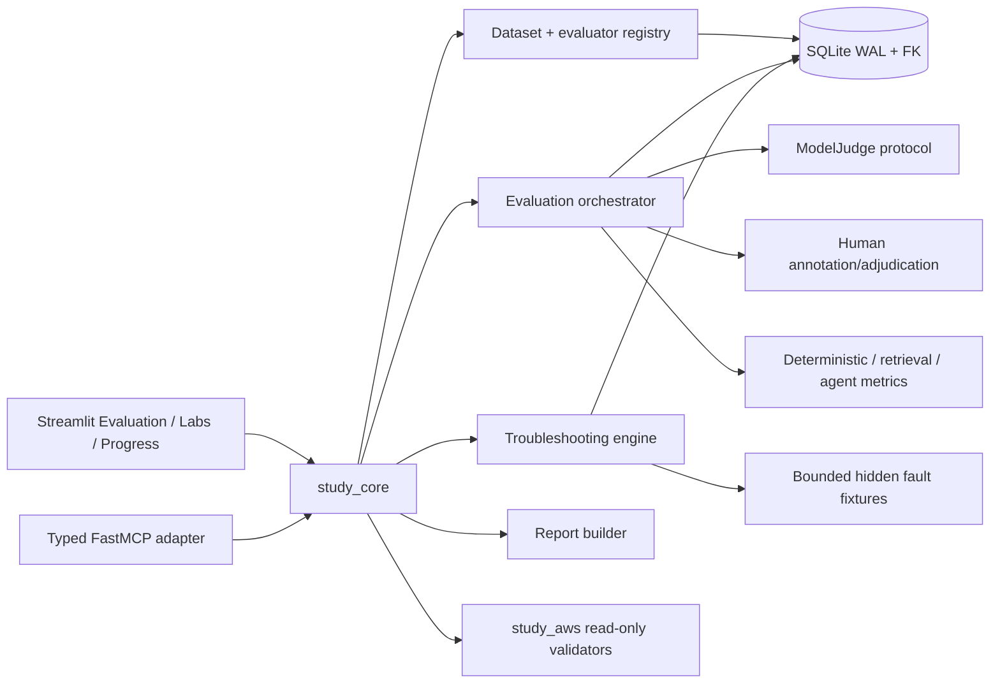
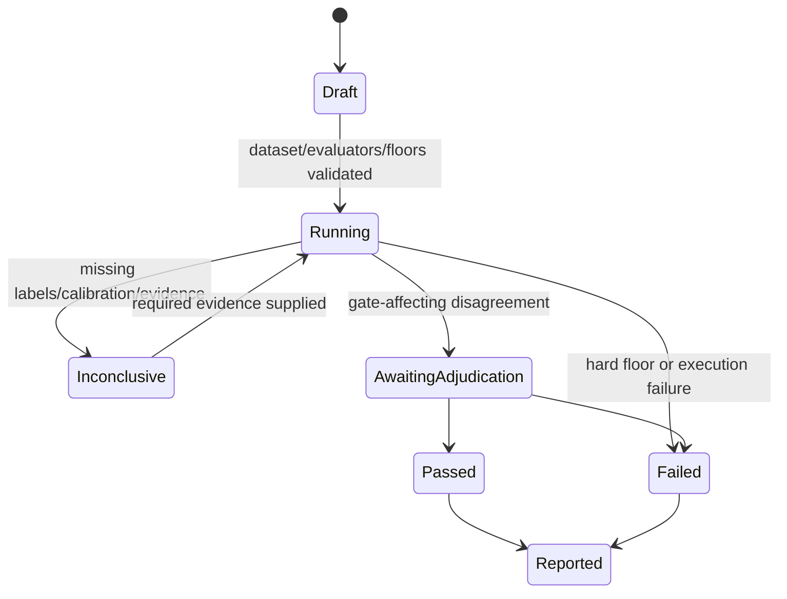

# Phase 7 — Domain 5 Evaluation and Troubleshooting Design

## Overview

Phase 7 adds a local evaluation registry, deterministic and human/model evaluation, calibrated judging, subsystem metrics, release-gate decisions, and a hidden multi-fault challenge. It consumes Phase 6 baselines and traces and produces auditable, non-sensitive readiness evidence for Phase 8. Business rules stay in `study_core`; SQLite is authoritative; UI/MCP/AWS layers remain adapters.

## Goals

- Complete `AIP-5.1` and `AIP-5.2` content, questions, and delayed mastery.
- Combine deterministic checks, calibrated model judging, human review, retrieval metrics, and agent metrics.
- Make regression and release decisions reproducible, floor-gated, and explainable.
- Teach complete, evidence-based isolation of hidden faults in Lab 12.
- Produce stakeholder reports with limitations and immutable evidence links.

## Non-goals

- Automatic production release or AWS resource mutation.
- Treating model judges, synthetic data, or aggregate scores as unquestionable truth.
- Persisting hidden model reasoning, private content, hidden fault manifests, or answer keys in learner-visible state.

## Contracts

| Direction | Contract |
|---|---|
| Upstream 0–2 | Blueprint/source registry, durable study state, evidence-state UI, answer separation |
| Upstream 3–5 | Prompt/RAG/agent/API/safety/governance artifacts and reviewed scenarios |
| Upstream 6 | Versioned baselines, floors, telemetry, traces, incidents, diagnoses, Lab 9/10 proof |
| Downstream 8 | Fresh pools, domain accuracy, misconceptions, lab completion/cleanup, evaluation limitations |
| Optional 9 | Baseline retrieval quality and question-authoring review data for admission decisions |

## Architecture





## Components and interfaces

### Models

- `EvaluationDatasetVersion`: stable ID/version, provenance/license, objective and segment labels, split, expected evidence, review status, exclusions, integrity hash.
- `EvaluatorVersion`: type, dimension, implementation/config/prompt/model version, threshold, known limitations, and data-sharing classification.
- `EvaluationRun`: baseline/candidate snapshots, dataset/evaluator versions, examples, metric outputs, hard floors, tolerances, cost bounds, state.
- `JudgeCalibration`: blinded human set, agreement statistic(s), disagreement taxonomy, segment/bias results, threshold and accepted/rejected status.
- `HumanAnnotation` and `Adjudication`: blinded labels, annotator role, rubric version, disagreements, final decision, rationale.
- `RetrievalMetrics`: relevance/recall@k/ranking/citation/filter/freshness/latency with sufficiency state.
- `AgentMetrics`: task/tool/argument/error/stop/escalation/safety/latency/cost measurements.
- `ReleaseDecision`: `pass`, `fail`, or `inconclusive`, hard-floor results, regression deltas, approver, limitations, rollback recommendation.
- `FaultScenario` and `FaultAttempt`: hidden manifest reference, learner-visible symptoms, evidence, hypotheses, diagnosis, remediation, regression and rollback.

### Core interfaces

```python
class EvaluationService(Protocol):
    def start_run(self, request: EvaluationRequest) -> EvaluationRun: ...
    def record_result(self, event_id: str, result: ExampleResult) -> EvaluationRun: ...
    def decide_release(self, run_id: str) -> ReleaseDecision: ...

class CalibrationService(Protocol):
    def calibrate(self, request: CalibrationRequest) -> JudgeCalibration: ...
    def adjudicate(self, event_id: str, request: AdjudicationRequest) -> Adjudication: ...

class TroubleshootingService(Protocol):
    def start_challenge(self, learner_id: str, scenario_id: str) -> ChallengeView: ...
    def record_hypothesis(self, event_id: str, attempt: DiagnosticAttempt) -> AttemptResult: ...
    def evaluate_completion(self, run_id: str) -> ChallengeResult: ...
```

`ChallengeView` cannot contain the fault manifest or rubric. Model judge adapters receive only explicitly approved, minimized evaluation content. Hidden reasoning is neither requested as an application contract nor stored.

## Data Models

Forward migrations add dataset/evaluator versions, examples/splits, runs/results, calibrations, annotations, adjudications, release decisions, fault scenarios/manifests, diagnostic attempts, and evidence links. Sensitive fixture payloads and hidden keys are separated from learner-facing records. Unique event IDs implement idempotency. Transactions are short; model/AWS calls never occur inside them.

Release transition rules:

- `pass` requires comparable data, all hard floors passing, accepted calibration for every gating judge, and resolved gate-affecting disagreements.
- `fail` results from any hard floor failure or accepted regression beyond tolerance.
- `inconclusive` results from insufficient samples/labels, failed calibration, unresolved disagreement, or non-equivalence.

## Lab 11 design

Exact mappings: `AIP-1.6`, `AIP-3.4`, `AIP-5.1`. The learner builds a reviewed golden set, declares metrics/floors, runs deterministic checks, calibrates a judge against blinded human labels, measures retrieval/agent behavior where applicable, injects a regression, and emits a deployment decision. Proof: golden set, metrics, judge calibration, deployment decision. A human-only gate is valid when judge calibration fails, but the failure and cost are reported.

## Lab 12 design

Exact mappings: `AIP-4.3`, `AIP-5.2`. A deterministic seed selects a reviewed hidden fault bundle spanning prompt, context, retrieval, IAM/API, schema, quota/timeout, and latency categories without exposing the manifest. Every fault requires reproduce → observe → hypothesize → discriminate → isolate → minimally remediate → regress. Completion compares structured evidence to a server-side/core rubric; false positives and broad changes remain unresolved. Proof: evidence-based root causes and minimal remediations.

## Error Handling

| Class | Handling |
|---|---|
| Validation | Reject malformed datasets, thresholds, IDs, unsafe fixtures; no partial success |
| Conflict | Idempotent identical replay; mismatched event replay rejected |
| Unavailable | Preserve run state; mark affected result incomplete/retryable |
| Authorization | Block AWS evidence; never substitute `Verified` |
| Calibration/adjudication | Produce `inconclusive` until resolved |
| Budget | Stop paid evaluations; retain partial evidence as incomplete |
| Persistence/internal | Roll back; never claim recorded/pass |
| Diagnostic uncertainty | Request next discriminating evidence; no asserted root cause |

## Security, privacy, and cost

- SQLite and browser DTO separation protects keys, rubrics, holdouts, and fault manifests.
- Redaction excludes credentials, PII, signatures, private prompts/retrievals, and judge reasoning.
- External model judging is opt-in per data classification and cannot receive private project/AWS/learner data without explicit direction.
- Evaluation runs have sample, retry, timeout, and cost ceilings.
- AWS adapters use standard credentials, explicit Region, and read-only allowlists.
- Lab cleanup follows verified absence/terminal-state semantics.

## Correctness Properties

### Property 1: Release-gate precedence

**Validates: Requirements 3.1, 4.1, 5.1**

A release can pass only when data are comparable, every hard floor passes, every gating judge is calibrated, and gate-affecting disagreements are resolved.

### Property 2: Inconclusive evidence

**Validates: Requirements 2.1, 3.1**

A failing calibration or insufficient sample produces `inconclusive`, never an inferred pass.

### Property 3: Complete fault isolation

**Validates: Requirements 6.1, 9.1**

Lab 12 completes if and only if every seeded fault has supported root cause and minimal regression-tested remediation with no unresolved false positive.

### Property 4: Hidden-data separation

**Validates: Requirements 1.1, 2.1, 6.1, 7.1**

Learner-visible challenge and question DTOs never contain holdout answers, rubrics, or hidden fault manifests.

## Testing Strategy

1. Model/schema tests for dataset splits, objective IDs, evaluator versions, hard floors, and hidden DTO separation.
2. Repository tests for FK/WAL, UTC, immutability, restart durability, transactions, and replay conflict.
3. Metric fixtures with known deterministic/retrieval/agent outputs and insufficient-sample behavior.
4. Calibration tests for agreement threshold, segment divergence, disagreement/adjudication, and judge exclusion.
5. Release decision truth-table tests for pass/fail/inconclusive and every hard floor.
6. Lab 11 regression exercise and Lab 12 seeded fault completeness/false-positive tests.
7. Privacy canaries assert no secret, key, fault manifest, private text, or hidden reasoning appears in logs/UI/exports.
8. Source/question audit and fresh Domain 5 assessment require ≥80% after delayed review.
9. Run targeted pytest, Ruff check/format check, and mypy over approved packages.

## Requirement traceability

| Requirement | Design elements | Validation |
|---|---|---|
| P7-R1 | source ingestion and question DTO contracts | source/review/leakage audit |
| P7-R2 | dataset registry, split and version models | split/version/privacy tests |
| P7-R3 | calibration, annotations, adjudication | agreement/segment/disagreement tests |
| P7-R4 | retrieval/agent metric models | known-fixture and hard-floor tests |
| P7-R5 | EvaluationService, ReleaseDecision, Lab 11 | release truth table and walkthrough |
| P7-R6 | TroubleshootingService, hidden manifests, Lab 12 | seeded multi-fault acceptance |
| P7-R7 | repositories, adapters, cost bounds | transaction/security/budget tests |
| P7-R8 | Report builder | snapshot and sensitive-field tests |
| P7-R9 | phase gate/handoff | full acceptance and fresh assessment |

## Risks and decisions

- **Judge bias/noise:** blinded human calibration, segment checks, adjudication, and `inconclusive` fallback.
- **Holdout leakage:** structural DTO/table separation and exposure tests.
- **Metric gaming:** multi-method gates and subsystem metrics, not a single aggregate.
- **Fault ambiguity:** deterministic fixtures with discriminating evidence and reviewed rubrics.
- **Evaluation cost:** bounded sets, local deterministic checks first, explicit paid-run budgets.
- **Decision:** model judging is optional per dimension and never sufficient for safety/privacy hard gates by itself.
- **Decision:** hidden faults and keys remain core-side; UI and MCP receive only safe views.
