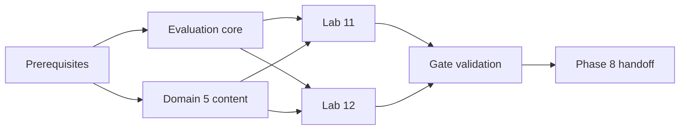

# Implementation Plan

## Overview

Implement Phase 7 through dependency-gated evaluation, content, lab, validation, and handoff work. Leaf tasks name outcomes, requirements, and dependencies; parallel execution is limited to independent targets.

## Prerequisites

- [ ] 0. Confirm predecessor contracts and Phase 7 vocabulary
  - [ ] 0.1 Verify Phase 0–6 handoff contracts and blockers
    - Outcome: A dependency matrix confirms blueprint/source state, repositories, UI evidence contracts, Labs 2–10 artifacts, safety controls, Phase 6 baselines/traces/floors, profile/Region allowlist, and budget policy.
    - Requirements: P7-R1, P7-R2, P7-R5, P7-R6, P7-R7
    - Depends on: None
  - [ ] 0.2 Freeze evaluation, calibration, freshness, and fault taxonomies
    - Outcome: Versioned definitions cover dimensions, hard floors, tolerances, pass/fail/inconclusive, dataset splits, agreement thresholds, retrieval/agent metrics, and diagnostic categories.
    - Requirements: P7-R2, P7-R3, P7-R4, P7-R6
    - Depends on: 0.1

## Task Dependency Graph



```json
{
  "waves": [
    {"wave": 1, "tasks": ["1", "2"]},
    {"wave": 2, "tasks": ["3", "4"]},
    {"wave": 3, "tasks": ["5"]}
  ]
}
```

## Tasks

- [ ] 1. Evaluation data and core services
  - [ ] 1.1 Add forward-only evaluation and troubleshooting migrations
    - Outcome: Normalized SQLite structures support immutable dataset/evaluator versions, splits, runs, metrics, calibration, annotation/adjudication, decisions, hidden faults, attempts, and evidence with FKs and event-ID constraints.
    - Requirements: P7-R2, P7-R3, P7-R5, P7-R6, P7-R7
    - Depends on: 0.2
  - [ ] 1.2 Implement dataset registry and safe view contracts
    - Outcome: Reviewed provenance, version, split, license/consent, integrity, expected evidence, and exclusions persist while holdouts, keys, rubrics, and hidden manifests remain absent from learner DTOs.
    - Requirements: P7-R2, P7-R6, P7-R7
    - Depends on: 1.1
  - [ ] 1.3 Implement deterministic, retrieval, and agent metrics
    - Outcome: Pure evaluators calculate declared checks and subsystem metrics, preserve insufficiency/inconclusive states, and link results to examples and traces.
    - Requirements: P7-R2, P7-R4
    - Depends on: 1.2
  - [ ] 1.4 Implement human annotation, judge calibration, and adjudication
    - Outcome: Blinded calibration records agreement/disagreement/segment results, excludes failing judges from gates, and resolves gate-affecting disagreement without overwriting labels.
    - Requirements: P7-R3, P7-R7
    - Depends on: 1.2
  - [ ] 1.5 Implement release decision and report services
    - Outcome: Comparable baseline/candidate runs produce deterministic pass/fail/inconclusive decisions, hard-floor precedence, limitations, rollback advice, and non-sensitive stakeholder reports.
    - Requirements: P7-R5, P7-R8
    - Depends on: 1.3, 1.4
  - [ ] 1.6 Test core evaluation and persistence behavior
    - Outcome: Tests cover FK/WAL, restart/replay, split/key isolation, known metrics, insufficiency, calibration rejection, disagreement, decision truth table, budget stop, and report redaction.
    - Requirements: P7-R2, P7-R3, P7-R4, P7-R5, P7-R7, P7-R8
    - Depends on: 1.5

- [ ] 2. Domain 5 content and assessment (safe parallel track)
  - [ ] 2.1 Author and ingest source-grounded AIP-5.1 material
    - Outcome: Reviewed concept, scenario, troubleshooting, and hands-on units cover evaluation dimensions, deterministic/model/human methods, retrieval/agent evaluation, regression, gates, and limitations.
    - Requirements: P7-R1, P7-R3, P7-R4, P7-R5
    - Depends on: 0.1
  - [ ] 2.2 Author and ingest source-grounded AIP-5.2 material
    - Outcome: Reviewed units cover context, prompt, retrieval, IAM/API, schema, quota, timeout, integration, and latency diagnosis using controlled evidence.
    - Requirements: P7-R1, P7-R6
    - Depends on: 0.1
  - [ ] 2.3 Build and independently review the fresh Domain 5 pool
    - Outcome: Questions satisfy objective/source/scenario/option-rationale/review contracts, are answer-safe, and carry fresh eligibility independently of practice exposure.
    - Requirements: P7-R1, P7-R9
    - Depends on: 2.1, 2.2

- [ ] 3. Lab 11 — Evaluation and release gate
  - [ ] 3.1 Author the complete Lab 11 definition
    - Outcome: Lab includes exact mappings `AIP-1.6`, `AIP-3.4`, `AIP-5.1`, common lab sections, golden-set construction, judge calibration, regression injection, release decision, cleanup, and delayed recall.
    - Requirements: P7-R5, P7-R7
    - Depends on: 0.1, 2.1
  - [ ] 3.2 Implement golden-set and evaluator workflow
    - Outcome: The learner versions a reviewed set, declares dimensions/floors, runs deterministic and applicable retrieval/agent metrics, and records limitations.
    - Requirements: P7-R2, P7-R4, P7-R5
    - Depends on: 1.3, 3.1
  - [ ] 3.3 Implement calibrated judging and human adjudication UI
    - Outcome: Blinded labels, agreement/segment results, rejected-judge fallback, disagreements, and adjudications persist before release decisions without exposing private data or hidden reasoning.
    - Requirements: P7-R3, P7-R5, P7-R7
    - Depends on: 1.4, 3.1
  - [ ] 3.4 Integrate release gate, report, and lab evidence
    - Outcome: UI/MCP adapters call core services, display pass/fail/inconclusive with inputs and limitations, persist before success, and capture exact Lab 11 proof.
    - Requirements: P7-R5, P7-R8
    - Depends on: 1.5, 3.2, 3.3
  - [ ] 3.5 Validate Lab 11 acceptance and failure paths
    - Outcome: Acceptance covers passing, hard-floor failure, regression, judge calibration failure, disagreement, inconclusive data, budget stop, report redaction, delayed recall, and cleanup semantics.
    - Requirements: P7-R3, P7-R4, P7-R5, P7-R7, P7-R8
    - Depends on: 3.4

- [ ] 4. Lab 12 — Hidden multi-fault troubleshooting
  - [ ] 4.1 Author reviewed hidden fault bundles and complete Lab 12 shell
    - Outcome: Bounded reversible fixtures cover prompt, context, retrieval, IAM/API, schema, quota/timeout, integration, and latency categories with exact mappings `AIP-4.3`, `AIP-5.2`; manifests/rubrics are separated from the visible shell.
    - Requirements: P7-R6, P7-R7
    - Depends on: 0.2, 2.2
  - [ ] 4.2 Implement challenge selection and answer-safe DTOs
    - Outcome: Deterministic selection provides symptoms and safe evidence only; keys, manifests, rubrics, and answer-bearing traces cannot reach UI/MCP payloads.
    - Requirements: P7-R2, P7-R6, P7-R7
    - Depends on: 1.2, 4.1
  - [ ] 4.3 Implement structured diagnostic attempt workflow
    - Outcome: Every attempted fault records reproduction, hypothesis, discriminating evidence, eliminated alternatives, root cause, minimal remediation, regression, rollback, false positives, and hint use.
    - Requirements: P7-R6
    - Depends on: 4.2
  - [ ] 4.4 Implement completion grading and targeted remediation
    - Outcome: Completion requires every seeded fault and rejects unsupported broad fixes/ad hoc prompt edits; unresolved faults generate precise next evidence without leaking answers.
    - Requirements: P7-R6, P7-R9
    - Depends on: 4.3
  - [ ] 4.5 Validate Lab 12 completeness, safety, and proof
    - Outcome: Seeded acceptance runs demonstrate all faults are diagnosable, false positives rejected, fixtures reversible/read-only, proof complete, delayed recall captured, and cleanup status truthful.
    - Requirements: P7-R6, P7-R7
    - Depends on: 4.4

- [ ] 5. Progress, validation, and handoff
  - [ ] 5.1 Implement Phase 7 progress and exit-gate evaluation
    - Outcome: Progress shows task accuracy/recall/confidence, method coverage, calibration status, lab evidence, cleanup, source freshness, and exact P7-R9 blockers.
    - Requirements: P7-R8, P7-R9
    - Depends on: 1.6, 2.3, 3.5, 4.5
  - [ ] 5.2 Run source, answer-leakage, privacy, cost, and evidence audits
    - Outcome: Audits reject stale/unreviewed scoring, exposed holdouts/keys/faults, private telemetry, uncalibrated gating judges, unbounded paid runs, false verification, and unsupported reports.
    - Requirements: P7-R1, P7-R2, P7-R3, P7-R7, P7-R8
    - Depends on: 5.1
  - [ ] 5.3 Run implementation validation
    - Outcome: Targeted tests pass followed by `uv run ruff check .`, `uv run ruff format --check .`, and `uv run mypy study_core study_mcp study_aws app`; all failures are resolved.
    - Requirements: P7-R1, P7-R2, P7-R3, P7-R4, P7-R5, P7-R6, P7-R7, P7-R8
    - Depends on: 5.2
  - [ ] 5.4 Execute the exact Phase 7 exit gate
    - Outcome: Both tasks have accepted coverage; Lab 11 proof is complete; every Lab 12 fault is isolated with minimal remediation; controlled evidence use is demonstrated; fresh delayed Domain 5 accuracy is at least 80%; otherwise phase remains incomplete.
    - Requirements: P7-R9
    - Depends on: 5.3
  - [ ] 5.5 Hand off Phase 7 evidence to Phase 8
    - Outcome: A versioned answer-safe handoff contains coverage, fresh pool eligibility, evaluation/report evidence, Labs 11–12 and cleanup proof, validation, source freshness, and unresolved low-priority risk.
    - Requirements: P7-R9
    - Depends on: 5.4

## Notes

- Tasks 2.1 and 2.2 can run in parallel after 0.1.
- Lab shells 3.1 and 4.1 can run in parallel with core migrations once taxonomy is frozen.
- Metric implementation 1.3 and calibration implementation 1.4 can run in parallel after 1.2.
- Lab 11 and Lab 12 implementation tracks may proceed in parallel after their respective core dependencies; they must not concurrently edit shared phase-gate or evidence-state code.
