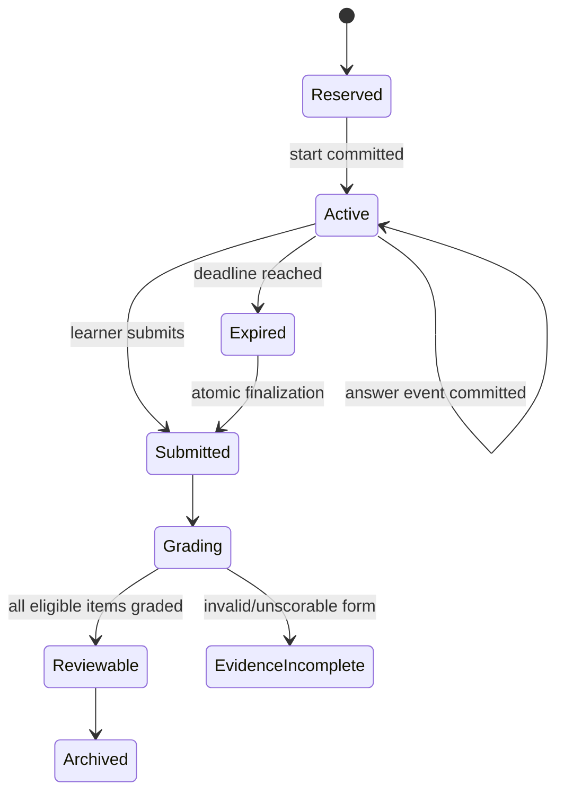

# Phase 8 — Exam Simulation and Readiness Closure Design

## Overview

Phase 8 adds immutable blueprint-weighted mock forms, durable timed sessions, delayed grading, `/aip-mock`, weakness-directed remediation, and a transparent readiness gate. It consumes accepted Phase 0–7 evidence across all 20 tasks and Labs 1–12. The result is an internal study estimate, never an AWS score prediction.

## Goals

- Assemble auditable 75-question MCQ/MR forms at the published 31/26/20/12/11 weights.
- Protect answers, objectives, and reserved freshness until submission.
- Require two fresh forms at ≥85% overall and ≥80% per domain.
- Close high-priority misconceptions and all lab/cleanup evidence.
- Include the official practice result and residual-risk review.

## Non-goals

- Predicting AWS scoring or guaranteeing certification.
- Scheduling, purchasing, scraping, or reproducing official exam content.
- Adding hosted infrastructure or changing the local-first architecture.

## Upstream/downstream contracts

| Direction | Contract |
|---|---|
| Upstream 0–2 | blueprint/source lock, learner profile, study/question/session repositories, Mock UI |
| Upstream 3–7 | accepted coverage for all 20 tasks, Labs 1–12 proof, domain mastery, source freshness |
| Downstream closure | immutable readiness record, blockers, limitations, learner acknowledgment |
| Downstream Phase 9 | measured optional-enhancement needs only; Phase 9 never gates Phase 8 |

## Architecture

```mermaid
flowchart LR
  UI[Streamlit Mock / Review / Progress] --> Core[study_core]
  Skill[/aip-mock thin adapter] --> MCP[FastMCP typed adapter]
  MCP --> Core
  Core --> Blueprint[Blueprint allocator]
  Core --> Form[Fresh form assembler]
  Core --> Session[Timed session service]
  Core --> Grade[Grading + review transaction]
  Core --> Ready[Readiness gate]
  Core --> Repo[Repository protocols]
  Repo --> DB[(SQLite WAL + FK)]
  Form --> Bank[Reviewed answer-separated bank]
  Ready --> Labs[Lab/cleanup evidence]
  Ready --> Official[Self-reported official result]
```



## Blueprint and task coverage

The locked task set is:

- Domain 1 (31%): `AIP-1.1`–`AIP-1.6`
- Domain 2 (26%): `AIP-2.1`–`AIP-2.5`
- Domain 3 (20%): `AIP-3.1`–`AIP-3.4`
- Domain 4 (12%): `AIP-4.1`–`AIP-4.3`
- Domain 5 (11%): `AIP-5.1`–`AIP-5.2`

For 75 integer slots, largest-remainder apportionment yields 23/20/15/9/8. The allocator first assigns floors of 23/19/15/9/8 and gives the remaining seat to Domain 2, whose fractional remainder is largest. Every task must have eligible pool capacity; constrained stratified selection balances tasks and difficulty without changing domain totals.

## Components and interfaces

### Models

- `BlueprintVersion`: exam code, effective/retrieved dates, domain weights, exact task IDs, source references, status.
- `MockForm`: immutable form ID/version, blueprint, 75 answer-safe question-version references, domain allocation, selection seed hash, freshness proof, review status.
- `MockSession`: learner/form IDs, UTC start/deadline/submission, configured duration, state, order, and idempotency metadata.
- `MockAnswer`: question version, selected option IDs, confidence, elapsed time, UTC event, revision number.
- `MockResult`: scorable counts, overall/domain/task results, confidence calibration, timing/unanswered metrics, grading version.
- `FreshnessRecord`: learner/item/equivalence-family exposure classes and first exposure timestamp.
- `Misconception`: severity/rule version, evidence, due review, closure criterion/status.
- `ReadinessSnapshot`: all gate inputs, blockers, internal-estimate label, source/blueprint freshness, limitations.
- `OfficialPracticeResult`: learner-reported date/result/domain metadata and provenance classification.

### Interfaces

```python
class MockFormService(Protocol):
    def check_capacity(self, blueprint_id: str) -> CapacityReport: ...
    def reserve_form(self, learner_id: str, request: FormRequest) -> MockForm: ...

class MockSessionService(Protocol):
    def start(self, event_id: str, form_id: str) -> MockQuestionView: ...
    def record_answer(self, event_id: str, answer: AnswerInput) -> SessionView: ...
    def submit(self, event_id: str, session_id: str) -> SubmissionReceipt: ...
    def resume(self, session_id: str) -> SessionView: ...

class MockGradingService(Protocol):
    def grade_submitted(self, event_id: str, session_id: str) -> MockResult: ...

class ReadinessService(Protocol):
    def evaluate(self, learner_id: str) -> ReadinessSnapshot: ...
    def close(self, event_id: str, learner_id: str) -> ReadinessClosure: ...
```

`MockQuestionView` cannot carry objective IDs, source metadata, keys, rubrics, rationales, correctness, or future questions during an active session. The `/aip-mock` skill only invokes these interfaces and maps typed errors.

## Data Models

Forward migrations add blueprint versions, forms/form items, equivalence families/exposures, mock sessions/answers/events/results, readiness snapshots/closures, and official practice metadata. Forms and historical question versions are immutable. Foreign keys and WAL are enabled for every connection; timestamps are UTC ISO 8601.

- Start commits form/session/deadline before rendering.
- Answer events are idempotent and revisioned.
- Expiry/final submission atomically freezes answers.
- Each graded attempt atomically records result, misconception update, and review reschedule.
- No answer key is joined into active-session DTOs.

## Freshness and form assembly

Eligibility requires independent review, current source/blueprint, no learner exposure to the item or its equivalence family, and no prior use in either readiness form. Two forms are reserved with disjoint equivalence families. A seed supports reproducibility but only its hash is exposed in audit output. If capacity cannot cover every task and domain allocation, assembly fails closed with deficits.

## Timing and grading

A typed configuration supplies the full-session duration because the roadmap fixes question count but not minutes. It is frozen into each form/session and displayed before start. Remaining time is `deadline_utc - trusted current UTC`, not a decrementing session-state counter. MCQ requires one selected option; MR requires the item’s declared selection count. Scoring policy is versioned and unchanged after submission.

## Readiness algorithm

The readiness result is rule-based, not an opaque scalar:

```text
ready =
  current_blueprint_and_20_task_coverage
  AND mock_1.overall >= 0.85 AND every(mock_1.domain >= 0.80)
  AND mock_2.overall >= 0.85 AND every(mock_2.domain >= 0.80)
  AND no_unresolved_high_priority_misconception
  AND all_labs_1_to_12_proof_complete
  AND all_applicable_cleanup_verified
  AND official_practice_result_recorded
  AND residual_risk_review_acknowledged
```

Any missing/contradictory evidence yields `Evidence incomplete` or `Not ready`, never an interpolated pass.

## Error Handling

| Failure | Behavior |
|---|---|
| Pool/coverage/source deficit | Block reservation and name affected task/domain |
| Duplicate/exposed item | Exclude before form commit; fail if replacement unavailable |
| Invalid answer | Reject event without mutating prior answer |
| Restart/network interruption | Resume from SQLite and persisted deadline |
| Expiry | Freeze committed answers and unanswered items atomically |
| Missing/conflicting key | Mark item unscorable and form under review; no fabricated score |
| Persistence conflict/failure | Idempotent result or rollback; no success display |
| Blueprint drift | Invalidate incompatible pending forms; retain historical provenance |

## Security, privacy, safety, and cost

- Answer keys, rubrics, objectives, sources, seeds, reserved forms, and author notes remain server/core-side during mocks.
- Logs and exports redact learner notes, PII, credentials, private prompts, and sensitive AWS evidence.
- Official results are minimal learner-entered metadata; no scraping or proprietary question capture.
- Phase 8 adds no AWS mutation and no required paid dependency beyond learner-chosen official resources.
- UI includes visible focus, labels, non-color status, keyboard support where Streamlit permits, and deliberate loading/offline/error states.

## Correctness Properties

### Property 1: Blueprint allocation

**Validates: Requirements 1.1, 2.1, 6.1**

Every full form contains exactly 75 unique eligible items allocated 23/20/15/9/8 across Domains 1–5 and represents all 20 tasks.

### Property 2: Delayed-feedback isolation

**Validates: Requirements 3.1, 5.1, 9.1**

During an active session, no correctness, key, rubric, explanation, source, or objective metadata is observable.

### Property 3: Exact readiness closure

**Validates: Requirements 11.1**

A readiness closure exists if and only if every explicit P8-R11 gate is satisfied by committed, current evidence.

### Property 4: Durable time and events

**Validates: Requirements 3.1, 5.1**

Session restart never extends the persisted deadline, and identical mutation events are idempotent.

## Testing Strategy

1. Allocation tests prove 75 total and 23/20/15/9/8 domains with all 20 tasks represented.
2. Property/fixture tests cover no duplicates, equivalence-family freshness, deterministic audit selection, and capacity failure.
3. DTO/security tests prove active sessions cannot expose keys, objectives, feedback, reserved items, or future questions.
4. Clock-injected tests cover start/resume/restart/expiry/submission and answer-event idempotency.
5. Grading fixtures cover MCQ/MR, invalid items, immutable versions, and atomic attempt/misconception/review writes.
6. Gate truth-table tests cover both form thresholds, each domain threshold, misconceptions, all labs/cleanup, blueprint freshness, and official result/risk review.
7. Accessibility and acceptance walkthroughs validate delayed feedback and recovery.
8. Source/licensing/review audit excludes dumps and stale/unreviewed items.
9. Run targeted pytest, Ruff check/format check, and mypy over approved packages.

## Requirement traceability

| Requirement | Design elements | Validation |
|---|---|---|
| P8-R1 | BlueprintVersion, eligibility audit | 20-task/source/review tests |
| P8-R2 | allocator and form assembler | allocation/capacity/duplicate tests |
| P8-R3 | session state and trusted clock | restart/expiry/delayed-feedback tests |
| P8-R4 | grading transaction and result versions | MCQ/MR/atomicity fixtures |
| P8-R5 | `/aip-mock` thin adapter | contract/error/leakage tests |
| P8-R6 | exposure/equivalence registry | two-form freshness audit |
| P8-R7 | misconception and remediation service | severity/closure tests |
| P8-R8 | lab/cleanup evidence query | all-12 truth table and false-proof tests |
| P8-R9 | ReadinessSnapshot and redaction | transparent-input/privacy tests |
| P8-R10 | official result/risk review | provenance/minimization tests |
| P8-R11 | ReadinessService closure | complete exit-gate acceptance |

## Risks and decisions

- **Insufficient fresh pool:** fail reservation and author/review more original items; never relax freshness invisibly.
- **Timer manipulation:** persist UTC deadline and inject/test clock; local study remains honor-based and transparent.
- **MR ambiguity:** store reviewed selection count and versioned scoring policy.
- **Blueprint drift:** version forms and block incompatible new sessions.
- **False precision:** expose rule inputs and label output internal, not AWS-predictive.
- **Decision:** 23/20/15/9/8 is the deterministic integer allocation closest to published weights.
- **Decision:** Phase 9 remains optional and cannot redefine Phase 8 closure.
