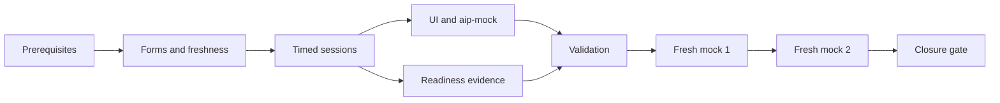

# Implementation Plan

## Overview

Implement the timed mock and exact readiness-closure contracts in dependency order while protecting fresh forms and delayed feedback. Leaf tasks name outcomes, requirements, and dependencies.

## Prerequisites

- [ ] 0. Confirm predecessor contracts and mock policies
  - [ ] 0.1 Verify Phase 0–7 handoffs and blockers
    - Outcome: A dependency matrix confirms current blueprint/source registry, all 20 task banks, durable study/UI contracts, Labs 1–12 proof/cleanup state, severity rules, and Phase 6–7 evidence; missing contracts block dependent work.
    - Requirements: P8-R1, P8-R6, P8-R8, P8-R11
    - Depends on: None
  - [ ] 0.2 Freeze mock policies
    - Outcome: Versioned policies define 23/20/15/9/8 allocation, task/difficulty distribution, MCQ/MR scoring, equivalence-family freshness, high-priority misconception severity, configured duration, invalid-item handling, and closure rules.
    - Requirements: P8-R2, P8-R3, P8-R4, P8-R6, P8-R7
    - Depends on: 0.1

## Task Dependency Graph



```json
{
  "waves": [
    {"wave": 1, "tasks": ["1"]},
    {"wave": 2, "tasks": ["2"]},
    {"wave": 3, "tasks": ["3"]},
    {"wave": 4, "tasks": ["4"]},
    {"wave": 5, "tasks": ["5"]}
  ]
}
```

## Tasks

- [ ] 1. Blueprint, form, and persistence core
  - [ ] 1.1 Add forward-only mock and readiness migrations
    - Outcome: SQLite tables/constraints/indexes support blueprint versions, immutable forms/items, exposure/equivalence, sessions/answers/events/results, official results, readiness snapshots/closures, FKs, UTC timestamps, and idempotency.
    - Requirements: P8-R1, P8-R2, P8-R3, P8-R6, P8-R9, P8-R10
    - Depends on: 0.2
  - [ ] 1.2 Implement blueprint capacity and 75-seat allocator
    - Outcome: Pure core logic validates all 20 tasks and allocates exactly 23/20/15/9/8 domain seats with task/difficulty deficits reported.
    - Requirements: P8-R1, P8-R2
    - Depends on: 1.1
  - [ ] 1.3 Implement freshness registry and immutable form reservation
    - Outcome: Two answer-safe forms can be deterministically reserved with no item/equivalence-family exposure or overlap and with historical versions preserved.
    - Requirements: P8-R2, P8-R6
    - Depends on: 1.2
  - [ ] 1.4 Test allocation, eligibility, and form safety
    - Outcome: Tests prove exact totals/weights, all-task coverage, deterministic audit, deficit failure, duplicate prevention, equivalence freshness, review/source eligibility, and no key/objective leakage.
    - Requirements: P8-R1, P8-R2, P8-R6
    - Depends on: 1.3

- [ ] 2. Timed session and grading
  - [ ] 2.1 Implement durable mock session state machine
    - Outcome: Start, answer revision, resume, expiry, submit, and archive use injected UTC time, persisted deadlines, stable events, and restart-safe transitions.
    - Requirements: P8-R3
    - Depends on: 1.3
  - [ ] 2.2 Implement answer-safe active-session DTOs
    - Outcome: Active views show only the current question, MCQ/MR selection requirement, navigation/timer/progress, and learner responses; keys, objectives, sources, hints, correctness, and feedback are structurally absent.
    - Requirements: P8-R3, P8-R5, P8-R9
    - Depends on: 2.1
  - [ ] 2.3 Implement versioned MCQ/MR grading transaction
    - Outcome: Submitted forms produce overall/domain/task/confidence/timing/unanswered metrics while each attempt atomically updates misconceptions and reviews and invalid items become unscorable.
    - Requirements: P8-R4, P8-R7
    - Depends on: 2.1
  - [ ] 2.4 Implement post-submission feedback and weakness planning
    - Outcome: Only committed graded sessions reveal reasoning, option analysis, sources, and prioritized remediation from errors, confidence, speed, misconceptions, recall, lab evidence, and freshness.
    - Requirements: P8-R4, P8-R7
    - Depends on: 2.3
  - [ ] 2.5 Test timing, grading, delayed feedback, and atomicity
    - Outcome: Clock/restart/expiry/idempotency tests and MCQ/MR/invalid-key/rollback tests pass with no pre-submit feedback leakage.
    - Requirements: P8-R3, P8-R4, P8-R5
    - Depends on: 2.2, 2.4

- [ ] 3. Interfaces and readiness evidence (parallel after core contracts)
  - [ ] 3.1 Implement the Streamlit Mock workflow
    - Outcome: Accessible start/resume/navigation/answer/confidence/timer/submit/review states persist durably and show deliberate loading, error, expired, offline, and evidence-incomplete states.
    - Requirements: P8-R3, P8-R4, P8-R9
    - Depends on: 2.5
  - [ ] 3.2 Implement `/aip-mock` and typed MCP adapters
    - Outcome: The thin skill exposes eligibility, start/resume, current question, answer, submit, and post-submit results with typed failures and no raw access or business rules.
    - Requirements: P8-R5
    - Depends on: 2.5
  - [ ] 3.3 Implement misconception severity and delayed closure
    - Outcome: Versioned rules prioritize misconceptions and require fresh/delayed evidence rather than explanation views or self-report for closure.
    - Requirements: P8-R7
    - Depends on: 2.3
  - [ ] 3.4 Implement all-lab and cleanup matrix evaluation
    - Outcome: Core queries validate accepted proof for Labs 1–12 and require validator evidence for `Verified` and absence/terminal state for `Cleaned up`, retaining blocked AWS states honestly.
    - Requirements: P8-R8
    - Depends on: 0.1, 1.1
  - [ ] 3.5 Implement official-result intake and residual-risk review
    - Outcome: Minimal self-reported official practice metadata and a source/risk/limitation review persist without scraped questions, credentials, or proprietary report content.
    - Requirements: P8-R10
    - Depends on: 1.1

- [ ] 4. Readiness gate and reporting
  - [ ] 4.1 Implement transparent readiness snapshot
    - Outcome: A non-opaque view exposes both mock results, per-domain/task metrics, confidence, speed/unanswered, recall, misconceptions, lab independence/proof/cleanup, and source/blueprint freshness as an internal estimate.
    - Requirements: P8-R9, P8-R11
    - Depends on: 3.1, 3.3, 3.4, 3.5
  - [ ] 4.2 Implement exact closure truth table
    - Outcome: Closure requires both fresh mocks at ≥85% overall and ≥80% each domain, zero high-priority misconceptions, all lab/cleanup proof, all-task/current-blueprint coverage, official result, and acknowledged residual-risk review.
    - Requirements: P8-R6, P8-R7, P8-R8, P8-R10, P8-R11
    - Depends on: 4.1
  - [ ] 4.3 Test closure failures and immutability
    - Outcome: Every individual gate failure, contradictory/missing evidence, blueprint drift, duplicate freshness, and persistence failure yields not-ready/evidence-incomplete; successful closure is immutable and versioned.
    - Requirements: P8-R9, P8-R11
    - Depends on: 4.2

- [ ] 5. Content audit, validation, and exit
  - [ ] 5.1 Audit all 20 task pools and reserve two fresh forms
    - Outcome: Current source/review/provenance and licensing checks pass; no dump, stale unsupported item, answer leakage, prior exposure, or equivalent overlap exists; both 75-item forms meet 23/20/15/9/8 and all-task coverage.
    - Requirements: P8-R1, P8-R2, P8-R6
    - Depends on: 1.4
  - [ ] 5.2 Run privacy, safety, accessibility, and recovery acceptance
    - Outcome: Tests/walkthroughs prove answer isolation, redaction, restart/expiry recovery, non-color status, keyboard-visible controls, no false lab/cleanup verification, and no external private-data transmission.
    - Requirements: P8-R3, P8-R5, P8-R8, P8-R9, P8-R10
    - Depends on: 3.1, 3.2, 4.3
  - [ ] 5.3 Run implementation validation
    - Outcome: Targeted behavioral tests pass followed by `uv run ruff check .`, `uv run ruff format --check .`, and `uv run mypy study_core study_mcp study_aws app`; failures are resolved.
    - Requirements: P8-R1, P8-R2, P8-R3, P8-R4, P8-R5, P8-R6, P8-R7, P8-R8, P8-R9, P8-R10
    - Depends on: 5.1, 5.2
  - [ ] 5.4 Execute readiness mock 1 and remediation
    - Outcome: A fresh 75-item form is completed with delayed feedback; ≥85% overall and ≥80% every domain is recorded or readiness remains open with weakness-directed review.
    - Requirements: P8-R3, P8-R4, P8-R6, P8-R7
    - Depends on: 5.3
  - [ ] 5.5 Execute readiness mock 2 and remediation
    - Outcome: A materially disjoint fresh 75-item form independently meets ≥85% overall and ≥80% every domain or readiness remains open.
    - Requirements: P8-R6, P8-R7
    - Depends on: 5.4
  - [ ] 5.6 Verify final evidence and official residual-risk review
    - Outcome: No high-priority misconception remains, all Labs 1–12 and cleanup are verified, blueprint/sources are current, and the official practice result/residual-risk review is recorded.
    - Requirements: P8-R1, P8-R7, P8-R8, P8-R10
    - Depends on: 5.5
  - [ ] 5.7 Execute the exact Phase 8 exit gate and closure handoff
    - Outcome: A versioned closure with evidence references, limitations, and learner acknowledgment is committed only if every P8-R11 criterion passes; Phase 9 remains optional and non-blocking.
    - Requirements: P8-R11
    - Depends on: 5.6

## Notes

- Tasks 3.2, 3.3, 3.4, and 3.5 may proceed in parallel after their stated core dependencies.
- The all-task audit in 5.1 may run in parallel with UI/interface acceptance work.
- Readiness mocks 5.4 and 5.5 must remain sequential to preserve freshness and remediation semantics.
- No concurrent task may edit the same form reservation, session state machine, grading transaction, or closure evaluator.
