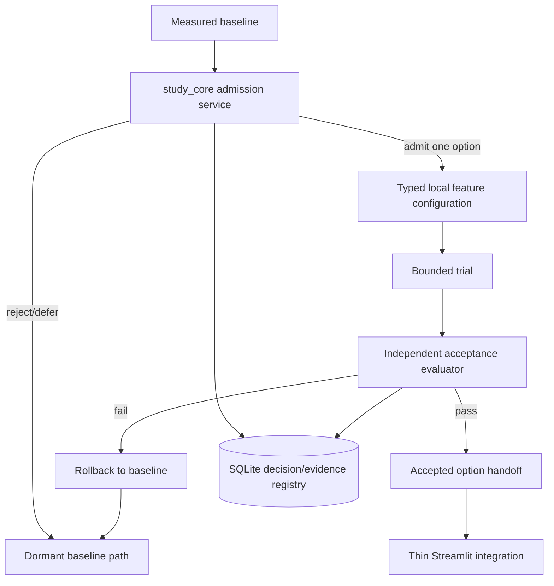
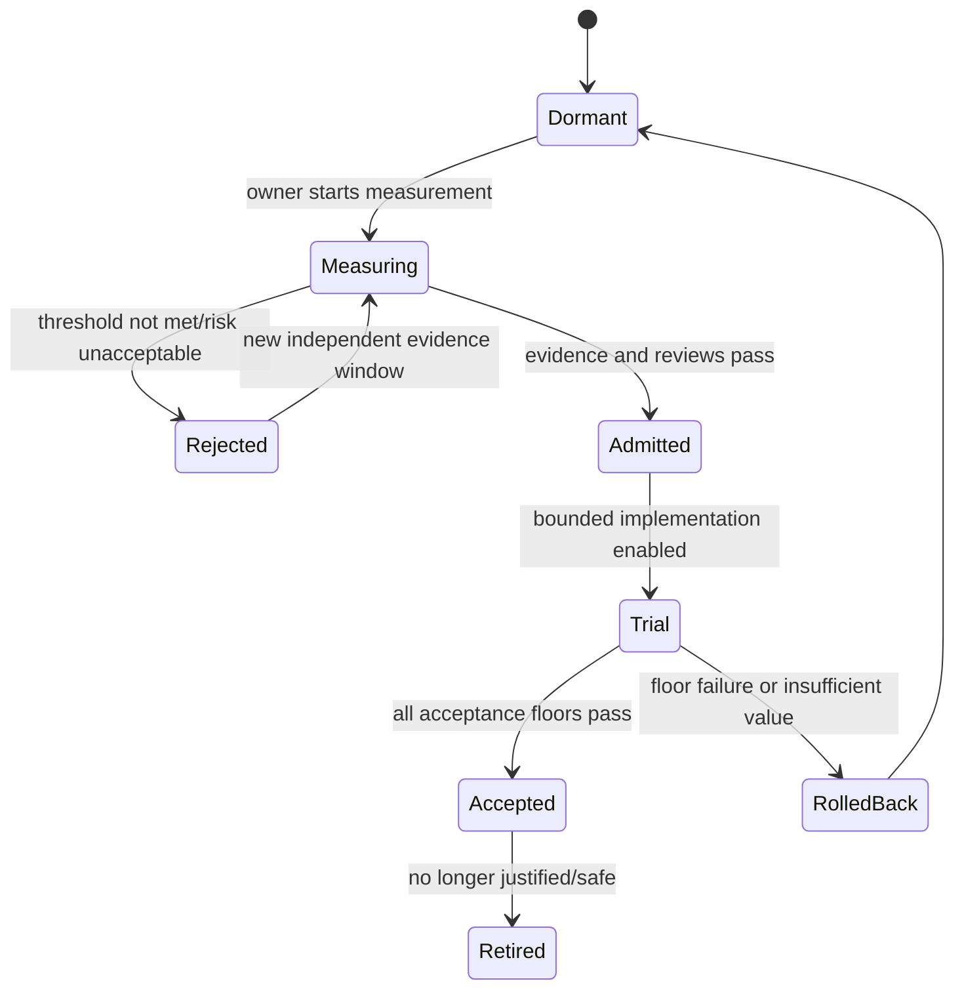

# Phase 9 — Evidence-Driven Optional Enhancements Design

## Overview

Phase 9 is a dormant-by-default portfolio of six independent experiments. A small admission registry records measured need and governance evidence; feature-specific adapters are activated only after admission. Every feature retains a baseline/fallback, is reversible, and cannot gate Phase 8. Optional dependencies are absent until selected, exact-pinned when admitted, and locked with `uv`.

## Goals

- Admit optional work only after predeclared measured need.
- Evaluate each enhancement independently against benefit, privacy, cost, dependency, and reliability thresholds.
- Preserve offline/local-first behavior and existing source/question/lab evidence contracts.
- Make rollback and baseline fallback explicit.

## Non-goals

- Implementing all six enhancements.
- Replacing SQLite/FTS5, validator evidence, independent review, or Phase 8 readiness rules.
- Adding optional MVP dependencies or external data-sharing by default.

## Upstream and downstream contracts

| Direction | Contract |
|---|---|
| Upstream | Phase 1–2 core/UI; enhancement-specific baseline from Phases 3–8; current safety/source/data rules |
| Admission output | Decision record with baseline, threshold, privacy/cost/dependency review, scope, rollback |
| Accepted output | Isolated feature contract, evidence, operating bounds, exact dependency pins, retention policy |
| Rejected/rollback output | Restored baseline, retained non-sensitive measurements, no effect on other options |
| Phase 8 relationship | Readiness closure is neither prerequisite-modified nor retroactively redefined |

## Architecture





Each enhancement has a separate state row and cannot transition another enhancement.

## Components and Interfaces

The admission service coordinates independent decisions and bounded trials; feature adapters remain isolated behind core protocols.

## Data Models

- `EnhancementKind`: speech, hybrid retrieval, source freshness, screenshot assistance, question drafting, calendar forecast.
- `AdmissionDecision`: state, baseline version/metrics, predeclared threshold, sample/window, user impact, privacy/security/cost/dependency/license/maintenance/offline reviews, owner, decision, rationale, rollback.
- `TrialDefinition`: candidate version, affected data/users, time/sample/spend bounds, quality/safety/privacy/reliability floors, retention and deletion policy.
- `TrialResult`: baseline/candidate metrics, floor results, incidents, costs, dependency pins, status, limitations.
- `FeatureConfiguration`: typed, checked-in non-secret defaults; all optional features `enabled = false`.

Forward migrations add generic admission/trial/result/dependency-review records only when the admission framework is implemented. Feature-specific migrations are added only for selected features and never mutate prior migrations. SQLite uses FKs/WAL/UTC/event IDs. Runtime media/indexes stay under gitignored `data/`.

```python
class EnhancementAdmissionService(Protocol):
    def record_baseline(self, event_id: str, baseline: BaselineEvidence) -> AdmissionDecision: ...
    def decide(self, event_id: str, request: AdmissionRequest) -> AdmissionDecision: ...
    def evaluate_trial(self, event_id: str, trial_id: str) -> TrialResult: ...
    def rollback(self, event_id: str, enhancement: EnhancementKind) -> RollbackResult: ...
```

## Enhancement boundaries

### Local speech/oral mode

`app` captures only after opt-in; a boundary Pydantic model passes an audio path under `data/` to a local adapter. The adapter returns transcript/confidence; core stores only confirmed answer text by default. Audio retention defaults to zero. Typed fallback preserves the same question/session use case. Admission/acceptance uses correction rate, completion, answer time, rubric quality, and accessibility outcome.

### Hybrid retrieval

A `RetrievalBackend` protocol preserves FTS5 as baseline. An admitted local vector adapter creates rebuildable derived indexes; source records and metadata remain in SQLite. A hybrid ranker combines normalized lexical/vector scores under versioned settings. Deletion/freshness tests must prove removed content is absent. Failure falls back visibly to FTS5.

### Source freshness

A deterministic script checks only registered URLs with bounds and records metadata/change signals. It never rewrites authored Markdown or auto-approves freshness. Redirects across origins require policy review. It is manual/scheduled deliberately, never a save hook; offline use remains available.

### Screenshot assistance

The UI accepts explicit local file selection, retention consent, and redaction confirmation. A local adapter may extract orientation hints. Its output state is `Assistive` and cannot call the lab verification transition. `record_lab_checkpoint` continues to require validator evidence for `Verified`; cleanup continues to require absence/terminal state. Images and derivatives live under `data/` and are deletable.

### Local question drafting

A local `DraftingAdapter` consumes approved source IDs and emits `DraftQuestion` records. Drafts are stored separately from scored eligibility and cannot transition to reviewed without independent source, duplication/equivalence, safety/licensing, and human-review records. No generated item is automatically scored.

### Calendar forecast

A pure forecast service consumes minimized availability blocks and existing effort/progress evidence. Local manual availability is baseline. Any external calendar adapter requires a separate opt-in review and returns free/busy only, not unrelated event content. Forecasts show assumptions, range, and as-of time; they are planning estimates only.

## Error Handling

| Failure | Behavior |
|---|---|
| Admission evidence/threshold missing | Keep `Measuring`/`Dormant`; do not install/enable |
| Dependency review or lock failure | Block trial; restore prior lock/config |
| Privacy/safety/cost floor breach | Stop trial, quarantine/delete sensitive runtime data, rollback |
| Optional adapter unavailable | Use explicit baseline fallback; preserve study state |
| Persistence conflict | Idempotent identical replay or conflict; no false state |
| Insufficient trial evidence | Keep `Trial` or roll back; never claim acceptance |
| Feature retirement | Disable adapter, migrate/export needed state, delete derived data per policy |

## Security, privacy, cost, and dependencies

- Default flags off; no dormant dependency installation.
- Package admission records exact name/version, source, license, security/maintenance review, size, platform support, and rationale; `uv.lock` changes only for admitted work.
- No external transfer by default. Recordings, screenshots, transcripts, vector indexes, and models are local and gitignored.
- Cost includes disk/model download, compute/time, maintenance, reviewer load, and any separately approved service spend.
- Data minimization, retention/deletion, redaction, standard credentials, and existing AWS read-only rules remain mandatory.

## Correctness Properties

### Property 1: Admission completeness

**Validates: Requirements 1.1, 2.1**

No optional feature can enter `Admitted` without its own measured baseline, predeclared threshold, and privacy, cost, dependency, and rollback reviews.

### Property 2: Enhancement independence

**Validates: Requirements 1.1, 9.1**

A transition or acceptance for one enhancement never changes another enhancement’s state.

### Property 3: Reversible baseline

**Validates: Requirements 2.1, 9.1**

Disabling or rolling back an enhancement restores its baseline path without changing historical Phase 8 closure evidence.

### Property 4: Screenshot non-authority

**Validates: Requirements 6.1**

Screenshot-derived evidence has no transition path to `Verified` or `Cleaned up`.

### Property 5: Dormant dependency isolation

**Validates: Requirements 1.1, 2.1**

Dormant and rejected enhancements add no runtime dependency.

## Testing Strategy

### Shared admission validation

Truth-table tests cover every state transition, independent feature rows, predeclared thresholds, missing reviews, budget/privacy rejection, idempotency, rollback, and no Phase 8 coupling. Dependency checks verify exact pins and lock consistency only for admitted features.

### Per-enhancement acceptance

| Option | Baseline and acceptance evidence |
|---|---|
| Speech | typed friction baseline; ≥20% friction improvement or accessibility need satisfied; quality loss ≤5 points; local/privacy/fallback tests |
| Hybrid retrieval | ≥50-query FTS5 set; ≥10% relative recall@5 gain or ≥0.90; no filter regression; latency/privacy/deletion/fallback tests |
| Freshness | two baseline audits/months; ≥50% SLA/effort improvement; false positives ≤10%; offline/manual-review tests |
| Screenshot | ≥20 eligible attempts; ambiguity reduction ≥30%; false guidance ≤5%; zero verification/cleanup authority; secret/retention tests |
| Drafting | two review cycles; accepted throughput +25%; no reviewer-time increase; zero unreviewed scored items; duplication/source tests |
| Calendar | rolling four-week trial; plan error ≤20% or missed targets improve ≥25%; minimization/revocation/fallback tests |

Every implemented option runs targeted pytest plus Ruff check, Ruff format check, and mypy for approved packages.

## Requirement traceability

| Requirement | Design elements | Validation |
|---|---|---|
| P9-R1 | admission registry/state machine | transition/independence/gating tests |
| P9-R2 | TrialDefinition, feature flags, dependency review | pin/lock/bounds/rollback tests |
| P9-R3 | local speech adapter and confirmed transcript | privacy/quality/friction/fallback trial |
| P9-R4 | RetrievalBackend and derived index | relevance/filter/deletion/latency/fallback trial |
| P9-R5 | bounded freshness script | SLA/effort/false-positive/offline trial |
| P9-R6 | assistive-only screenshot adapter | authority/privacy/ambiguity tests |
| P9-R7 | DraftQuestion quarantine/review workflow | throughput/review/leakage/duplication tests |
| P9-R8 | pure forecast and optional free/busy adapter | accuracy/minimization/revocation tests |
| P9-R9 | independent evaluator and handoff/rollback | acceptance truth table and Phase 8 invariance |

## Risks and decisions

- **Optional-scope creep:** default-off independent states and no global “implement Phase 9” gate.
- **Large/untrusted packages:** exact package review/pins and rollback before trial.
- **Biometric/media privacy:** local processing, explicit consent, zero-retention defaults, deletion controls.
- **Vector complexity:** FTS5 stays authoritative and available; vectors are derived and admitted only by benchmark.
- **Generated-content contamination:** draft quarantine and independent review are structural.
- **Forecast false confidence:** display assumptions/range; never predict AWS outcome.
- **Decision:** accepting one option completes only that option; the remaining five may remain dormant forever.
