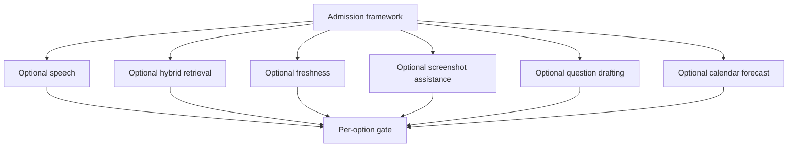

# Implementation Plan

## Overview

All enhancement implementation tasks are **Optional and unselected by default**. The admission framework permits any independently justified subset and leaves every other option dormant. Completing or skipping any option does not block Phase 8 readiness or another option.

## Prerequisites and admission framework

- [ ] 0. Establish optional admission governance
  - [ ] 0.1 Confirm Phase 9 does not delay or alter Phase 0–8 gates
    - Outcome: A decision record identifies upstream availability, confirms core study work priority, and establishes that dormant/unselected options are non-blocking.
    - Requirements: P9-R1, P9-R9
    - Depends on: None
  - [ ] 0.2 Implement independent admission/trial state and persistence
    - Outcome: Typed core models and a forward migration support separate state, baseline, predeclared threshold, reviews, trial bounds/results, rollback, event IDs, UTC timestamps, FKs, and feature flags defaulting off.
    - Requirements: P9-R1, P9-R2, P9-R9
    - Depends on: 0.1
  - [ ] 0.3 Implement admission and rollback validation
    - Outcome: Tests prove missing threshold/privacy/cost/dependency evidence blocks admission, one option cannot activate another, dormant options install nothing, rollback restores baseline, and Phase 8 evidence is invariant.
    - Requirements: P9-R1, P9-R2, P9-R9
    - Depends on: 0.2

## Task Dependency Graph



```json
{
  "waves": [
    {"wave": 1, "tasks": ["1", "2", "3", "4", "5", "6"]},
    {"wave": 2, "tasks": ["7"]}
  ]
}
```

## Tasks

- [ ] 1. Optional local speech/oral mode — unselected by default
  - [ ] 1.1 [Optional] Measure and decide speech/oral admission
    - Outcome: A 5-session typed-friction baseline or documented learner-selected accessibility need is compared to the predeclared threshold; privacy, local model, disk/compute, package/license, retention, and rollback reviews yield `Admitted` or `Rejected` only for speech.
    - Requirements: P9-R1, P9-R2, P9-R3
    - Depends on: 0.3
  - [ ] 1.2 [Optional; only if 1.1 Admitted] Add exact-pinned local speech dependencies and adapter
    - Outcome: Reviewed exact versions and `uv.lock` support opt-in local capture/transcription with no-retention default, deletion, low-confidence handling, and typed fallback.
    - Requirements: P9-R2, P9-R3
    - Depends on: 1.1
  - [ ] 1.3 [Optional; only if 1.1 Admitted] Integrate confirmed oral answers
    - Outcome: The learner edits/confirms transcripts before the existing answer use case records text; raw recognition never silently submits or bypasses grading.
    - Requirements: P9-R3
    - Depends on: 1.2
  - [ ] 1.4 [Optional; only if 1.1 Admitted] Evaluate, validate, and hand off or roll back speech
    - Outcome: The bounded trial measures correction, completion, time, rubric quality, privacy, retention/deletion, and fallback; acceptance requires P9-R3 thresholds, targeted tests, Ruff/format/mypy, exact-pin evidence, and an independent handoff, otherwise rollback.
    - Requirements: P9-R3, P9-R9
    - Depends on: 1.3

- [ ] 2. Optional hybrid lexical/vector retrieval — unselected by default
  - [ ] 2.1 [Optional] Measure and decide hybrid-retrieval admission
    - Outcome: At least 50 reviewed queries establish FTS5 recall@5/MRR and tuning attempts; privacy, local model, disk/compute, package/license, maintenance, and rollback reviews independently admit or reject hybrid retrieval.
    - Requirements: P9-R1, P9-R2, P9-R4
    - Depends on: 0.3
  - [ ] 2.2 [Optional; only if 2.1 Admitted] Add exact-pinned local embedding dependencies and derived index
    - Outcome: Reviewed exact versions and `uv.lock` create rebuildable gitignored vector data while SQLite/FTS5 and metadata remain authoritative.
    - Requirements: P9-R2, P9-R4
    - Depends on: 2.1
  - [ ] 2.3 [Optional; only if 2.1 Admitted] Implement hybrid ranking, freshness, deletion, and fallback
    - Outcome: Versioned score fusion preserves filters/tenant boundaries, updates on source change/deletion, reports mode/freshness, and visibly falls back to FTS5.
    - Requirements: P9-R4
    - Depends on: 2.2
  - [ ] 2.4 [Optional; only if 2.1 Admitted] Evaluate, validate, and hand off or roll back hybrid retrieval
    - Outcome: The same query set proves recall/MRR/nDCG, p95, filter correctness, size/build cost, deletion, privacy, and fallback; P9-R4 acceptance plus targeted/Ruff/format/mypy and lock evidence produces only this option’s handoff, otherwise rollback.
    - Requirements: P9-R4, P9-R9
    - Depends on: 2.3

- [ ] 3. Optional source-freshness automation — unselected by default
  - [ ] 3.1 [Optional] Measure and decide source-freshness admission
    - Outcome: Two audits/months quantify SLA breaches and manual hours; network policy, rates, privacy, maintenance/dependency cost, false-positive risk, and rollback are reviewed independently.
    - Requirements: P9-R1, P9-R2, P9-R5
    - Depends on: 0.3
  - [ ] 3.2 [Optional; only if 3.1 Admitted] Implement bounded registered-source checks
    - Outcome: A deterministic explicit maintenance command records status/change/redirect/error/review-needed metadata with timeouts/rates and never runs on save or rewrites authored claims.
    - Requirements: P9-R5
    - Depends on: 3.1
  - [ ] 3.3 [Optional; only if 3.1 Admitted] Integrate stale-source review and scoring exclusions
    - Outcome: UI/core preserve last-known metadata, require human freshness approval, show offline/unavailable states, and apply existing stale-source scoring rules.
    - Requirements: P9-R5
    - Depends on: 3.2
  - [ ] 3.4 [Optional; only if 3.1 Admitted] Evaluate, validate, and hand off or roll back freshness automation
    - Outcome: Trial proves ≥50% SLA/effort improvement, ≤10% false positives, offline usefulness, policy compliance, targeted/Ruff/format/mypy results, and any exact pin/lock evidence; otherwise baseline manual review is restored.
    - Requirements: P9-R5, P9-R9
    - Depends on: 3.3

- [ ] 4. Optional screenshot assistance — unselected by default
  - [ ] 4.1 [Optional] Measure and decide screenshot-assistance admission
    - Outcome: At least 20 eligible attempts quantify ≥20% evidence-orientation ambiguity and evaluate whether an annotation trial, not validator substitution, has measurable value; media/privacy/OCR/dependency/cost/rollback reviews complete.
    - Requirements: P9-R1, P9-R2, P9-R6
    - Depends on: 0.3
  - [ ] 4.2 [Optional; only if 4.1 Admitted] Add exact-pinned local media dependencies and consent flow
    - Outcome: Reviewed exact versions and `uv.lock` support explicit file selection, redaction guidance, gitignored retention/deletion, and safe local derivatives.
    - Requirements: P9-R2, P9-R6
    - Depends on: 4.1
  - [ ] 4.3 [Optional; only if 4.1 Admitted] Implement assistive-only checkpoint guidance
    - Outcome: Screenshot/OCR output can only be `Assistive`/`Self-reported`; type/state boundaries prevent it from invoking `Verified` or `Cleaned up`, and manual fallback preserves state.
    - Requirements: P9-R6
    - Depends on: 4.2
  - [ ] 4.4 [Optional; only if 4.1 Admitted] Evaluate, validate, and hand off or roll back screenshot assistance
    - Outcome: Trial proves ≥30% ambiguity reduction, ≤5% false guidance, no completion regression, secret/privacy/deletion controls, zero screenshot authority, targeted/Ruff/format/mypy, and exact-pin evidence; otherwise rollback/delete derived data.
    - Requirements: P9-R6, P9-R9
    - Depends on: 4.3

- [ ] 5. Optional local question drafting — unselected by default
  - [ ] 5.1 [Optional] Measure and decide drafting admission
    - Outcome: Two review cycles show a ≥20% fresh-pool supply deficit after process improvements; source/license/privacy, local model, compute/disk, reviewer capacity, dependency, duplication, and rollback reviews independently admit or reject drafting.
    - Requirements: P9-R1, P9-R2, P9-R7
    - Depends on: 0.3
  - [ ] 5.2 [Optional; only if 5.1 Admitted] Add exact-pinned local drafting dependencies and quarantine
    - Outcome: Reviewed exact versions and `uv.lock` support local draft generation into a structurally non-scorable `Draft` repository separated from eligible banks.
    - Requirements: P9-R2, P9-R7
    - Depends on: 5.1
  - [ ] 5.3 [Optional; only if 5.1 Admitted] Implement source, duplication, safety, and independent-review workflow
    - Outcome: Drafts include required metadata/provenance and cannot become eligible without all checks and a human reviewer distinct from generation.
    - Requirements: P9-R7
    - Depends on: 5.2
  - [ ] 5.4 [Optional; only if 5.1 Admitted] Evaluate, validate, and hand off or roll back drafting
    - Outcome: Trial proves accepted throughput +25%, no reviewer-time increase, tracked rejection reasons, zero unreviewed scored items, privacy/source integrity, targeted/Ruff/format/mypy, and exact-pin evidence; otherwise generation stops and drafts are removable.
    - Requirements: P9-R7, P9-R9
    - Depends on: 5.3

- [ ] 6. Optional calendar and readiness forecast — unselected by default
  - [ ] 6.1 [Optional] Measure and decide forecast admission
    - Outcome: A four-week baseline shows missed targets/capacity risk; privacy/minimization, local-first design, optional calendar boundary/dependency, maintenance, cost, uncertainty, and rollback reviews independently admit or reject forecast work.
    - Requirements: P9-R1, P9-R2, P9-R8
    - Depends on: 0.3
  - [ ] 6.2 [Optional; only if 6.1 Admitted] Implement local capacity forecast
    - Outcome: A pure service uses minimized learner-entered availability, remaining work, pace, blockers, and exam date to show as-of assumptions and uncertainty without predicting AWS scores.
    - Requirements: P9-R8
    - Depends on: 6.1
  - [ ] 6.3 [Optional; separately admitted within 6.1] Implement minimal external free/busy adapter
    - Outcome: Only if explicitly opted in and reviewed, an exact-pinned adapter/`uv.lock` imports free/busy blocks without storing unrelated titles, attendees, locations, or descriptions and supports revocation/fallback.
    - Requirements: P9-R2, P9-R8
    - Depends on: 6.2
  - [ ] 6.4 [Optional; only if 6.1 Admitted] Evaluate, validate, and hand off or roll back forecast
    - Outcome: Four-week trial demonstrates ≤20% plan error or ≥25% missed-target improvement, privacy/usability/revocation/fallback, targeted/Ruff/format/mypy, and any exact-pin evidence; otherwise local baseline planning is restored.
    - Requirements: P9-R8, P9-R9
    - Depends on: 6.2; 6.3 only if external integration was separately selected

- [ ] 7. Optional portfolio validation and handoff
  - [ ] 7.1 [Optional; run for each selected option only] Audit admission and dependency evidence
    - Outcome: Every selected option has measured need, predeclared thresholds, privacy/security/cost/dependency/license/maintenance review, bounded trial, exact pins/lock if needed, and rollback; unselected options remain off and dependency-free.
    - Requirements: P9-R1, P9-R2
    - Depends on: The selected option’s admission task
  - [ ] 7.2 [Optional; run for each implemented option only] Run implementation validation
    - Outcome: Relevant targeted tests pass plus `uv run ruff check .`, `uv run ruff format --check .`, and `uv run mypy study_core study_mcp study_aws app`; selected optional packages match exact pins and committed lock.
    - Requirements: P9-R2, P9-R9
    - Depends on: The selected option’s implementation/evaluation task
  - [ ] 7.3 [Optional; run for each trial only] Execute independent acceptance or rollback gate
    - Outcome: Only the trialed enhancement is accepted when all benefit and floor criteria pass; otherwise it is rejected/rolled back with baseline restored and no impact on Phase 8 or other options.
    - Requirements: P9-R9
    - Depends on: 7.1, 7.2
  - [ ] 7.4 [Optional; run after any accepted option] Publish per-enhancement handoff
    - Outcome: The handoff records evidence, operating limits, retention, known risks, dependencies/pins/lock, support/fallback, and confirms all remaining options are still unselected unless separately admitted.
    - Requirements: P9-R9
    - Depends on: 7.3

## Notes

- After 0.3, admission measurements 1.1–6.1 may run independently and in parallel because each owns a separate decision record.
- Implement only admitted options; separate option tracks may proceed in parallel if they do not edit the same migration, lockfile, shared configuration, or UI component.
- Dependency/`uv.lock` changes must be serialized and independently attributable to an admitted option.
- Screenshot assistance can never run concurrently with or bypass validator state transitions; it has no verification authority.
- Phase 9 may remain dormant indefinitely; no unchecked Optional task is a release blocker.
