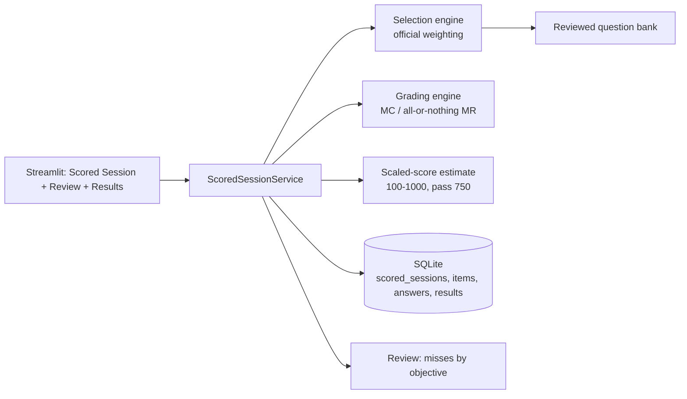
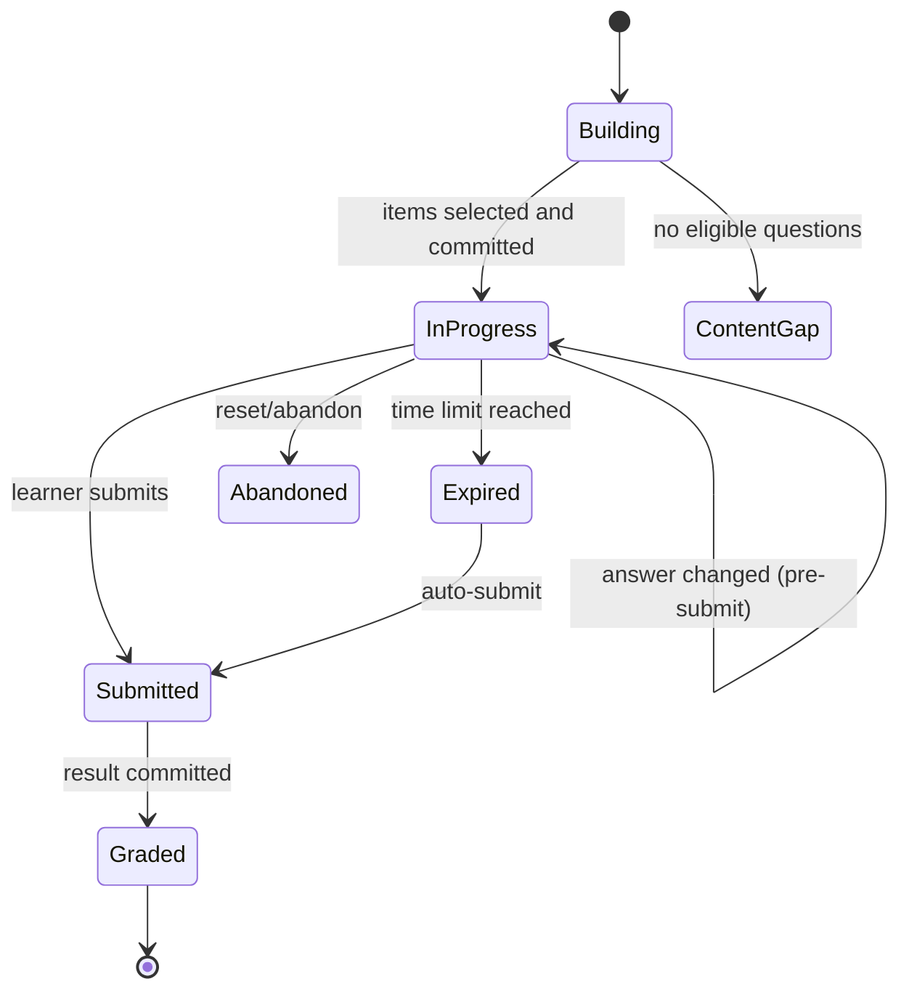

# Phase 2.5 Design — Scored Sessions, Scoring, and Session Management

**Status:** Proposed

## Overview

Phase 2.5 adds a scored-session capability over the existing Phase 1 study core and Phase 2
Streamlit app. A pure selection-and-scoring engine in `study_core` targets the official
AIP-C01 weighting and grading mechanics; a `ScoredSessionService` persists sessions, items,
answers, results, and history in SQLite; and new Streamlit views present a delayed-feedback
exam flow with an original terminal/ASCII score readout. Phase 8 later reuses this engine.

## Goals

- Officially weighted, scaled-to-available-content question selection.
- Exam-accurate grading (MC, all-or-nothing MR, unanswered-as-incorrect, no guess penalty).
- Transparent 100-1000 scaled-score estimate with compensatory pass/fail at 750.
- Delayed feedback, session reset, durable history, and review of missed items.
- Original, accessible terminal aesthetic.

## Non-goals

- The Phase 8 readiness gate and fresh-form reservation.
- Reproducing AWS's proprietary scaling or official exam items.
- Per-domain pass gates (the exam is compensatory).

## Upstream and downstream contracts

| Direction | Contract |
|---|---|
| Upstream Phase 1 | `DbConnection`, migrations, questions/options/answer_material/option_rationales, attempts, reviews, idempotency, `StudyService.explain_answer` |
| Upstream Phase 2 | Streamlit runtime (thread-safe, cross-thread connection), theme/components, status badges |
| Downstream Phase 8 | The selection + grading + scaled-score engine and session history, extended with fresh-form reservation and the readiness gate |

## Architecture





## Selection engine

A pure function allocates scored-item counts per domain using largest-remainder rounding of
the official weights, scaled to a target scored total:

- Full length: target 65 scored -> 20/17/13/8/7 across D1-D5.
- Reduced: when only a subset of domains has reviewed questions (or the learner scopes to a
  subset), compute each selected domain's share of the summed selected weights, apply
  largest-remainder rounding to the achievable scored total (bounded by available
  questions), and preserve relative weighting.
- Unscored count = 10 when the pool can supply 65 scored + 10 unscored; otherwise 0 until
  the pool is large enough. A documented pool threshold governs activation.

Selection draws randomly within each domain bucket via the injected `RandomSource` (so tests
are deterministic), with no repeats. The result is an ordered item list with scored/unscored
flags; unscored positions are shuffled among scored positions and never surfaced to the UI.

## Grading engine

A pure function grades each answered item:

- MC: correct iff selected == the single correct option.
- MR: correct iff `set(selected) == set(correct)` (all-or-nothing).
- Unanswered: incorrect.

Only scored items contribute to totals. The scaled-score estimate is a documented linear map
from scored percentage `p` in [0,1]:

```text
scaled = round(100 + 900 * p)      # 0% -> 100, 100% -> 1000
pass   = scaled >= 750             # equivalently p >= ~0.7222
```

This is labeled an internal estimate. Per-domain correct/total is reported as informational
only.

## Components and interfaces

```python
class ScoredSessionService(Protocol):
    def start(self, request: StartScoredSessionRequest) -> ScoredSessionView: ...
    def current_item(self, session_id: str, index: int) -> ScoredItemView: ...
    def answer(self, request: AnswerItemRequest) -> None: ...
    def submit(self, session_id: str, event_id: str) -> ScoredResult: ...
    def reset(self, session_id: str) -> None: ...
    def history(self, learner_id: str) -> tuple[ScoredSessionSummary, ...]: ...
    def misses(self, session_id: str) -> tuple[MissedItem, ...]: ...
```

- `ScoredItemView` carries prompt, options, index, total, and scored-session flags, but
  never correct answers, rationales, or the scored/unscored flag.
- `ScoredResult` carries raw correct, scored total, percentage, scaled estimate, pass/fail,
  per-domain breakdown, and the not-full-length label.
- `MissedItem` reuses the Phase 3 `AnswerExplanation` shape for post-submission review.

## Data model

Forward migration `0004_scored_sessions.sql` adds:

- `scored_sessions` (session_id, learner_id, scope JSON, state, scored_total, unscored_total,
  time_limit_seconds, started_at, deadline, submitted_at).
- `scored_session_items` (session_id, position, question_id, is_scored, domain_id).
- `scored_answers` (session_id, question_id, selected_option_ids JSON, answered, updated_at).
- `scored_results` (session_id, raw_correct, scored_total, percent, scaled_estimate, passed,
  per_domain JSON, committed_at).

Foreign keys and WAL remain enabled; timestamps are UTC ISO 8601; submission and grading are
one transaction; answer changes are idempotent per (session, question).

## Error handling

| Case | Behavior |
|---|---|
| No eligible questions | Typed content-gap result; no empty session |
| Answer after submit | Rejected; answers are frozen |
| Expiry | Auto-submit; unanswered -> incorrect |
| Persistence failure | Recoverable error; no success or fabricated score |
| Reset of a submitted session | Rejected; history is immutable |

## Security and honesty

- Answer keys, rationales, correct options, and the scored/unscored flag stay server-side
  during a session and never enter browser-visible state.
- The scaled score is always labeled an internal estimate, never an AWS scaled score.
- Not-full-length sessions are labeled and their estimates carry a caution.

## UI

- **Scored Session view:** scope picker (default all available domains), length indicator,
  one item at a time with navigation and answer change, a visible timer, and a submit action
  with confirmation. No feedback until submission.
- **Results view:** original terminal/ASCII banner (PASS/FAIL), monospace readout of raw,
  percentage, scaled estimate, and per-domain breakdown, with text+icon status and an
  accessible text equivalent for the banner.
- **Review view (extended):** missed items from the latest scored session with explanations,
  grouped by objective, alongside existing spaced-repetition items.
- Reset and history controls are available from the Scored Session view.

## Testing strategy

1. Selection: exact 20/17/13/8/7 at full length; reduced scaling preserves relative weights;
   no repeats; unscored activation threshold; content-gap path.
2. Grading: MC correct/incorrect, MR all-or-nothing (partial = incorrect), unanswered =
   incorrect, unscored excluded from totals.
3. Scoring: linear map endpoints and the 750 boundary; compensatory (a failed domain with a
   passing overall still passes).
4. Delayed feedback: item view DTOs carry no answer material or scored flag; running score
   not exposed pre-submit.
5. Session management: reset discards state; submit persists immutable history; restart
   durability; idempotent submit.
6. Review: misses recorded and listed with explanations and objective grouping.
7. UI: AppTest flow start -> answer -> submit -> result -> review; accessibility of the
   banner (text equivalent, non-color status).
8. Quality gates: Ruff, Ruff format check, mypy, targeted pytest.

## Requirement traceability

| Requirement | Design elements | Validation |
|---|---|---|
| P2.5-R1 | selection engine, migration | weighting/scale/no-repeat/gap tests |
| P2.5-R2 | scope picker, selection scoping | subset-weighting tests |
| P2.5-R3 | grading engine | MC/MR/unanswered/unscored tests |
| P2.5-R4 | scoring map, result model | linear-map and compensatory tests |
| P2.5-R5 | item-view DTO, submit flow | delayed-feedback leakage tests |
| P2.5-R6 | service, scored_sessions tables | reset/history/restart tests |
| P2.5-R7 | misses, Review view | miss-recording and listing tests |
| P2.5-R8 | terminal theme, results view | accessibility and originality review |
| P2.5-R9 | full flow | end-to-end acceptance |

## Risks and decisions

- **Small pool:** reduced sessions are honest and labeled; the same engine scales to full
  length with more content.
- **Scaling fidelity:** the linear estimate is transparent and labeled, never presented as
  AWS's actual scaling.
- **Decision:** per-domain results are informational only, matching the exam's compensatory
  model, so a strong overall performance is not blocked by one weak domain.
- **Decision:** the scored/unscored flag is server-side only, so unscored items are
  genuinely indistinguishable to the learner, like the real exam.
